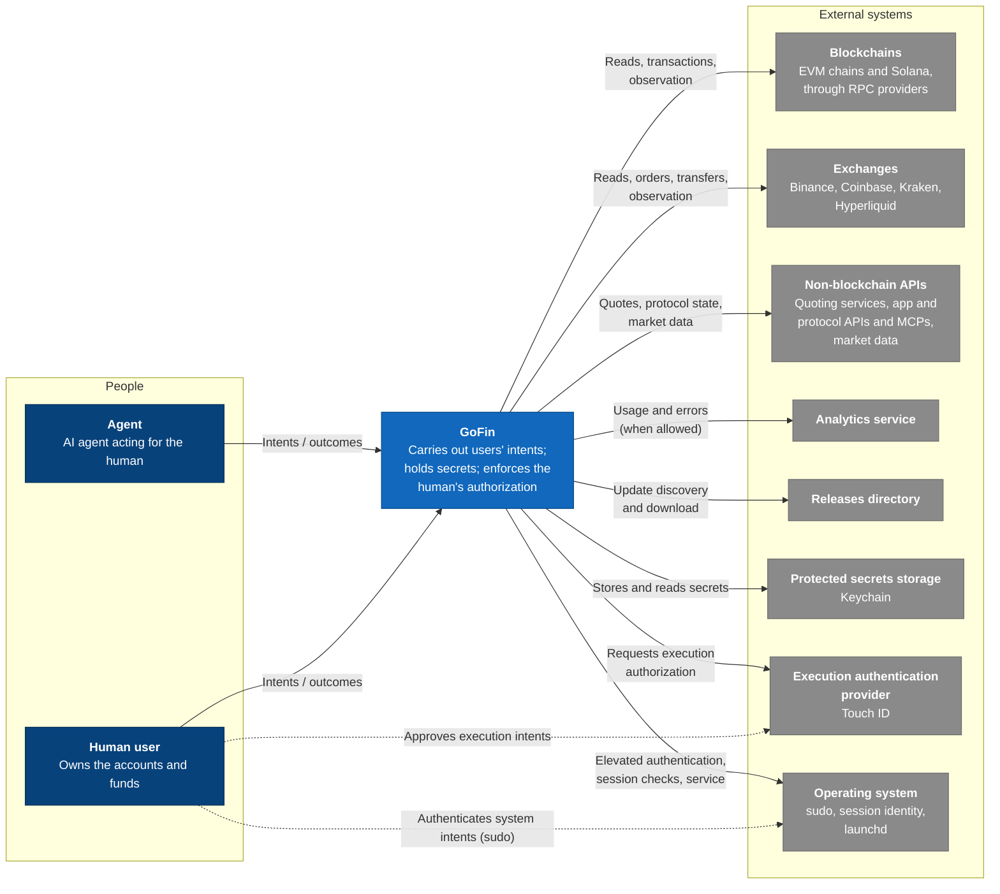
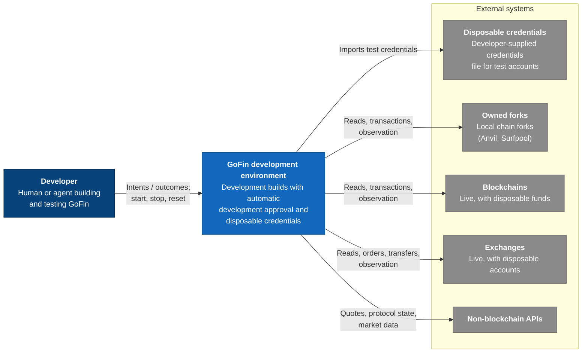

# C4 level 1: system context

- Status: agreed
- Date: 2026-11-06

GoFin as one system, the people who use it and the external systems it depends on. Inputs: [actors, external systems and capabilities](00-inputs.md).

## Main context

Dashed lines are interactions the human performs directly with an external system, outside GoFin. They are what the agent cannot fake.

## Elements

| ID | Type | Name | Description | Inputs reference |
| --- | --- | --- | --- | --- |
| `agent` | Person | Agent | AI agent acting for the human; primary user of information and execution intents. | Actors |
| `human` | Person | Human user | Owns the accounts and funds; primary user of system intents and authorization. | Actors |
| `gofin` | System | GoFin | Carries out users' intents, holds secrets, enforces the human's authorization. | Purpose |
| `chains` | External system | Blockchains | EVM chains and Solana, reached through RPC providers. | E1 |
| `exchanges` | External system | Exchanges | Binance, Coinbase, Kraken, Hyperliquid. | E2 |
| `apis` | External system | Non-blockchain APIs | Quoting services, app and protocol APIs and MCPs, market data. | E3 |
| `analytics` | External system | Analytics service | Receives optional anonymous usage and error reports. | E4 |
| `releases` | External system | Releases directory | Publishes GoFin releases for update. | E5 |
| `auth` | External system | Execution authentication provider | Touch ID. | E6 |
| `secrets` | External system | Protected secrets storage | Keychain. | E7 |
| `os` | External system | Operating system | sudo, terminal and SSH session identity, launchd. | E8 |

## Relationships

**Path** says whether the interaction goes through GoFin or happens directly between the human and an external system. Direct interactions are drawn dashed; they are what the agent cannot fake.

| ID | From | To | Path | Sends | Returns | Trust |
| --- | --- | --- | --- | --- | --- | --- |
| R1 | `agent` | `gofin` | Through GoFin | Intents the agent may submit | Outcomes, reads, discovery; never secrets | GoFin trusts the agent for nothing it enforces: every intent is validated, and the agent cannot authorize. |
| R2 | `human` | `gofin` | Through GoFin | Intents of every kind | Outcomes, reads, discovery; never secrets | Same as R1 for the intent itself. The human's identity is never established through this channel, only through R11 and R12. |
| R3 | `gofin` | `chains` | Through GoFin | Read requests, signed transactions | State, receipts, inclusion | The chain is the source of truth; an RPC provider is not trusted for correctness. GoFin checks chain identity and verifies evidence. |
| R4 | `gofin` | `exchanges` | Through GoFin | Authenticated reads and requests (orders, transfers, configuration) | Account state, order and transfer status | The exchange is authoritative for its own ledger. Results are correlated to the request's identity. |
| R5 | `gofin` | `apis` | Through GoFin | Quote, state and data requests | Quotes, provider-built transactions or orders, protocol state, prices, token metadata | Not trusted. Quotes and provider-built transactions are checked against the intent's bounds before authorization; market data is best-effort. |
| R6 | `gofin` | `analytics` | Through GoFin | Anonymous usage and error reports, only when the human allows it | — | Receives no secrets and nothing that identifies accounts or funds. |
| R7 | `gofin` | `releases` | Through GoFin | Version and download requests | Release metadata and binaries | A release is verified before it is installed. |
| R8 | `gofin` | `secrets` | Through GoFin | Secrets to store, read requests | Secrets | Trusted storage. Secrets read from it never leave GoFin's protected boundary. |
| R9 | `gofin` | `auth` | Through GoFin | An authorization request with a summary written by GoFin, never by the agent | The human's decision | Trusted. |
| R10 | `gofin` | `os` | Through GoFin | Elevated-authentication and session checks, service management | Results | Trusted. |
| R11 | `human` | `auth` | Direct | Biometric approval of an execution intent | — | The human's own act; the agent cannot perform it. |
| R12 | `human` | `os` | Direct | sudo password and terminal confirmation for a system intent | — | The human's own act; the agent cannot perform it. |

## Development context

The development environment is a separate system: development builds of GoFin with automatic development approval and disposable credentials. It shares no state, credentials or service with the protected installation.

### Elements

| ID | Type | Name | Description |
| --- | --- | --- | --- |
| `developer` | Person | Developer | Human or agent building and testing GoFin. |
| `gofin_dev` | System | GoFin development environment | Development builds of GoFin with automatic development approval and disposable credentials; isolated from the protected installation. Controlled fixtures (simulated venues and transports) are part of this system. |
| `dev_credentials` | External system | Disposable credentials | Developer-supplied credentials file for test accounts. |
| `forks` | External system | Owned forks | Local chain forks (e.g. Anvil for EVM, Surfpool for Solana) owned by one test run. |
| `chains`, `exchanges`, `apis` | External system | As in the main context | Used live with disposable funds and accounts when a test needs real venue behavior. |

### Relationships

| ID | From | To | Sends | Returns | Trust |
| --- | --- | --- | --- | --- | --- |
| D1 | `developer` | `gofin_dev` | Intents; environment start, stop and reset | Outcomes, reads, discovery | Development approval is automatic; there is no human authorization in this system. |
| D2 | `gofin_dev` | `dev_credentials` | Import request | Disposable credentials | Only disposable test credentials; never production secrets. |
| D3 | `gofin_dev` | `forks` | Reads, signed transactions | State, receipts | Owned by the test run; disposable state. |
| D4 | `gofin_dev` | `chains`, `exchanges`, `apis` | As in R3–R5 | As in R3–R5 | As in R3–R5, with disposable funds and accounts only. |
| D5 | `gofin_dev` | `gofin` | — | — | No relationship: the development environment never reads or changes the protected installation's state, credentials or service. |

Deliberately absent from the development context: the execution authentication provider (approval is automatic), protected secrets storage (disposable credentials use a development-only store), operating-system elevation and service management, analytics (development builds never report), and the releases directory.
