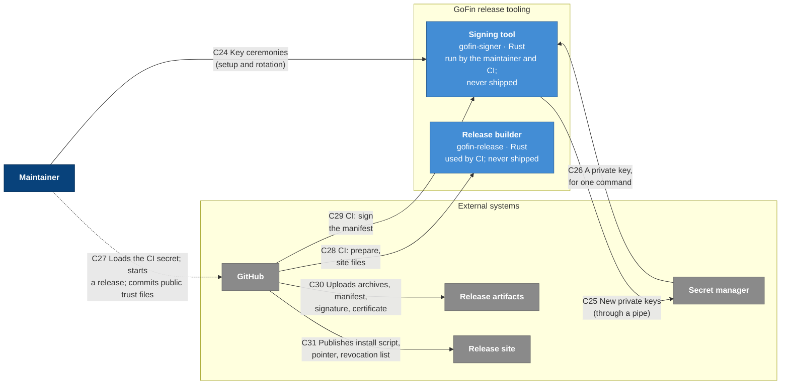
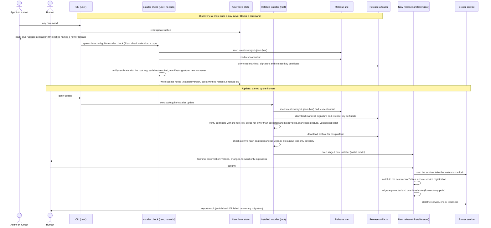
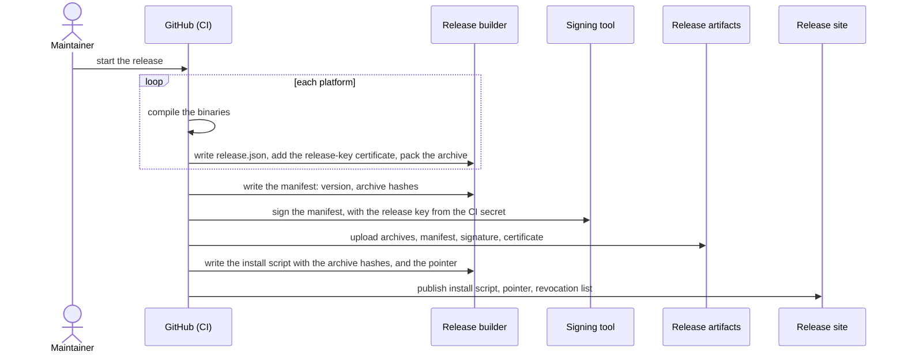

# C16 level 2: containers

- Status: agreed
- Date: 2026-11-07

## Containers

The same containers are shown in two views. The tables below are the source of truth for both.

### View 1: serving intents

### View 2: system intents that need elevated privileges

### View 3: release

### Elements

| ID | Type | Name | Technology and runtime | Responsibility | Does not |
| --- | --- | --- | --- | --- | --- |
| `cli` | Container | CLI | `gofin`, Rust; runs as the human | Parses intents and renders results for humans or as `--json`. Answers discovery and help directly; dispatches information and execution intents to the broker; replaces itself through `exec sudo` with the admin binary or the installer for system intents that need elevated privileges. About once a day starts the installer's unprivileged update check (no sudo). | Hold secrets, sign, or change protected state. |
| `user_state` | Data store | User-level state | Files in the human's home directory | Analytics settings and anonymous installation ID, the latest update notice, companion skill, shell completions. | Hold secrets or anything that protects funds. |
| `broker` | Container | Broker service | `gofin-broker`, Rust; root; started by launchd when the CLI connects | Serves information and execution intents from the CLI over a socket only the human's user can reach. Holds secrets, signs, executes and observes operations through external integrations, and requests execution authorization. | Perform system intents that need elevated privileges, install or update GoFin, or migrate state. |
| `admin` | Container | Admin | `gofin-admin`, Rust; root one-shot started through sudo | System intents that need elevated privileges, with a terminal review: secrets and connections (including venue subaccounts) and critical settings (Yolo). Works without a healthy broker. | Serve agent requests or execute financial operations. |
| `installer` | Container | Installer | `gofin-installer`, Rust; root one-shot started through sudo, except `check`, which runs as the human without sudo | Owns the whole update lifecycle. `check` (unprivileged): discovers the latest release for the installed major version, verifies its manifest signature and records an update notice in user-level state. Root modes: install, update, repair and uninstall: verifies releases, swaps files, registers the broker service, migrates protected state, updates user-level state. Works without a healthy broker. | Serve intents or hold connection secrets in memory beyond migration. |
| `bootstrap` | Container | Bootstrap installer | `install.sh`, shell; served by the release site; runs as the human | First install, or reinstall when the CLI is broken: carries the hash of each platform's release archive, downloads the archive for this platform, checks it against the pinned hash, then starts the bundled installer through sudo. | Install anything itself or run as root. |
| `approval_helper` | Container | Approval helper | `GoFin`, Swift; one-shot started by the broker in the human's session | Shows the human a GoFin-written summary through the execution authentication provider and returns the decision. | Decide anything itself or see secrets. |
| `signing_tool` | Container | Signing tool | `gofin-signer`, Rust; run by the maintainer and by CI; never shipped to users | The signing device: generates keys, derives public keys, certifies release keys and revokes keys (maintainer, with the root key) and signs manifests (CI, with the release key). Private keys leave it only through a pipe, at generation. | Prepare release files. |
| `release_builder` | Container | Release builder | `gofin-release`, Rust; used by CI; never shipped to users | Prepares a release: writes each platform's `release.json`, packs the archives, writes the manifest, and writes the site files (install script with archive hashes, pointer, revocation list). Built on the release verifier library, so these formats have one implementation. | Hold or use any private key. |
| `store` | Data store | Protected store | Root-only directory: one SQLite database (operations, configuration, connections, secrets, Yolo state) plus OS lock files for maintenance windows | Durable operational state, configuration and secrets. Used by the broker, admin and installer only through the shared protected-store library, which provides typed operations, secret access, locks and migrations. | Allow access to non-root processes, or let any container touch its files or locks directly. |

### Relationships

| ID | From | To | What flows | Trust |
| --- | --- | --- | --- | --- |
| C1 | `agent`, `human` | `cli` | Intents in; outcomes out | As L1 R1 and R2. |
| C2 | `cli` | `broker` | Information and execution intents; outcomes | The broker verifies the caller is the human's user and validates every intent itself. |
| C3 | `os` | `broker` | Starts the service when the CLI connects | Trusted. |
| C4 | `broker` | `store` | Operations, configuration, secrets, Yolo state, through the protected-store library | Shared with `admin` and `installer`; database transactions for data, OS locks for maintenance windows. |
| C5 | `broker` | `approval_helper` | Approval request with a GoFin-written summary; the decision | The summary is never written by the agent. |
| C6 | `approval_helper` | `auth` | Biometric prompt | Trusted. |
| C7 | `human` | `auth`, `os` | Touch ID approval; sudo authentication | Direct, as L1 R5 and R9. |
| C8 | `broker` | `chains`, `exchanges`, `apis` | As L1 R3, R6 and R7 | As L1 R3, R6 and R7. |
| C9 | `cli` | `user_state` | Reads and writes analytics settings; reads the update notice | Not protected; holds nothing sensitive. |
| C10 | `cli`, `broker`, `admin`, `installer` | `analytics` | Each binary reports its own anonymous usage and errors, when the human allows it (the setting lives in user-level state) | As L1 R10. |
| C11 | `cli` | `admin` | `exec sudo` with the system intent | Only reachable through sudo, i.e. the human's password. |
| C12 | `admin` | `store` | Connections, secrets, Yolo state, through the protected-store library | As C4. |
| C13 | `admin` | `exchanges` | Subaccount creation and removal | Venue code limited to connection operations. |
| C14 | `cli` | `installer` | About once a day starts `gofin-installer check` as the human, without sudo | The check mode needs no privilege and touches only user-level state; every other installer mode refuses to run without root. |
| C15 | `installer` | `user_state` | `check` records the latest verified release as an update notice | Written as the human; only verified releases are announced. |
| C16 | `cli` | `installer` | `exec sudo` with update, repair or uninstall. First install is started by the bootstrap installer (C23), not the CLI. | Only reachable through sudo. |
| C17 | `installer` | `release_site`, `release_artifacts` | Pointer and revocation list from the site; manifest, signature, release-key certificate and archives from the artifacts | The pointer is a hint; nothing from a release runs until its manifest signature verifies. |
| C18 | `installer` | `store` | Initialization, migrations, removal, through the protected-store library | Holds the maintenance lock exclusively. |
| C19 | `installer` | `os` | Registers, starts and stops the broker service | Trusted. |
| C20 | `installer` | `user_state` | Companion skill and shell completions, written as root and left owned by the human | — |
| C21 | `human` | `bootstrap` | Runs the bootstrap script fetched from the release site (`curl … \| sh`) | Trusted only through HTTPS, as L1 R11. |
| C22 | `bootstrap` | `release_artifacts` | Archive for this platform | Checked against the hash the script carries before anything runs. |
| C23 | `bootstrap` | `installer` | Starts the verified bundled installer through sudo for a first install | Only reachable through sudo. |
| C24 | `maintainer` | `signing_tool` | Key ceremonies, once to set up release trust, and afterwards only to rotate or revoke a key; never per release: generate keys, derive public keys, certify a release key, revoke keys | The maintainer's own act; the outputs are public files to commit. |
| C25 | `signing_tool` | `secret_manager` | A new root or release private key, through a pipe into the secret manager's command-line tool | As L1 RL2. |
| C26 | `secret_manager` | `signing_tool` | The root or release private key in a stable environment variable (`GOFIN_ROOT_KEY`, `GOFIN_RELEASE_KEY`), injected for one `derive`, `certify` or `revoke` command | The signing tool reads it, removes it from its environment so no child process inherits it, and keeps it only in memory. As L1 RL3. |
| C27 | `maintainer` | `github` | Loads the release key into the CI secret from the secret manager, through a pipe; starts a release; commits public trust files (root public keys, certificates, revocation list) | Direct, as L1 RL4. |
| C28 | `github` | `release_builder` | CI runs the release builder, which returns the archives, the manifest and the site files | The release builder holds no keys and publishes nothing. |
| C29 | `github` | `signing_tool` | CI runs `sign` on the manifest the release builder wrote, with the release key from the CI secret in `GOFIN_RELEASE_KEY` | As L1 RL5. |
| C30 | `github` | `release_artifacts` | CI uploads the archives, manifest, signature and release-key certificate | Published only once the manifest is signed. |
| C31 | `github` | `release_site` | CI publishes the bootstrap install script with the archive hashes, the latest-release pointer and the revocation list | Published after the release artifacts. |

### Development environment

The development environment uses development builds of the CLI and the broker service with their own development store and disposable credentials. It has no admin binary, installer, bootstrap installer or approval helper: approval is automatic and nothing requires sudo. It never touches the protected installation's store, service or user-level state, and development builds never report analytics.

## Decisions

| Decision |
| --- |
| Privileged GoFin processes (the protected service and short-lived processes started through sudo) share the protected store directly, through a shared protected-store library: database transactions coordinate data, and OS file locks (released automatically when a process dies) coordinate maintenance windows. There is no handoff to the service: install, update, uninstall and disabling Yolo must work without a healthy service. |
| The protected store is one root-only SQLite database holding operations, configuration, connections, secrets and Yolo state. Secrets are reached only through dedicated store-library functions and are never logged or exported. Yolo fails closed: if the store cannot be read, Yolo counts as off. |
| The protected-store library is a shared component inside each container that uses it, not a separate service. It exposes operations (e.g. record a submission, enroll a connection with its secret), locks and migrations rather than raw tables; external secrets storage providers plug in behind it. |
| On update, the installed version discovers, downloads and verifies the new release; the new release's installer performs the installation. |
| Every release has one signed manifest (version and, per file, name, size and hash), published with the release. Nothing from a release runs until code that is already trusted verifies it: the installed installer checks the manifest signature against a root public key it carries; for a first install, the bootstrap installer checks the archive against its pinned hash. Signatures are post-quantum where practical, produced automatically in CI as part of a release the maintainer started, with key rotation. |
| Every platform archive carries its release file list (`release.json`) and the release-key certificate. The revocation list reaches installations two ways: it is published on the release site next to the pointer, where `check` and `update` fetch it, so installations reject a revoked release key at their next check, before updating; and it is built into every release's installer, which records it when installed. |
| The release site provides the stable install URL: the bootstrap install script, regenerated for each release and carrying the hash of each platform's archive, and one "latest release" pointer per major version (`latest-v<major>.json`). Pointers are hints only; trust comes from the manifest signature. |
| Persistent-state migrations are forward-only and safe to interrupt and resume. The installer performs them as part of an update: the protected store and other protected state files. The installer also updates user-level state (companion skill, shell completions) directly with root privileges, without starting a separate process as the human, and leaves the files owned by and accessible to the human. Other containers never migrate state; they refuse to work with un-migrated state and point to `gofin repair`. |
| System intents that need elevated privileges are performed by a separate admin binary, started through sudo: secrets and connections (including creating and removing venue subaccounts) and critical settings (Yolo). Its only venue code is what connection operations such as subaccounts need. Venue changes that only need execution authorization (e.g. withdrawal address allowlisting, deposit address creation, trading and margin settings) are execution intents served by the broker. |
| Every GoFin binary reports its own analytics through a shared analytics reporter, honoring the human's analytics setting in user-level state. |
| Release trust is handled by a separate signing tool that is never shipped to users and acts only as a signing device: key generation, public-key derivation, certification, revocation and manifest signing. Root-key commands are run by the maintainer, who keeps the secret manager out of CI; manifest signing runs in CI with the release key from a CI secret. A release runs automatically once the maintainer starts it; there is no separate signing approval. |
| Release preparation is handled by a separate release builder, used by CI and never shipped to users: release file lists, archives, the manifest and site files. It holds no keys. Both tools are built on the same release verifier library as the installer, so formats, signing and verification each have one implementation. |
| Installation, update, repair and uninstall are performed by a separate installer binary, including keeping user-level state (companion skill, shell completions) current. Shared concerns (installation paths, locks, store schema checks and migrations) live in a Rust library used by the installer, the admin binary and the broker. |

## Flows

### Update

1. Discovery is unprivileged and asynchronous. When a command finishes and the last check is older than a day, the CLI spawns `gofin-installer check` as a detached process without sudo and does not wait for it. The check returns nothing to the CLI; its only output is the update notice in user-level state: the installed version, the latest release that passed verification, and when it checked.
2. Verification: the release-key certificate verifies against an embedded root public key (selected by root key ID); its key serial is not on the revocation list; the manifest signature verifies with the certified release key; the release version is not older than the installed one. Root modes also require the key serial to be not lower than the highest the installation has accepted; `check` keeps no trust state, since it only announces.
3. Every command reads the notice, a local file. When it names a newer release, the CLI tells the caller: human output shows a one-line notice; `--json` responses carry a structured `update_available` field. The companion skill tells the agent to relay it to the human once, since only the human can run `gofin update`.
4. `gofin update` replaces the CLI process with `sudo gofin-installer update`, the same elevation pattern as other system intents that need elevated privileges.
5. The installed installer verifies the release before anything from it runs; the new release's installer asks for confirmation, because only it knows its migrations, and performs the installation and migrations.
6. A failure before any migration switches back to the previous version; after that the update only moves forward.

### Release

1. Once the maintainer starts a release, everything runs automatically.
2. The revocation list committed in the repository is built into the release's installer and published on the release site with the release, so an installation receives the newest revocations both when it checks and when it installs.
3. The release site is published last, so the pointer and the bootstrap installer never name a release whose artifacts are missing.
4. The release builder prepares; the signing tool only signs the manifest bytes it is given. Their components are in [03-components-release-builder.md](03-components-release-builder.md) and [03-components-signing-tool.md](03-components-signing-tool.md); key ceremonies (setting up, rotating or revoking keys) are signing tool flows.
