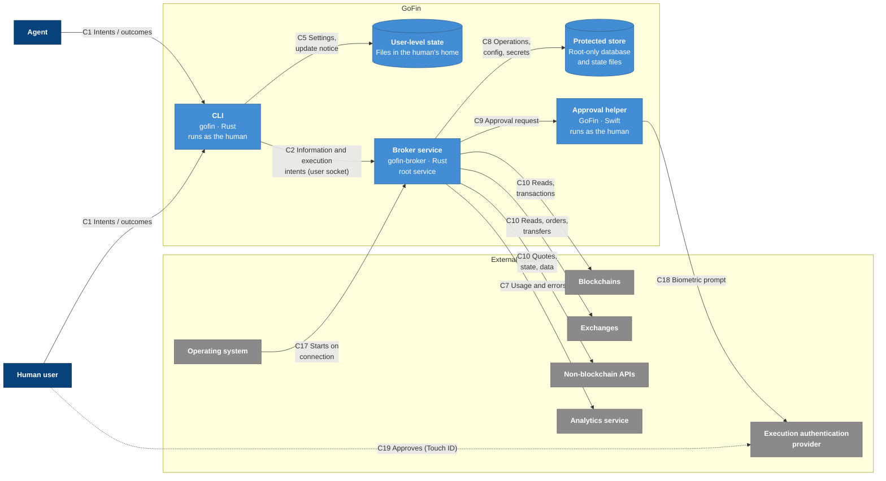
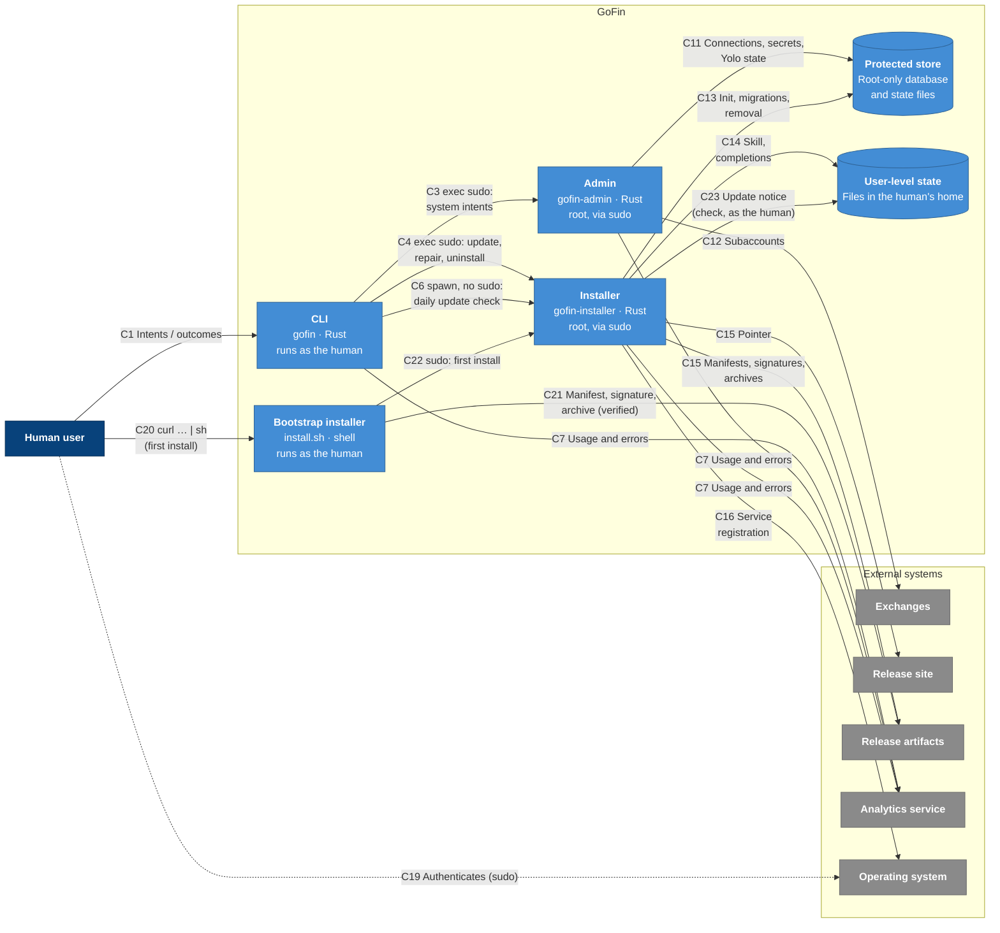
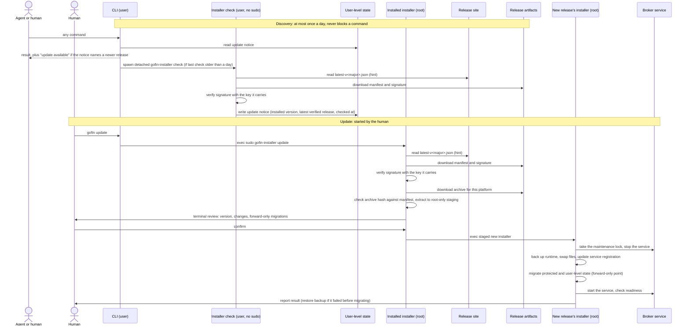

# C4 level 2: containers

- Status: agreed
- Date: 2026-11-07

## Containers

The same containers are shown in two views. The tables below are the source of truth for both.

### View 1: serving intents

### View 2: system intents that need elevated privileges

### Elements

| ID | Type | Name | Technology and runtime | Responsibility | Does not |
| --- | --- | --- | --- | --- | --- |
| `cli` | Container | CLI | `gofin`, Rust; runs as the human | Parses intents and renders results for humans or as `--json`. Answers discovery and help directly; dispatches information and execution intents to the broker; replaces itself through `exec sudo` with the admin binary or the installer for system intents that need elevated privileges. About once a day starts the installer's unprivileged update check (no sudo). | Hold secrets, sign, or change protected state. |
| `user_state` | Data store | User-level state | Files in the human's home directory | Analytics settings and anonymous installation ID, the latest update notice, companion skill, shell completions. | Hold secrets or anything that protects funds. |
| `broker` | Container | Broker service | `gofin-broker`, Rust; root; started by launchd when the CLI connects | Serves information and execution intents from the CLI over a socket only the human's user can reach. Holds secrets, signs, executes and observes operations through external integrations, and requests execution authorization. | Perform system intents that need elevated privileges, install or update GoFin, or migrate state. |
| `admin` | Container | Admin | `gofin-admin`, Rust; root one-shot started through sudo | System intents that need elevated privileges, with a terminal review: secrets and connections (including venue subaccounts) and critical settings (Yolo). Works without a healthy broker. | Serve agent requests or execute financial operations. |
| `installer` | Container | Installer | `gofin-installer`, Rust; root one-shot started through sudo, except `check`, which runs as the human without sudo | Owns the whole update lifecycle. `check` (unprivileged): discovers the latest release for the installed major version, verifies its manifest signature and records an update notice in user-level state. Root modes: install, update, repair and uninstall: verifies releases, swaps files, registers the broker service, migrates protected state, updates user-level state. Works without a healthy broker. | Serve intents or hold connection secrets in memory beyond migration. |
| `bootstrap` | Container | Bootstrap installer | `install.sh`, shell; served by the release site; runs as the human | First install only: carries GoFin's release public key, downloads the manifest, signature and archive for this platform, verifies them, then starts the bundled installer through sudo. | Install anything itself or run as root. |
| `approval_helper` | Container | Approval helper | `GoFin`, Swift; one-shot started by the broker in the human's session | Shows the human a GoFin-written summary through the execution authentication provider and returns the decision. | Decide anything itself or see secrets. |
| `store` | Data store | Protected store | Root-only directory: one SQLite database (operations, configuration, connections, secrets, Yolo state) plus OS lock files for maintenance windows | Durable operational state, configuration and secrets. Used by the broker, admin and installer only through the shared store library, which provides typed operations, secret access, locks and migrations. | Allow access to non-root processes, or let any container touch its files or locks directly. |

### Relationships

| ID | From | To | What flows | Trust |
| --- | --- | --- | --- | --- |
| C1 | `agent`, `human` | `cli` | Intents in; outcomes out | As L1 R1 and R2. |
| C2 | `cli` | `broker` | Information and execution intents; outcomes | The broker verifies the caller is the human's user and validates every intent itself. |
| C3 | `cli` | `admin` | `exec sudo` with the system intent | Only reachable through sudo, i.e. the human's password. |
| C4 | `cli` | `installer` | `exec sudo` with update, repair or uninstall. First install is started by the bootstrap installer (C22), not the CLI. | Only reachable through sudo. |
| C5 | `cli` | `user_state` | Reads and writes analytics settings; reads the update notice | Not protected; holds nothing sensitive. |
| C6 | `cli` | `installer` | About once a day starts `gofin-installer check` as the human, without sudo | The check mode needs no privilege and touches only user-level state; every other installer mode refuses to run without root. |
| C7 | `cli`, `broker`, `admin`, `installer` | `analytics` | Each binary reports its own anonymous usage and errors, when the human allows it (the setting lives in user-level state) | As L1 R6. |
| C8 | `broker` | `store` | Operations, configuration, secrets, Yolo state, through the store library | Shared with `admin` and `installer`; database transactions for data, OS locks for maintenance windows. |
| C9 | `broker` | `bootstrap` | Container | Bootstrap installer | `install.sh`, shell; served by the release site; runs as the human | First install only: carries GoFin's release public key, downloads the manifest, signature and archive for this platform, verifies them, then starts the bundled installer through sudo. | Install anything itself or run as root. |
| `approval_helper` | Approval request with a GoFin-written summary; the decision | The summary is never written by the agent. |
| C10 | `broker` | `chains`, `exchanges`, `apis` | As L1 R3–R5 | As L1 R3–R5. |
| C11 | `admin` | `store` | Connections, secrets, Yolo state, through the store library | As C8. |
| C12 | `admin` | `exchanges` | Subaccount creation and removal | Venue code limited to connection operations. |
| C13 | `installer` | `store` | Initialization, migrations, removal, through the store library | Holds the maintenance lock exclusively. |
| C14 | `installer` | `user_state` | Companion skill and shell completions, written as root and left owned by the human | — |
| C15 | `installer` | `release_site`, `release_artifacts` | Pointer from the site; manifest, signature and archives from the artifacts | The pointer is a hint; nothing from a release runs until its manifest signature verifies. |
| C23 | `installer` | `user_state` | `check` records the latest verified release as an update notice | Written as the human; only verified releases are announced. |
| C16 | `installer` | `os` | Registers, starts and stops the broker service | Trusted. |
| C17 | `os` | `broker` | Starts the service when the CLI connects | Trusted. |
| C18 | `bootstrap` | Container | Bootstrap installer | `install.sh`, shell; served by the release site; runs as the human | First install only: carries GoFin's release public key, downloads the manifest, signature and archive for this platform, verifies them, then starts the bundled installer through sudo. | Install anything itself or run as root. |
| `approval_helper` | `auth` | Biometric prompt | Trusted. |
| C19 | `human` | `auth`, `os` | Touch ID approval; sudo authentication | Direct, as L1 R11 and R12. |
| C20 | `human` | `bootstrap` | Runs the bootstrap script fetched from the release site (`curl … \| sh`) | Trusted only through HTTPS, as L1 R13. |
| C21 | `bootstrap` | `release_artifacts` | Manifest, signature and archive | Verified against the public key the script carries before anything runs. |
| C22 | `bootstrap` | `installer` | Starts the verified bundled installer through sudo for a first install | Only reachable through sudo. |

### Development environment

The development environment uses development builds of the CLI and the broker service with their own development store and disposable credentials. It has no admin binary, installer, bootstrap installer or approval helper: approval is automatic and nothing requires sudo. It never touches the protected installation's store, service or user-level state, and development builds never report analytics.

## Decisions

| Decision |
| --- |
| Privileged GoFin processes (the protected service and short-lived processes started through sudo) share the protected store directly, through a shared store library: database transactions coordinate data, and OS file locks (released automatically when a process dies) coordinate maintenance windows. There is no handoff to the service: install, update, uninstall and disabling Yolo must work without a healthy service. |
| The protected store is one root-only SQLite database holding operations, configuration, connections, secrets and Yolo state. Secrets are reached only through dedicated store-library functions and are never logged or exported. Yolo fails closed: if the store cannot be read, Yolo counts as off. |
| The store library is a shared component inside each container that uses it, not a separate service. It exposes operations (e.g. record a submission, enroll a connection with its secret), locks and migrations rather than raw tables; external secrets storage providers plug in behind it. |
| On update, the installed version discovers, downloads and verifies the new release; the new release's installer performs the installation. |
| Every release has one signed manifest (version and, per file, name, size and hash), published with the release. Nothing from a release runs until the manifest signature verifies against a GoFin public key the verifier already carries. Signatures are post-quantum where practical, produced in CI behind a manual approval gate, with key rotation. |
| The release site provides the stable install URL: the bootstrap install script, which carries the public key, and one "latest release" pointer per major version (`latest-v<major>.json`). Pointers are hints only; trust comes from the manifest signature. |
| Persistent-state migrations are forward-only and safe to interrupt and resume. The installer performs them as part of an update: the protected store and other protected state files. The installer also updates user-level state (companion skill, shell completions) directly with root privileges, without starting a separate process as the human, and leaves the files owned by and accessible to the human. Other containers never migrate state; they refuse to work with un-migrated state and point to `gofin update`. |
| System intents that need elevated privileges are performed by a separate admin binary, started through sudo: secrets and connections (including creating and removing venue subaccounts) and critical settings (Yolo). Its only venue code is what connection operations such as subaccounts need. Venue changes that only need execution authorization (e.g. withdrawal address allowlisting, deposit address creation, trading and margin settings) are execution intents served by the broker. |
| Every GoFin binary reports its own analytics through a shared analytics library, honoring the human's analytics setting in user-level state. |
| Installation, update, repair and uninstall are performed by a separate installer binary, including keeping user-level state (companion skill, shell completions) current. Shared concerns (installation paths, locks, store schema checks and migrations, release verification) live in a Rust library used by the installer, the admin binary and the broker. |

## Flows

### Update

1. Discovery is unprivileged and asynchronous. When a command finishes and the last check is older than a day, the CLI spawns `gofin-installer check` as a detached process without sudo and does not wait for it. The check returns nothing to the CLI; its only output is the update notice in user-level state: the installed version, the latest release whose manifest signature verified, and when it checked.
2. Every command reads the notice, a local file. When it names a newer release, the CLI tells the caller: human output shows a one-line notice; `--json` responses carry a structured `update_available` field. The companion skill tells the agent to relay it to the human once, since only the human can run `gofin update`.
3. `gofin update` replaces the CLI process with `sudo gofin-installer update`, the same elevation pattern as other system intents that need elevated privileges.
4. The installed installer verifies the release before anything from it runs; the new release's installer performs the installation and migrations.
5. A failure before migration restores the backup; after migration the update only moves forward.
