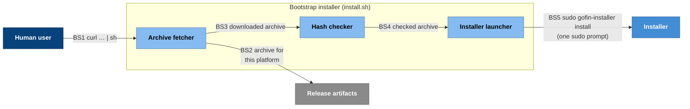

# C4 level 3: bootstrap installer components

- Status: agreed
- Date: 2026-11-09

Components of the bootstrap installer (`bootstrap` in [02-containers.md](02-containers.md)): a shell script served by the release site and run as the human with `curl … | sh`. It is regenerated for each release. The install it starts is the installer's install flow ([03-components-installer.md](03-components-installer.md#install)).

## Components

### Elements

| ID | Type | Name | Responsibility |
| --- | --- | --- | --- |
| `bs_fetcher` | Component | Archive fetcher | Detects the platform and downloads that platform's archive for the release the script was generated for, into a new temporary directory. |
| `bs_hash_checker` | Component | Hash checker | Checks the archive's SHA-256 against the hash written into the script and unpacks only the installer. Refuses on any mismatch. |
| `bs_launcher` | Component | Installer launcher | Starts the unpacked installer through `sudo` in `install` mode, passing the archive path, and returns its result. |

### Relationships

| ID | From | To | What flows |
| --- | --- | --- | --- |
| BS1 | `human` | `bs_fetcher` | Runs the script fetched from the release site |
| BS2 | `bs_fetcher` | `release_artifacts` | Archive for this platform |
| BS3 | `bs_fetcher` | `bs_hash_checker` | Downloaded archive |
| BS4 | `bs_hash_checker` | `bs_launcher` | Archive whose hash matched |
| BS5 | `bs_launcher` | `installer` | `sudo gofin-installer install` with the path of the checked archive. This is the only sudo prompt: the human authenticates to sudo (L2 C7) and sudo starts the installer. |

## Decisions

| Decision |
| --- |
| For a first install, the pinned SHA-256 hash per platform archive is the release's only verification; signatures are verified by the installed installer on later updates. A shell script cannot verify SLH-DSA signatures without extra tools, and the script's own trust comes from HTTPS anyway, so a signature check here would add nothing. |
| The bootstrap installer is regenerated for each release with that release's version and archive hashes written in, and is published with the latest-release pointer. |
