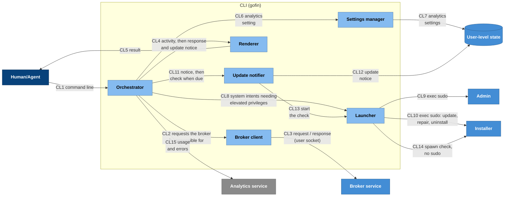
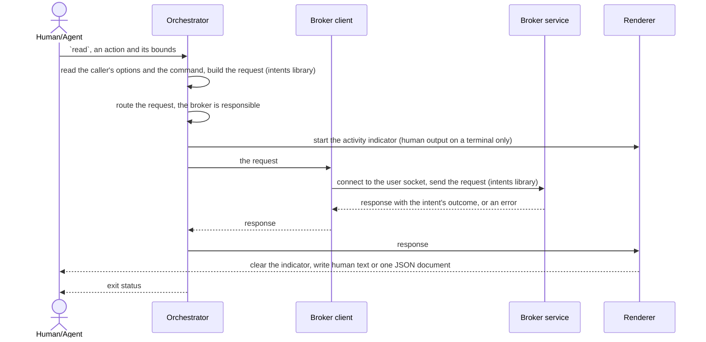
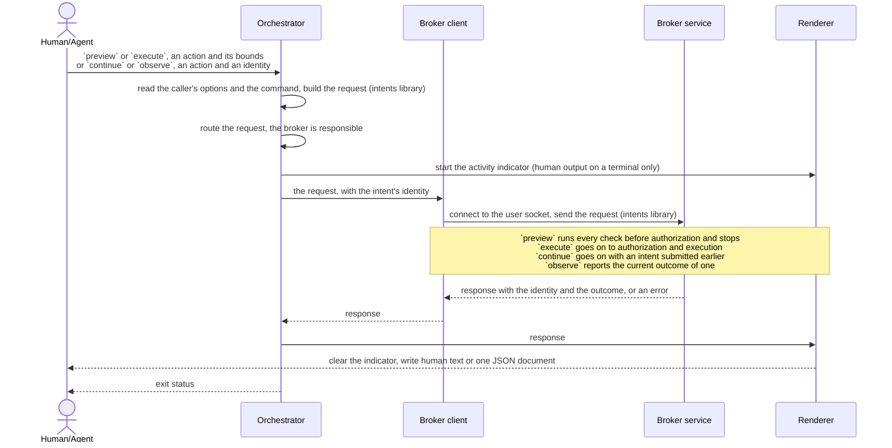
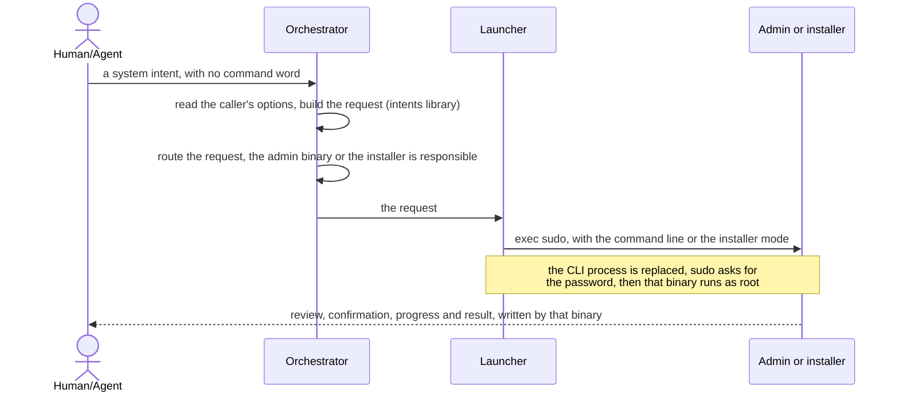
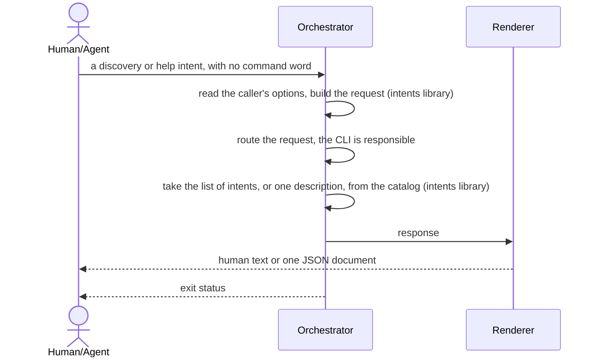
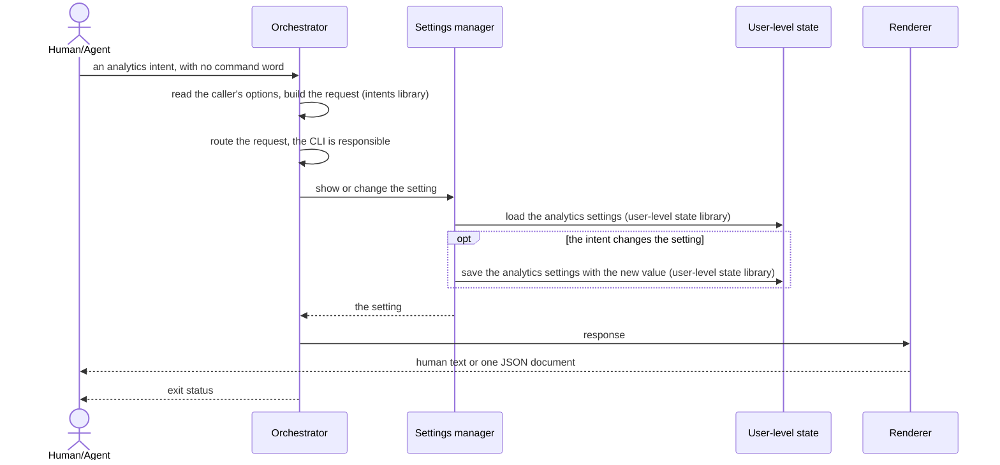
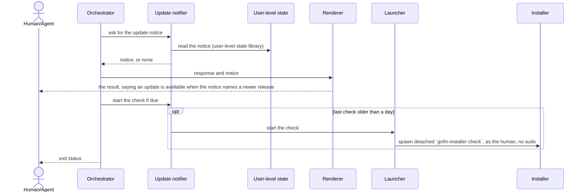

# C4 level 3: CLI components

- Status: agreed — components and flows; the caller contract and decisions are added after the broker's lifecycle and outcome
- Date: 2026-11-17

Components of the CLI (`cli` in [02-containers.md](02-containers.md)): `gofin`, the only GoFin binary a caller runs. It runs as the human, whether the human or the agent started it, and holds no secrets.

## Components

The human and the agent (`human` and `agent` at level 1) reach the CLI in the same way, so the diagrams draw them as one node, `caller`.

### Elements

| ID | Type | Name | Responsibility |
| --- | --- | --- | --- |
| `cli_orchestrator` | Component | Orchestrator | The binary's entry point. Runs one command line: reads the caller's options (human output or `--json`, and an identity for the intent when the caller chose one) and the command word when there is one, and passes the rest to the intents library, which returns the request (the command, the intent and its identity). Routes the request: it holds the table of which container is responsible for each intent (below) and passes the request to the component that reaches that container. Discovery and help it answers itself, from the catalog in the intents library, without the broker. Hands the response to the Renderer and sets the exit status. A command line that cannot be decoded becomes a structured error and nothing is sent anywhere. Decides nothing about whether an intent is allowed. Reports usage and errors through the analytics reporter library. |
| `cli_broker_client` | Component | Broker client | Sends one request to the broker over the user socket and returns the broker's response. Each command line is one connection, and each message on it is one line: the request or the response as the intents library encodes it. Connecting is what makes the operating system start the broker. When the broker cannot be reached, refuses to work or stops answering, it returns an error that says which of these happened, the intent's identity and the next step; it never sends a request a second time on its own. |
| `cli_renderer` | Component | Renderer | Writes the response for the caller. Human output states what was asked, the result and the useful next step, with color and an activity indicator while work runs, through the terminal presenter library, and only when writing to a terminal that supports them. `--json` output is exactly one JSON document, a result or a structured error, with no prompts, animation or color. Adds the update notice to either form. Changes nothing in the response and decides nothing. |
| `cli_settings_manager` | Component | Settings manager | Shows and changes the analytics setting through the user-level state library. |
| `cli_update_notifier` | Component | Update notifier | Reads the update notice through the user-level state library and gives it to the Orchestrator for the Renderer. After the command's result is written, asks the Launcher to start the update check when the last check is older than a day. |
| `cli_launcher` | Component | Launcher | Starts GoFin's other binaries, the ones installed next to the CLI. For a system intent that needs elevated privileges it replaces the CLI process with `sudo` running the admin binary, with the command line passed on unchanged, the caller's options included, or the installer, with its mode; from then on that binary talks to the human. For the update check it spawns `gofin-installer check` detached, without sudo, and does not wait. Never passes a secret: the admin binary collects secrets itself. |

### How an intent is served

Every request has a command: `read`, `preview`, `execute`, `continue` or `observe`. For reads and execution intents the caller writes it first on the command line, before the intent's `action` and bounds. Discovery and system intents each have exactly one command, so it is implied and not written. The command travels with the intent in the request, and the responsible container decides what it means for that intent. `read`, `preview` and `observe` authorize and execute nothing and need no privilege; the privilege in an intent's definition is what `execute` and `continue` need.

The intent's definition, in the intents library, says what the intent is: its bounds, the commands it accepts, the privilege it needs and the shape of its outcome. It does not say which container is responsible for it. That is the Orchestrator's routing table, since only the CLI has to get an intent somewhere. The table names a container for every intent in the catalog: the CLI does not build while an intent has none. The responsible container carries out the intent and alone knows which operations that takes. For discovery, help and the analytics setting the CLI is itself the responsible container.

| Intents | Commands | Privilege to execute | Responsible container | Path in the CLI |
| --- | --- | --- | --- | --- |
| Discovery and help (I1) | `read`, implied | — | CLI | Orchestrator, from the intents library |
| Analytics setting (S6) | `read` to show it, `execute` to change it, both implied | None | CLI | Settings manager |
| Reads (I2), listing submitted intents (I3) | `read`, written | — | Broker | Broker client |
| System reads (S9) | `read`, implied | — | Broker | Broker client |
| Execution intents (X1 to X5) | `preview`, `execute`, `continue` (X3) and `observe` (I3), written | Execution authorization | Broker | Broker client |
| Connections, human-only venue configuration, enabling and disabling Yolo (S2 to S4) | `execute`, implied | System authorization | Admin | Launcher, `exec sudo` |
| Update, repair, uninstall (S5) | `execute`, implied | System authorization | Installer | Launcher, `exec sudo` |

### Libraries

Shared code built into the components above; not components themselves.

| ID | Library | Used by | For |
| --- | --- | --- | --- |
| `lib_intents` | Intents library | Orchestrator, Broker client, Renderer | The catalog of intents and the shapes they share ([04-intents.md](04-intents.md)). The catalog has one definition per intent (for example `uniswap.swap`): its `action`, its required and optional bounds, the commands it accepts, the privilege it needs, the shape of its outcome and its description for discovery. How an intent is carried out, and by which container, is not part of its definition. The library builds a request from what the Orchestrator took off the command line, describes intents for discovery and help, and encodes the request and the response that carries the intent's outcome, as JSON, for the broker socket and for `--json` output. Also used by the broker and the admin binary, so parsing, help, schemas and validation come from the same definitions. |
| `lib_domain_types` | Domain types library | Renderer, and every component through the intents library | The value types bounds and outcomes are made of: exact quantities and explicit asset, network and account identities. Used by every binary that handles intents. |
| `lib_presenter` | Terminal presenter library | Renderer | Color, the activity indicator and the layout of messages for human output, honoring `NO_COLOR`, `TERM=dumb` and redirection. Also used by the installer and the admin binary, so all three look the same to the human. |
| `lib_user_state` | User-level state library | Settings manager, Update notifier | Reading and writing the analytics settings and reading the update notice in `~/.gofin/` ([04-user-level-state.md](04-user-level-state.md)). |
| `lib_reporter` | Analytics reporter library | Orchestrator | Reporting usage and errors when the human allows it. Used by every binary. |

### Relationships

| ID | From | To | What flows |
| --- | --- | --- | --- |
| CL1 | `agent`, `human` | `cli_orchestrator` | One command line: the caller's options, a command when it is written, and an intent (L2 C1) |
| CL2 | `cli_orchestrator` | `cli_broker_client` | A request the broker is responsible for; back comes the broker's response or a connection error |
| CL3 | `cli_broker_client` | `broker` | One request and its response over the user socket, each one line in the intents library's encoding (L2 C2) |
| CL4 | `cli_orchestrator` | `cli_renderer` | Start the activity indicator while work runs; then the response and the update notice |
| CL5 | `cli_renderer` | `agent`, `human` | The result on standard output: human text or one JSON document (L2 C1) |
| CL6 | `cli_orchestrator` | `cli_settings_manager` | Show or change the analytics setting |
| CL7 | `cli_settings_manager` | `user_state` | Analytics settings, through the user-level state library (L2 C9) |
| CL8 | `cli_orchestrator` | `cli_launcher` | A system intent that needs elevated privileges |
| CL9 | `cli_launcher` | `admin` | `exec sudo` with the system intent (L2 C11) |
| CL10 | `cli_launcher` | `installer` | `exec sudo` with `update`, `repair` or `uninstall` (L2 C16) |
| CL11 | `cli_orchestrator` | `cli_update_notifier` | Asks for the update notice before rendering; after rendering, lets it start the check when due |
| CL12 | `cli_update_notifier` | `user_state` | Reads the update notice, through the user-level state library (L2 C9) |
| CL13 | `cli_update_notifier` | `cli_launcher` | Start the update check |
| CL14 | `cli_launcher` | `installer` | Spawns `gofin-installer check` detached, as the human, without sudo (L2 C14) |
| CL15 | `cli_orchestrator` | `analytics` | Usage and errors, through the analytics reporter library (L2 C10) |

A development build of the CLI has the same components. Its Broker client connects to the development environment's broker, and its Launcher and Update notifier have nothing to start, since that environment has no admin binary and no installer. A development build reports no analytics.

## Flows

Participants are the components above and the containers they reach; a library a step uses is named in the step. Every flow starts the same way: the Orchestrator reads the caller's options and the command, has the intents library build the request from the rest, and routes it. A command line that cannot be decoded ends there: the Renderer writes a structured error and nothing is sent.

Two things are left out of the first five flows. The update notice and check are drawn once, in [Update check](#update-check); they are part of every flow except the system intent's. Analytics reporting (CL15) happens at the end of every command that returns to the CLI. On the system intent path the CLI process is replaced, and the binary that takes over reports its own usage and errors.

### Information intent

Reads and system reads the broker answers. Nothing is authorized and nothing changes.

1. The activity indicator is the small animation that tells a human at a terminal that GoFin is working while the CLI waits for the broker. It is never shown under `--json` or when the output is redirected, and it is cleared before the result is written.
2. When the broker cannot be reached, refuses to work or stops answering, the Broker client returns an error instead of a response, and the flow continues from there. A read changes nothing, so the caller can simply run it again.
3. A system read takes the same path. Its `read` is implied, so the caller writes no command word.

### Execution intent

`preview`, `execute`, `continue` or `observe` with an intent the broker is responsible for. The path through the CLI is the same as for an information intent; what differs is the intent's identity and what the broker does.

1. The intent's identity is fixed before the request is sent: the one the caller chose, or a new one from the intents library. Every response and every error carries it, so the caller can observe the intent later, also when no response arrived.
2. `continue` and `observe` take the action and the identity of an intent submitted earlier, and no bounds. `observe` authorizes and executes nothing; the response carries that intent's current outcome. `continue` lets the broker decide between observing the intent and trying again.
3. `execute` always starts a new intent and always carries its bounds. The broker refuses an `execute` whose identity is already in use, so an identity the caller chose is never mistaken for a continuation.
4. The CLI sends one request and waits for one response. While it waits it shows only that work is running; it does not know which stage the broker has reached. The connection stays open until the response, so progress messages can later be added as further lines before it.
5. The authorization prompt comes from the broker through the approval helper, not from the CLI. The CLI is simply still waiting while the human decides.
6. When the broker cannot be reached, refuses to work or stops answering, the Broker client returns an error with the identity. The CLI never sends the request again by itself. A `preview` or an `observe` executes nothing, so the caller can simply run it again. After an `execute` or a `continue`, the caller runs `continue` with the same action and identity.

### System intent that needs elevated privileges

Connections, human-only venue configuration, Yolo, update, repair and uninstall. Only the human can carry these through, because sudo asks for their password.

1. After `exec` there is no CLI process left: the admin binary or the installer writes everything the human sees, through the same terminal presenter library, and its exit status is the command's exit status.
2. The CLI does not check who is calling or how. An agent that starts this path stops at sudo, which asks for a password the agent does not have; discovery already tells it that the intent needs the human.
3. On this path the CLI shows no update notice and starts no update check; the next ordinary command does both.
4. The admin binary decodes the same command line with the same intents library, so the Launcher passes it on unchanged, the caller's options included. The installer is started with its mode: `update`, `repair` or `uninstall`.

### Describe

Discovery and help: the list of intents, or one intent's description and schema. The CLI is the responsible container, so this works when the broker is stopped or broken.

### Analytics change

Turning analytics reporting on or off, or showing the setting.

1. The settings are loaded first and saved whole, so a change keeps the installation ID and the notice flag.

### Update check

The end of every flow above except the system intent's: it starts when the response is ready and replaces their last three steps.

1. The notice is a local file, read after the response is ready. The check is only started, after the result is written, and the CLI does not wait for it, so the network never delays a command.
2. The check writes its result as the next update notice ([installer check flow](03-components-installer.md#check)); a later command shows it.
