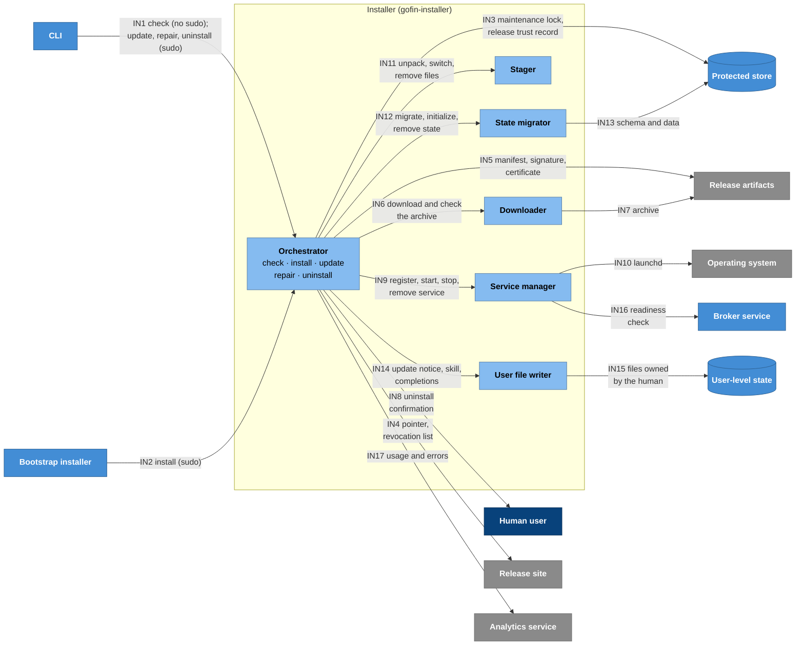
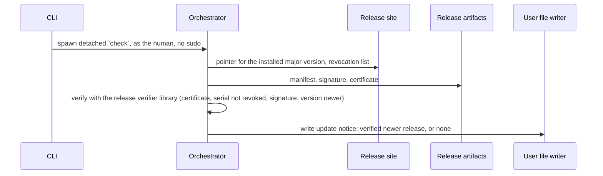
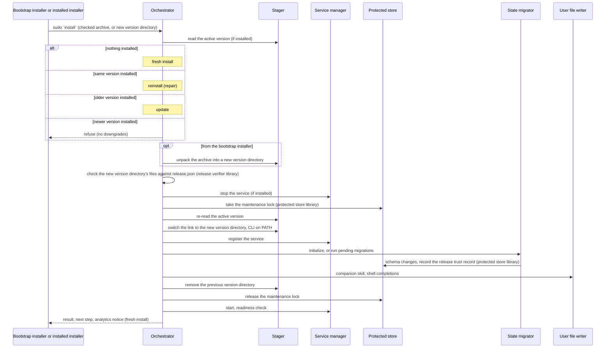
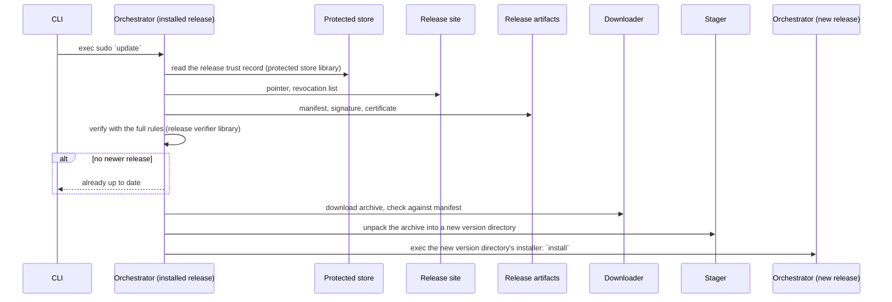
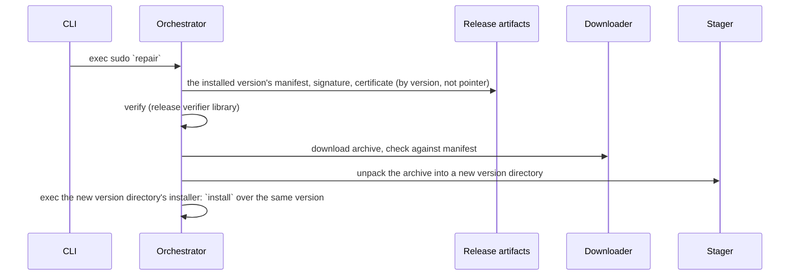
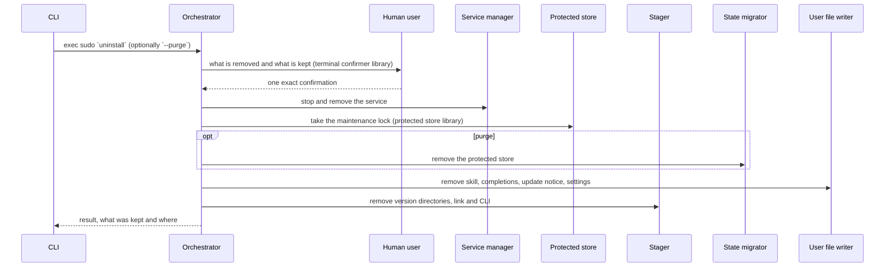

# C4 level 3: installer components

- Status: in review
- Date: 2026-11-09

Components of the installer container (`installer` in [02-containers.md](02-containers.md)).

## Components



### Elements

| ID | Type | Name | Responsibility |
| --- | --- | --- | --- |
| `in_orchestrator` | Component | Orchestrator | The binary's entry point: parses the mode and runs its flow, calling the other components in order. `check` runs as the human without root; `install`, `update`, `repair` and `uninstall` refuse to run without root. Holds the maintenance lock while a root mode changes the installation. Discovers and verifies releases, asks for confirmation before an uninstall and reports analytics through the libraries below. |
| `in_downloader` | Component | Downloader | Downloads the archive for this platform into a new root-only directory and checks it against the verified manifest with the release verifier library. Used by `update` and `repair`; a bootstrap install arrives with its archive already downloaded and checked. |
| `in_stager` | Component | Stager | Owns the installed layout and permissions: unpacks an archive straight into a new version directory (allowed entries only, fixed permissions), switches the active-version link to it (or back), puts the CLI on the human's `PATH`, and removes version directories. The active-version link is the only record of the active version: the Stager reads it from `release.json` in the directory the link points to. |
| `in_service_manager` | Component | Service manager | Registers, starts, stops and removes the broker service with the OS service manager (launchd), and runs the readiness check after a start. |
| `in_migrator` | Component | State migrator | Initializes, migrates (forward only) and removes protected state through the protected store library. |
| `in_user_writer` | Component | User file writer | Writes the update notice (from `check`), the companion skill and shell completions through the user-level state library, leaving files owned by and accessible to the human, and removes them on uninstall. |

### Libraries

Shared code built into the components above; not components themselves.

| ID | Library | Used by | For |
| --- | --- | --- | --- |
| `lib_verifier` | Release verifier library | Orchestrator, Downloader | Reading the latest-release pointer and revocation list; verifying certificates, key serials, manifest signatures, versions and file hashes ([04-release-verifier.md](04-release-verifier.md)). |
| `lib_confirmer` | Terminal confirmer library | Orchestrator | Showing what an uninstall removes and collecting exact confirmation. Also used by the admin binary. |
| `lib_store` | Protected store library | Orchestrator, State migrator | Typed access to the protected store, migrations and the maintenance lock ([04-protected-store.md](04-protected-store.md)). Also used by the broker and the admin binary. |
| `lib_reporter` | Analytics reporter library | Orchestrator | Reporting usage and errors when the human allows it. Used by every binary. |
| `lib_user_state` | User-level state library | User file writer | Reading and writing GoFin's files in `~/.gofin/` ([04-user-level-state.md](04-user-level-state.md)). Also used by the CLI. |

The **release trust record** is what an installation remembers about release keys: the highest key serial it has accepted and the newest revocation list it has seen. It lives in the protected store. Only the installed installer reads it, to decide whether to trust a new release; the install records the new release's serial and list there. `check` keeps none: it applies the newer of the fetched and built-in revocation lists and only announces, so the full rules are enforced when the human updates.

The installer's trust anchor for the [release verifier library](04-release-verifier.md#functions) is the root public keys and revocation list built into it. The modes use the library as follows:

| Mode | Library use |
| --- | --- |
| `check` | Verifies the fetched revocation list and keeps the newer of it and the built-in one, then `Release::verify` with policy `announce`. If the list cannot be fetched or verified, the check fails and announces nothing. |
| `update`, `repair` | Verifies the fetched revocation list and stores the newer list in the release trust record at once; then `Release::verify` with policy `update` or `repair`, and `check` on the download. If the list cannot be fetched or verified, the mode stops with a clear error before anything else; it never falls back to the held list. |
| `install` | `UnpackedRelease::check_files` on the unpacked release, then `record_install`. It verifies no signatures: its caller (the installed installer, or the bootstrap installer's pinned hash) already verified the release. |

### Relationships

| ID | From | To | What flows |
| --- | --- | --- | --- |
| IN1 | `cli` | `in_orchestrator` | `check` as the human without sudo; `update`, `repair`, `uninstall` through `exec sudo` |
| IN2 | `bootstrap` | `in_orchestrator` | `install` through sudo, first install only |
| IN3 | `in_orchestrator` | `store` | Maintenance lock and release trust record, through the protected store library |
| IN4 | `in_orchestrator` | `release_site` | Latest-release pointer and revocation list, through the release verifier library |
| IN5 | `in_orchestrator` | `release_artifacts` | Manifest, signature and release-key certificate, verified with the release verifier library before anything from the release runs |
| IN6 | `in_orchestrator` | `in_downloader` | Download a verified release's archive and check it against the manifest |
| IN7 | `in_downloader` | `release_artifacts` | Archive for this platform |
| IN8 | `in_orchestrator` | `human` | What an uninstall removes and keeps, and one exact confirmation, through the terminal confirmer library |
| IN9 | `in_orchestrator` | `in_service_manager` | Register, start, stop or remove the broker service |
| IN10 | `in_service_manager` | `os` | launchd registration and control |
| IN11 | `in_orchestrator` | `in_stager` | Read the active version; unpack an archive into a new version directory; switch, switch back or remove version directories |
| IN12 | `in_orchestrator` | `in_migrator` | Initialize, migrate or remove protected state |
| IN13 | `in_migrator` | `store` | Schema changes, migrations and the release trust record, through the protected store library |
| IN14 | `in_orchestrator` | `in_user_writer` | Update notice, companion skill, shell completions |
| IN15 | `in_user_writer` | `user_state` | Files written as root, left owned by the human |
| IN16 | `in_service_manager` | `broker` | Readiness check: connect to the broker's socket (which makes launchd start it) and ask for its version; ready when the new version answers within a timeout |
| IN17 | `in_orchestrator` | `analytics` | Outcome of each mode, through the analytics reporter library |

## Installed layout

```
/Library/GoFin/                                 root, 755
├── current -> versions/1.4.2-20261109T101500Z  active-version link
├── versions/                                   root, 755
│   └── 1.4.2-20261109T101500Z/                 one per placement; files read-only
│       ├── release.json                        release file list: version, platform, name, size and hash of every file
│       ├── release-key.cert                    certificate of the key that signed the release
│       ├── bin/
│       │   ├── gofin                           CLI
│       │   ├── gofin-broker                    broker service
│       │   ├── gofin-admin                     admin
│       │   └── gofin-installer                 installer
│       ├── libexec/
│       │   └── GoFin                           approval helper
│       └── share/                              companion skill, shell completions, README
├── store/                                      root, 700: protected store
│   ├── gofin.db                                SQLite database (with its -wal and -shm files)
│   └── maintenance.lock                        OS lock file for maintenance windows
├── run/                                        root, 755
│   └── broker.sock                             broker socket, reachable only by the human's user
└── downloads/                                  root, 700: downloaded archives, one new directory per installer run

/Library/LaunchDaemons/io.gofin-cli.broker.plist   runs /Library/GoFin/current/bin/gofin-broker
/etc/paths.d/gofin                                 contains /Library/GoFin/current/bin
~/.gofin/                                          user-level state: settings, update notice, record of skill and completion files
```

1. The active-version link `current` is a symbolic link to one version directory. Everything outside GoFin's directory refers to runtime files only through it: the service definition, the `PATH` entry and the approval helper's path. The Stager switches it by creating the new link under a temporary name and renaming it over `current`, which is atomic, so the link always names one complete version.
2. Every directory on the path to anything that runs as root is owned by root and not writable by the human.
3. An archive is unpacked straight into a new version directory, so during an install the old and new version directories exist side by side. The old one is removed once the install completes; a new one is deleted if the install fails before the switch.
4. Updates change only `current` and `versions/`. `store/`, `run/` and the system entries stay in place; the Service manager rewrites the service definition only when a release changes it.
5. `uninstall` removes everything above except `store/`; `--purge` removes `store/` too.

## Decisions

| Decision |
| --- |
| Release signing, certificates, the revocation list and the release file list are defined in [04-release-verifier.md](04-release-verifier.md). |
| The installer refuses any release older than the installed version. The version is part of the signed manifest, so it cannot be forged. |
| Runtime files live in one directory per placement, named `<version>-<placement time>` (e.g. `1.4.2-20261109T101500Z`), so a repair of the same version gets a fresh directory too. Names are never parsed: the active version is read from the directory's `release.json`. An active-version link selects one directory and is switched atomically; switching back is the only restore, and the previous directory is removed once an install completes. |
| `install` is the one path that changes an installation: on a fresh machine it installs; over the same version it reinstalls (this is repair); over an older version it updates (forward-only migrations); over a newer version it refuses. Rerunning the bootstrap installer is therefore always safe, and the second half of `update` and `repair` is `install`. |
| A release is verified once, by code that is already trusted before anything from the release runs: the installed installer for `update` and `repair`, the pinned hash in the bootstrap installer for a first install. `install` does not re-verify the release it is part of, since code checking itself proves nothing. The release-key certificate is included in the archive, so `install` can record its key serial. |
| An interrupted install is finished by running it again (`gofin repair` or the bootstrap installer): its migration step runs whatever migrations are still pending, each in its own transaction. Containers that find un-migrated state refuse to work and point to `gofin repair`. |
| Analytics is on by default. A fresh install ends with an informational message saying what is reported and how to turn it off; it asks nothing. |
| `uninstall` removes the service, runtime files and user-level files but keeps the protected store, which holds secrets and financial history; `uninstall --purge` also removes the store. Either way there is one exact confirmation, which names what is removed and, when purging, what will be lost. |

## Flows

Participants are the components above and the containers they reach; a library a step uses is named in the step. Analytics reporting (IN17) happens at the end of every mode and is omitted.

### Check



1. The notice holds the installed version, the latest verified newer release (or none) and the check time. It is replaced atomically, so concurrent checks are harmless.
2. When the check fails (network, a revocation list that cannot be fetched, verification), the notice keeps its previous release, records the check time so the CLI waits another day, and the error goes to analytics. A release that fails verification is never announced.

### Install

Used for a first install from the bootstrap installer, for reruns of the bootstrap installer, and as the second half of `update` and `repair`. The caller hands over a release it has already verified: the bootstrap installer passes its checked archive, and the installed installer passes a new version directory it has unpacked.



1. The human is identified from sudo's record of the invoking user; user-level files and socket access are set up for that user.
2. The active version is re-read under the lock, so two concurrent installs cannot both apply: the second sees what the first installed and follows that branch instead.
3. Resume: migrations run in order, each in its own transaction, and the store records which have run. "Run pending migrations" therefore both migrates a normal update and finishes an interrupted one; a reinstall over the same version (`gofin repair`) is how an interrupted install is finished.
4. A failure before the switch deletes the new version directory. A failure after the switch but before any migration commits switches the link back (or, on a fresh machine, removes everything placed) and restarts the previous service. After a migration commits, the install only moves forward.
5. Readiness check: the service manager connects to the broker's socket, which makes launchd start the broker, and asks for its version. The install succeeds when the new version answers within a timeout; otherwise it reports the service as not ready, with the switch-back rule above.

### Update



1. The installed release decides what to trust, using the release trust record; the new release decides how to install. This is the only verification of the new release. Everything after the exec is the install flow.
2. `update` holds no lock: each run downloads into its own directory and unpacks into its own version directory, and the install re-reads the active version under the lock.
3. If the revocation list cannot be fetched or verified, `update` stops with a clear error; the same holds for `repair`.

### Repair



1. Repair is the install flow's same-version branch: a fresh version directory, service registration, user-level files, and any pending migrations. It never changes the version.
2. If the installed version's release key has been revoked, `repair` is refused and points to `gofin update`. A release-key rotation alone does not revoke the old key, so repair keeps working.
3. If the CLI itself is broken, the human reruns the bootstrap installer, which reaches the same path.

### Uninstall



1. The uninstall analytics report is sent before user-level settings are removed.
2. Without `--purge`, a later install finds the kept store and migrates it forward.
