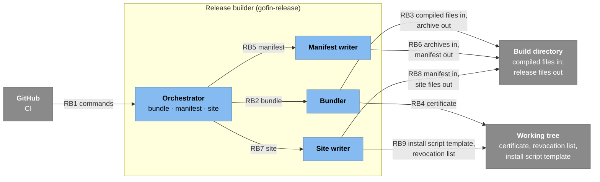
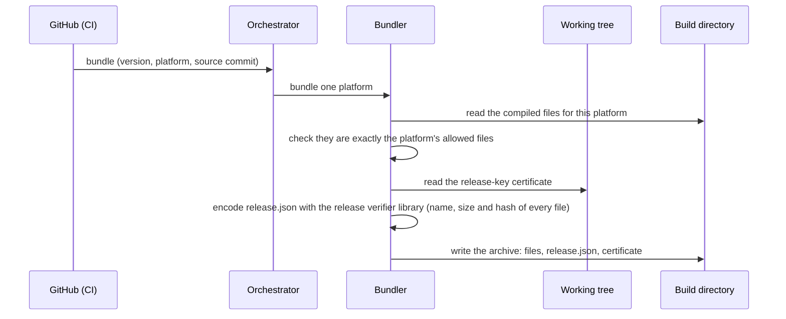
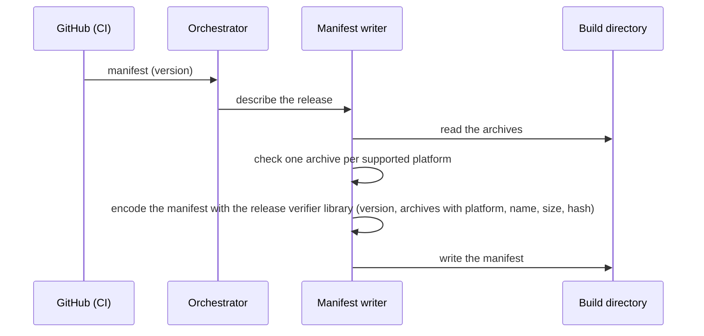
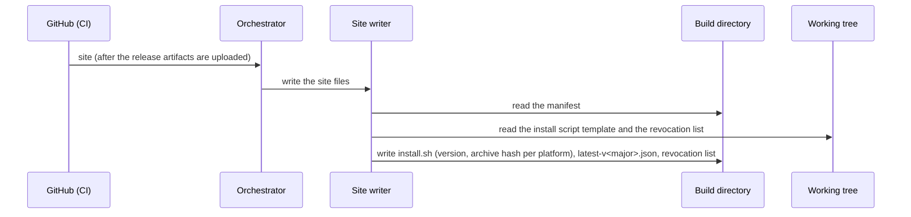

# C4 level 3: release builder components

- Status: agreed
- Date: 2026-11-12

Components of the release builder (`release_builder` in [02-containers.md](02-containers.md)): `gofin-release`, an internal Rust command-line tool used by CI to prepare a release. It holds no keys and is never shipped to users. The order in which CI uses it is the release flow in [02-containers.md](02-containers.md#release); formats are in [04-release-verifier.md](04-release-verifier.md).

## Components

### Elements

| ID | Type | Name | Responsibility |
| --- | --- | --- | --- |
| `rb_orchestrator` | Component | Orchestrator | The binary's entry point: parses the command (`bundle`, `manifest`, `site`) and runs it. Never prompts. |
| `rb_bundler` | Component | Bundler | For one platform: writes `release.json` (version, platform, source commit, and the name, size and hash of every file), adds the current release-key certificate (the one with the highest serial), and packs the archive with only allowed entries. The certificate is a public file read from the repository checkout; it is neither built into the release builder nor passed as a secret. |
| `rb_manifest_writer` | Component | Manifest writer | Hashes every archive and writes the manifest: the release version and, per platform, the archive's name, size and hash. |
| `rb_site_writer` | Component | Site writer | Writes the site files: the bootstrap install script with the release version and each platform archive's hash, the latest-release pointer for the major version, and a copy of the committed revocation list. |
| `repo_files` | External | Working tree | The release checkout: committed certificate, revocation list and the install script template. |
| `build_dir` | External | Build directory | The CI job's directory: compiled files go in; archives, the manifest and site files come out for CI to sign and upload. |

### Libraries

Shared code built into the components above; not components themselves.

| ID | Library | Used by | For |
| --- | --- | --- | --- |
| `lib_verifier` | Release verifier library | Bundler, Manifest writer, Site writer | Encoding `release.json` and the manifest, and reading the manifest for the site files ([04-release-verifier.md](04-release-verifier.md)); the release builder uses no signing or verification code. |

### Relationships

| ID | From | To | What flows |
| --- | --- | --- | --- |
| RB1 | `github` | `rb_orchestrator` | `bundle` per platform, `manifest`, `site`, in the release workflow |
| RB2 | `rb_orchestrator` | `rb_bundler` | Describe and pack one platform bundle |
| RB3 | `rb_bundler` | `build_dir` | Reads one platform's compiled files; writes its archive |
| RB4 | `rb_bundler` | `repo_files` | Committed release-key certificate |
| RB5 | `rb_orchestrator` | `rb_manifest_writer` | Describe the release's archives |
| RB6 | `rb_manifest_writer` | `build_dir` | Reads the archives; writes the manifest |
| RB7 | `rb_orchestrator` | `rb_site_writer` | Install script and pointer |
| RB8 | `rb_site_writer` | `build_dir` | Reads the manifest; writes the install script, pointer and revocation list copy |
| RB9 | `rb_site_writer` | `repo_files` | Install script template and the committed revocation list |

## Flows

CI runs the commands in this order: `bundle` once per platform, `manifest`, then (after the signing tool signs the manifest) `site`. Every command writes its outputs under a temporary name and renames them into place only on success, so a failed command leaves no partial file, and any failure exits non-zero and stops the release workflow.

### bundle

1. The allowed files per platform are fixed in the release builder; a missing or unexpected file stops the release.
2. The archive holds only regular files with fixed permissions, no links.

### manifest

1. The manifest is written once and then signed by the signing tool over its exact bytes; nothing rewrites it afterwards.

### site

1. Archive hashes come from the manifest, so the install script pins exactly what the signed manifest lists.

## Decisions

| Decision |
| --- |
| Release files are prepared by the release builder, which holds no keys and is built on the release verifier library, so the installer reads exactly the formats the release builder writes. |
