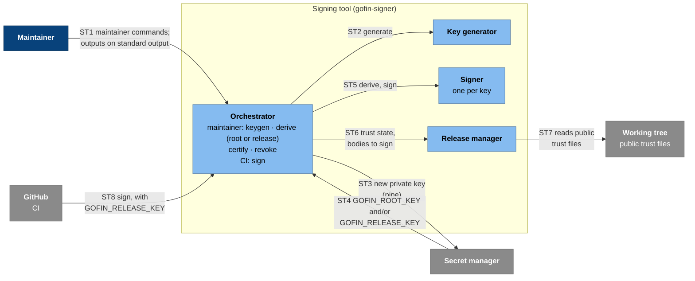
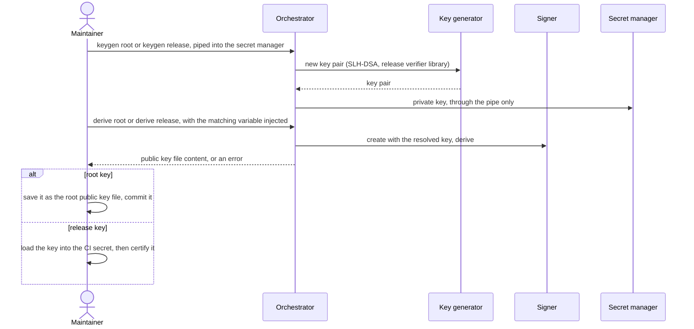
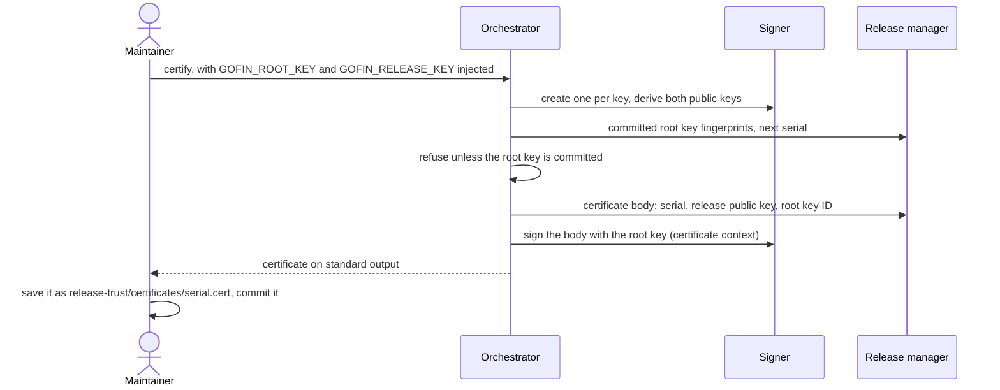
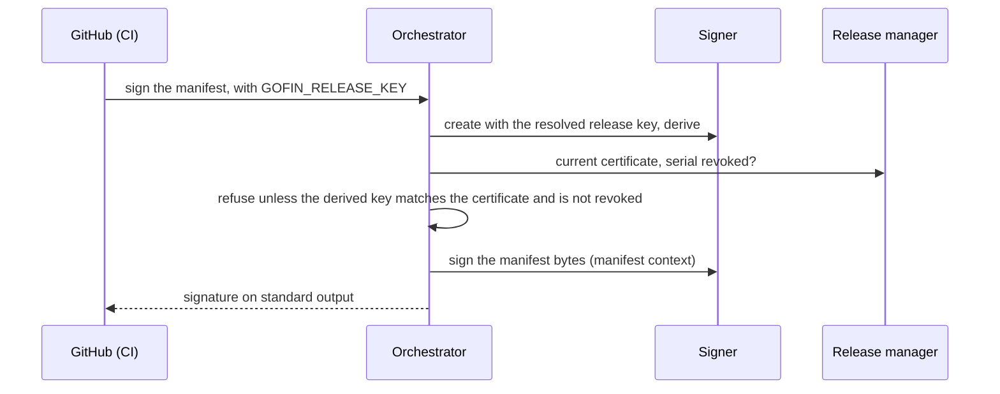

# C4 level 3: signing tool components

- Status: agreed
- Date: 2026-11-12

Components of the signing tool (`signing_tool` in [02-containers.md](02-containers.md)): `gofin-signer`, an internal Rust command-line tool that acts only as a signing device. The maintainer runs it for key ceremonies; CI runs it to sign a manifest the release builder prepared. It is never shipped to users. Formats and the library's functions are in [04-release-verifier.md](04-release-verifier.md); release preparation is in [03-components-release-builder.md](03-components-release-builder.md).

## Components



### Elements

| ID | Type | Name | Responsibility |
| --- | --- | --- | --- |
| `st_orchestrator` | Component | Orchestrator | The binary's entry point: parses the command, and for `keygen` and `derive` the key role (`root` or `release`), and runs its flow. The only component that deals with the environment and standard streams. The command and role decide which stable environment variables it expects: `GOFIN_ROOT_KEY` for a root key, `GOFIN_RELEASE_KEY` for a release key (`derive root`, `derive release`, `revoke` and `sign` take one; `certify` takes both). It reads each variable, removes it from its environment so no child process inherits it, and creates a Signer per key. Exports a newly generated private key once, as text on standard output, only when standard output is a pipe; refuses a terminal or a file. Prints every other output (public key, certificate, revocation list, signature) on standard output. Makes the comparisons a flow needs. Never prompts. |
| `st_key_generator` | Component | Key generator | Generates SLH-DSA-SHA2-192s key pairs with the release verifier library. |
| `st_signer` | Component | Signer | Holds one resolved private key, root or release (both use the same scheme), and keeps it only in memory. Validates the key when created, then offers `derive` (the public key and its fingerprint) and `sign` (exact bytes, with the context string for the object type), both through the release verifier library. Knows nothing about files or releases. |
| `st_release_manager` | Component | Release manager | Reads the public trust files in the working tree: root public keys, certificates and the revocation list. Works out the next key serial and revocation-list version (1 for the first of each), encodes certificate and revocation-list bodies for signing with the release verifier library, and provides the current release-key certificate and whether its serial is revoked. Never writes to the working tree. |
| `repo_files` | External | Working tree | The repository checkout holding the public trust files, which the maintainer adds and commits. |

### Libraries

Shared code built into the components above; not components themselves.

| ID | Library | Used by | For |
| --- | --- | --- | --- |
| `lib_verifier` | Release verifier library | Key generator, Signer, Release manager | All release cryptography and formats: SLH-DSA key generation, public-key derivation and signing with context strings (key handling, built only into this tool), and decoding and encoding public key files, certificates and revocation lists ([04-release-verifier.md](04-release-verifier.md)). |

### Relationships

| ID | From | To | What flows |
| --- | --- | --- | --- |
| ST1 | `maintainer` | `st_orchestrator` | `keygen root`, `keygen release`, `derive root`, `derive release`, `certify`, `revoke`: once to set up release trust, and afterwards only to rotate or revoke a key; never per release. Outputs come back on standard output for the maintainer to save and commit. |
| ST2 | `st_orchestrator` | `st_key_generator` | Generate a key pair |
| ST3 | `st_orchestrator` | `secret_manager` | A new private key, through a pipe into the secret manager's command-line tool |
| ST4 | `secret_manager` | `st_orchestrator` | The root key in `GOFIN_ROOT_KEY` and the release key in `GOFIN_RELEASE_KEY`, as the command and role require, injected for one `derive`, `certify` or `revoke` command |
| ST5 | `st_orchestrator` | `st_signer` | Create a Signer with a resolved key; `derive`, `sign` |
| ST6 | `st_orchestrator` | `st_release_manager` | Committed root key fingerprints, the next serial or list version, certificate and revocation-list bodies to sign, the current certificate and its revocation status |
| ST7 | `st_release_manager` | `repo_files` | Reads root public keys, certificates and the revocation list |
| ST8 | `github` | `st_orchestrator` | `sign` on the manifest the release builder wrote, with the release key in `GOFIN_RELEASE_KEY` from the CI secret |

## Public trust files

The maintainer commits these under `release-trust/` in the repository, saving them from the signing tool's output; the signing tool never writes to the repository. They are public; nothing here is secret. There is no root certificate: root public keys are trusted because the installer embeds them.

| Path | Content | Saved from |
| --- | --- | --- |
| `root-keys/<fingerprint>.pub` | A root public key file ([format](04-release-verifier.md#types)), named by its fingerprint: normally one file, two during a root-key rotation. The installer embeds every file here at build time. | `gofin-signer derive root` |
| `certificates/<serial>.cert` | A release-key certificate; it contains the release public key, so no release public key file is kept. The release builder puts the current one into every archive. | `gofin-signer certify` |
| `revocation-list` | The current revocation list; earlier versions live in the repository history. The installer embeds it at build time; the release builder publishes a copy with the site files. | `gofin-signer revoke` |

The Release manager also checks that a root public key file's name matches its fingerprint and a certificate file's name matches its serial.

## Flows

Manifest signing in a release is part of the release flow in [02-containers.md](02-containers.md#release); its inside is shown below. The signing tool is run from the repository root: the Release manager reads `release-trust/` from the current directory, so serials, versions and root-key checks are always against the maintainer's local working tree. The examples use 1Password's command-line tool (`op`) and the GitHub command-line tool (`gh`); the `.env` files hold only secret references and are the maintainer's own files, kept outside the repository.

### Set up release trust

Done once, in this order; each step is a flow below:

1. Generate the root key, and commit its public key file.
2. Create the first revocation list: `revoke` with no serial writes version 1 with no revoked serials. Commit it.
3. Generate the release key and load it into the CI secret.
4. Certify the release key, and commit the certificate.

```sh
op run --env-file=root-key.env -- gofin-signer revoke > release-trust/revocation-list
```

### Generate a key (root or release)



1. The private key never appears on disk, in shell history, on screen or in the clipboard: it exists only in the pipe between the signing tool and the secret manager's command-line tool. If that command fails, nothing has used the key yet; the maintainer runs `keygen` again.
2. `derive` reads the stored key, so what the maintainer commits (the root public key, or the certificate made from the derived release public key) is by construction for the key in the secret manager. An error from `derive` means the key was not stored correctly.
3. The secret manager is the release key's backup: the maintainer can reload the CI secret or derive its public key at any time.

```sh
# Generate a key and store it; the private key passes only through the pipe.
gofin-signer keygen root \
  | jq -R '{title: "gofin-root-key", category: "PASSWORD",
            fields: [{id: "password", type: "CONCEALED", purpose: "PASSWORD", value: .}]}' \
  | op item create --vault gofin-release -

# root-key.env:   GOFIN_ROOT_KEY=op://gofin-release/gofin-root-key/password
# both-keys.env:  GOFIN_ROOT_KEY=op://gofin-release/gofin-root-key/password
#                 GOFIN_RELEASE_KEY=op://gofin-release/gofin-release-key/password

# Root key: save the output as release-trust/root-keys/<fingerprint>.pub and commit it.
op run --env-file=root-key.env -- gofin-signer derive root

# Release key: generate it the same way with `keygen release` as item gofin-release-key,
# then load it into the CI secret and certify it (below).
op read op://gofin-release/gofin-release-key/password | gh secret set GOFIN_RELEASE_KEY --env release
```

### Certify a release key



1. The next key serial is one more than the highest serial among the certificates in the working tree's `release-trust/certificates/` (1 for the first). The maintainer saves the certificate under that serial.
2. `certify` refuses a root key whose fingerprint is not a committed root public key, so a certificate can only name a root key that installers embed. Both checks are against the local working tree, which is why the signing tool runs from the repository root.
3. Releases from then on ship the new certificate. An installation raises its accepted serial when it installs the first release signed with the new key, and refuses older keys after that. No new installer is needed for a release-key rotation.

```sh
op run --env-file=both-keys.env -- gofin-signer certify > release-trust/certificates/<serial>.cert
```

### Sign a manifest (CI)



1. Signing refuses if the key does not match the current certificate or its serial is revoked, so CI cannot publish a release that installers would reject for those reasons.
2. CI saves the signature as `manifest.sig` next to the manifest in the build directory; CI uploads both, with the certificate, to the release artifacts, where the installer fetches them.

### Rotate a release key

Rotation is the generate and certify flows above: a new release key, loaded into the CI secret, and a certificate with the next serial. The old key is not revoked; installations stop accepting it once they install a release signed with the new key.

### Revoke a release key

Revocation goes out with a release signed by a new release key:

1. `revoke` with the leaked key's serial and the root key injected prints the next revocation list version: every serial already on the current list plus the new one. The maintainer saves it as `release-trust/revocation-list`. With no serial, `revoke` prints the next version with the serials unchanged: the first, empty list at setup, and the list signed again in a root-key rotation.
2. The maintainer rotates the release key as above (new key, CI secret, certificate) and commits the revocation list and the certificate together.
3. The maintainer starts a release. The installer built for it embeds the new list, and CI publishes it to the release site with the release. Every `check` and `update` fetches the list from the release site, so installations reject the leaked key at their next check, then update to the release signed with the new key.

Until that release is published, installations still accept the leaked key, so the maintainer starts it right away.

```sh
op run --env-file=root-key.env -- gofin-signer revoke <serial> > release-trust/revocation-list
```

### Rotate the root key

1. The maintainer generates a new root key as above, under a new item name, and commits its public key file next to the old one.
2. Overlap: for a period the maintainer chooses, every release ships an installer that embeds both root keys. Release keys are still certified, and revocation lists still signed, by the old root key, so every installation keeps verifying releases.
3. After the overlap, release keys are certified by the new root key and the revocation list is signed again with it (`revoke` with no serial); the root key ID in each certificate and list selects which embedded key verifies it.
4. Later, the old root public key file is removed and releases ship an installer that embeds only the new root key.

An installation that installed no release during the overlap has only the old root key and cannot verify later releases. It recovers by rerunning the bootstrap installer, which relies on the pinned archive hash, not on signatures.

A compromised root key cannot be revoked through the revocation list, because the attacker could sign lists too. Recovery is a release whose installer drops the compromised root key; until an installation installs it, the installation trusts the attacker's certificates. Root-key custody is therefore the scheme's most important control.

## Decisions

| Decision |
| --- |
| The signing tool is only a signing device: key generation, public-key derivation, certification, revocation and signing exact bytes it is given. Preparing release files is the release builder's job. |
| `keygen` and `derive` take the key role (`root` or `release`) as an argument. The command and role alone decide which stable environment variables the signing tool expects: `GOFIN_ROOT_KEY` (`derive root`, `revoke`), `GOFIN_RELEASE_KEY` (`derive release`, `sign`), or both (`certify`). Private keys reach it only through these variables, both for the maintainer (injected by the secret manager) and in CI (from the CI secret). The Orchestrator reads the variable, removes it from its environment and hands the resolved key to a Signer, which keeps it only in memory. |
| One Signer component serves both key kinds, since root and release keys use the same scheme; the Orchestrator creates one per key. The Signer only derives and signs; the Orchestrator makes any comparison. |
| A new private key leaves the signing tool only once, as text on standard output, and only when standard output is a pipe; the maintainer pipes it straight into the secret manager. It never touches disk, shell history, the screen or the clipboard. |
| The secret manager holds both private keys; the maintainer loads the release key into the CI secret from it through a pipe, and never makes the secret manager available to CI. |
| The signing tool never writes to the working tree: `derive`, `certify`, `revoke` and `sign` print their output, and the maintainer saves and commits it. |
| Key serials and revocation-list versions are derived from the public trust files in the local working tree, so the repository is the single record of what has been issued; the signing tool runs from the repository root. |
| A revocation list always exists: `revoke` with no serial creates the first, empty one at setup, so every verifier follows one path. |
| A revocation is published with the release signed by the new release key, not on its own. |
| The signing tool never prompts. |
