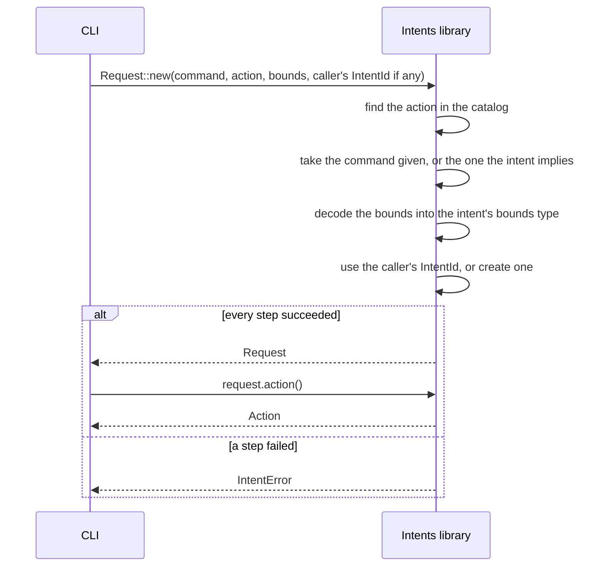
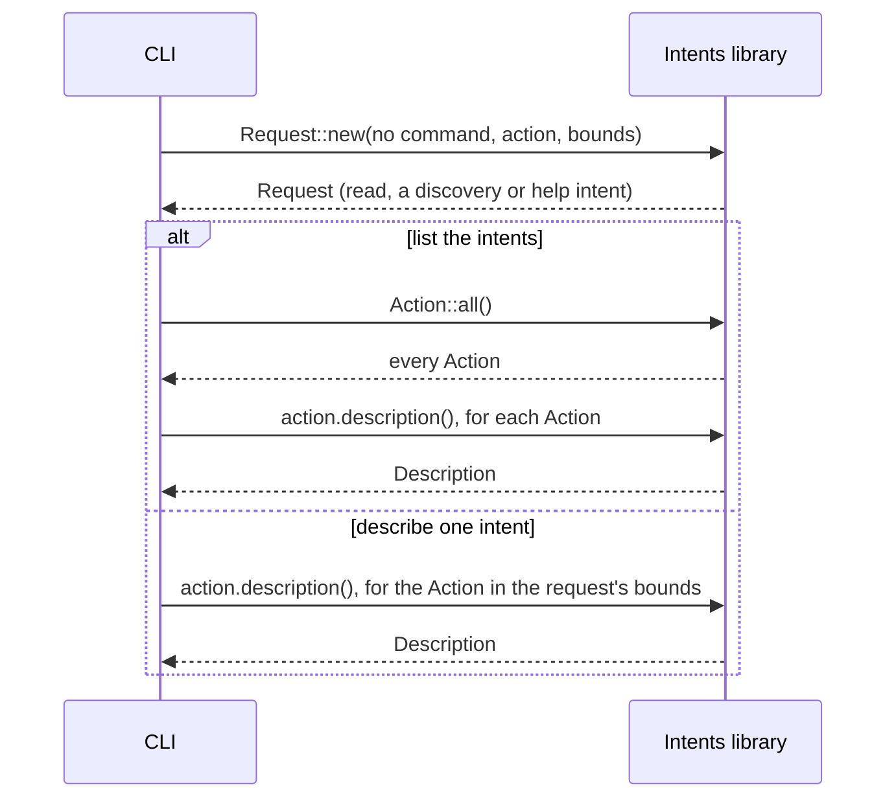

# C4 level 4: intents library

- Status: agreed — first version; extended by the broker and the admin binary
- Date: 2026-11-17

Code-level view of the intents library (`lib_intents`): the intents catalog and the shapes every intent shares. It is built into the CLI, the broker and the admin binary, so parsing, help, schemas and validation all come from the same definitions. This version covers what the [CLI](03-components-cli.md#libraries) needs; the broker and the admin binary add to it when their level 3 documents are written.

The library defines what an intent is and what comes back. It does not say how any intent is carried out or which container does it: it contains no venue code, reaches no external system and holds no secrets.

The catalog is compiled into the library. There is no catalog file to install, load or verify, and every binary of a release carries the same catalog.

## One intent

An intent definition is one Rust type that names two others: the type of the intent's bounds and the type of its outcome. Everything else in the definition is a constant.

```rust
/// The bounds of a swap. Shared by every intent that swaps this way.
pub struct SwapBounds {
    pub input_account: Account,            // required bound
    pub input_asset: Asset,                // required bound
    pub input_amount: Amount,              // required bound
    pub output_asset: Asset,               // required bound
    pub output_account: Account,           // required bound
    pub min_output_amount: Option<Amount>, // additional bound
}

/// Swap one asset for another on Uniswap.
pub struct UniswapSwap;

impl IntentDefinition for UniswapSwap {
    type Bounds = SwapBounds;
    type Outcome = ExecutionOutcome<SwapResult>;

    const ACTION: &'static str = "uniswap.swap";
    const COMMANDS: Commands =
        Commands::Written(&[
            Command::Preview,
            Command::Execute,
            Command::Continue,
            Command::Observe,
        ]);
    const PRIVILEGE: Privilege = Privilege::ExecutionAuthorization;
    const SUMMARY: &'static str = "Swap one asset for another on Uniswap.";
    const CHECKS: &'static [&'static str] = &[
        "The input account holds the input amount.",
        "The quoted output is at least the minimum output amount.",
    ];
}
```

The bounds and checks shown are an illustration; each intent's bounds and checks are agreed when the intent is defined.

## The catalog

The catalog is one list of definitions, given to `intents!`, a declarative macro (`macro_rules!`) defined in the library.

```rust
intents! {
    UniswapSwap,
    SushiSwap,
    BinanceWithdraw,
    // one line per intent
}
```

The macro repeats each name once per enum, so the list above expands to:

```rust
pub enum Action {
    UniswapSwap,
    SushiSwap,
    BinanceWithdraw,
}

pub enum Intent {
    UniswapSwap(<UniswapSwap as IntentDefinition>::Bounds),         // SwapBounds
    SushiSwap(<SushiSwap as IntentDefinition>::Bounds),             // SwapBounds
    BinanceWithdraw(<BinanceWithdraw as IntentDefinition>::Bounds), // WithdrawBounds
}

pub enum Outcome {
    UniswapSwap(<UniswapSwap as IntentDefinition>::Outcome),
    SushiSwap(<SushiSwap as IntentDefinition>::Outcome),
    BinanceWithdraw(<BinanceWithdraw as IntentDefinition>::Outcome),
}
```

It also writes the few functions that need one arm per intent: finding the `Action` for a text such as `uniswap.swap` and printing it back (both from each definition's `ACTION`), decoding the bounds for an action into the right `Intent` variant, and building an action's `Description`. An intent is therefore added by writing its definition and adding one line; nothing else in the library changes. A test in the library checks that no two definitions share an `ACTION`.

## Types

| Type | Purpose | Fields |
| --- | --- | --- |
| `IntentDefinition` (trait) | Implemented once per intent, by a type with no fields such as `UniswapSwap`. The implementation is the intent definition. Its facts are constants of the definition, not fields of a value, so no code can build a swap that claims another privilege. | Types `Bounds` and `Outcome`; constants `ACTION` (the action as text), `COMMANDS`, `PRIVILEGE`, `SUMMARY` (one sentence saying what the intent does) and `CHECKS` (one sentence for each thing GoFin verifies before it asks for authorization). `SUMMARY` and `CHECKS` are text for discovery only; no code acts on them. |
| Bounds types, for example `SwapBounds` | A plain struct holding the bounds of an intent. A required bound is a plain field; an additional bound is an `Option`. Intents with the same bounds share one type. | The bounds, as public fields |
| `Action` | The identifier of an intent, written `<venue>.<verb>`, for example `uniswap.swap`. An enum without fields, generated from the catalog list. | One variant per intent |
| `Intent` | Any one intent: its action together with its bounds. This enum is the catalog as a type: a container that carries out intents matches on it without a catch-all arm, and the compiler then refuses to build until every intent is handled. | One variant per intent, holding that definition's `Bounds` |
| `Outcome` | Any one intent's outcome. | One variant per intent, holding that definition's `Outcome` |
| `Command` | What the caller asks GoFin to do with the intent. | `Read`, `Preview`, `Execute`, `Continue`, `Observe` |
| `Commands` | The commands an intent accepts, and whether the caller writes one. | `Written(commands)`: the command line names one of them. `Implied(command)`: the intent has one command and the command line names none. |
| `Privilege` | What an intent requires to be executed. | `None`, `ExecutionAuthorization`, `SystemAuthorization` |
| `Description` | An intent definition as data, for discovery and help. Built from the definition's constants and from the schemas of its bounds and outcome types. Those types derive their schema (`schemars::JsonSchema`), with each field's doc comment as its meaning, so a description cannot disagree with the types. | Action, summary, commands, privilege, bounds (name, type, required or additional, meaning), outcome schema, checks |
| `IntentId` | The identity of one submitted intent. The caller may choose it; otherwise the library creates a random one. | — |
| `Request` | What the CLI sends to the responsible container. | `IntentId`, `Command`, and the `Intent`. A `continue` or `observe` request carries only the `Action` in place of the intent. |
| `Response` | What comes back. | `IntentId`, `Action`, and `Result<Outcome, IntentError>` |
| `ExecutionOutcome<R>` | The outcome shape execution intents share, so a caller reads every execution the same way, plus the result details `R` of the particular intent (for a swap: the amounts in and out and the fees). | Not designed yet: the stages an execution intent goes through and what is reported about each. Plus the details `R`. |
| `IntentError` | Why an intent was not carried out: the command line could not be decoded, the intent was refused, or no response arrived. | Code, message, next action |

Value types such as `Account`, `Asset`, `Network` and `Amount` are not defined here. They come from the domain types library (`lib_domain_types`), which the broker and its integrations use as well.

How the commands apply:

- An information intent accepts only `read`. Its outcome is its own type, for example a list of balances.
- An execution intent accepts `preview`, `execute`, `continue` and `observe`.
- `execute` always starts a new intent and always carries its bounds. An identity already in use is refused by the responsible container.
- `continue` goes on with an intent submitted earlier, and `observe` returns its current outcome. Both requests carry that intent's action and identity and no bounds. Because the caller names the action, the outcome type is known from the definition: it is the type `execute` returns. An outcome that is not final says so, with what is known so far.
- Dismissing a submitted intent, and listing the submitted intents that are not final, are intents of their own in the catalog, each with its own outcome type.
- Discovery and system intents have exactly one command, which is implied.

## Encoding

Everything is JSON in UTF-8, written by the types themselves (`serde`). Amounts are decimal strings, never JSON numbers. A bound the intent does not define is an error, never ignored, so a misspelled additional bound cannot silently disappear.

```json
{"id":"01JCQ7…","command":"execute","intent":{"action":"uniswap.swap","bounds":{"input_account":"base:main","input_asset":"USDC","input_amount":"250","output_asset":"WETH","output_account":"base:main"}}}
{"id":"01JCQ7…","command":"continue","action":"uniswap.swap"}
{"id":"01JCQ7…","command":"observe","action":"uniswap.swap"}
{"id":"01JCQ7…","action":"uniswap.swap","outcome":{"…":"…"}}
{"id":"01JCQ7…","action":"uniswap.swap","error":{"code":"…","message":"…","next_action":{"…":"…"}}}
```

`Request`, `Response` and the types inside them implement `Serialize` and `Deserialize`, so writing one as JSON text or reading it back is one `serde_json` call by the component that holds it. Bounds and outcome types derive them. For `Intent`, `Outcome`, `Request` and `Response` they are written by the macro and the library, not derived: the `action` key holds the definition's `ACTION` text and selects the type the `bounds` or the `outcome` is read as. Reading a `Request` from JSON applies the same form checks as `Request::new`. The library opens no connection and reads no stream: how a message travels, and how messages are kept apart on the way, belongs to the components that send and receive it. `--json` output carries a response in this encoding.

A caller gives bounds in one of two forms, and both decode into the same bounds type. Under `--json` the bounds are one JSON object, as in the first line above. Otherwise each bound is a flag. A bound has one name, the field's name, used as its flag and as its JSON key.

## Functions

| Function | Purpose | Inputs | Output | Used in |
| --- | --- | --- | --- | --- |
| `Request::new()` | Builds a request from what the Orchestrator took off the command line. Finds the action in the catalog, takes the command (the one given, or the one the intent implies) and decodes the bounds into that intent's bounds type. Uses the caller's `IntentId` when given and creates one otherwise; `continue` and `observe` need the identity of the intent submitted earlier and take no bounds. Checks form only: a known action, a command the intent accepts, required bounds present, well-formed values, no unknown bounds. | The command, when the caller wrote one; the action as text; the bounds, as flag words or as one JSON object; an `IntentId` when the caller chose one | `Result<Request, IntentError>` | [Build a request](#build-a-request), [Describe](#describe-intents) |
| `Request::action(&self)` | The action of the request's intent. | — | `Action` | [Build a request](#build-a-request) |
| `Action::description(self)` | The intent definition as data. | — | `Description` | [Describe](#describe-intents) |
| `Action::all()` | Every action in the catalog, in catalog order. | — | An iterator of `Action` | [Describe](#describe-intents) |

## Flows

### Build a request



1. The words passed in are what is left of the command line after the caller's options and the command word.
2. The bounds arrive as flag words or as one JSON object. Both decode into the same bounds type.
3. For `continue` and `observe` there are no bounds to decode, and the identity of the intent submitted earlier is required.
4. An `IntentError` names the step that failed: an unknown action, a command the intent does not accept, a missing required bound, a malformed value or an unknown bound.

### Describe intents



## Decisions

| Decision |
| --- |
| The catalog is compiled into the library as the `Intent` enum. Nothing is loaded at run time, so the catalog cannot be missing, stale or tampered with separately from the binaries. |
| An intent definition is one implementation of `IntentDefinition`, naming the intent's bounds type and outcome type. Adding an intent means writing that implementation and adding one line to the catalog list. Intents with the same bounds or the same outcome share those types. |
| The `Action`, `Intent` and `Outcome` enums and the functions with one arm per intent are generated from the one catalog list by a declarative macro, so an intent is never listed twice. |
| A definition never says how the intent is carried out. The responsible container matches on `Intent` without a catch-all arm, so the compiler names every place a new intent still has to be handled. |
| A definition does not name its responsible container. Only the CLI needs that, to route a request, so it is the CLI's table: a match on `Action` with an arm for every intent, so the compiler refuses to build the CLI while an intent has no container. |
| A definition does name the privilege the intent needs. Discovery shows it to the caller, and the container that executes the intent enforces it from the definition, not from anything the CLI sent. |
| A request carries its command (`read`, `preview`, `execute`, `continue` or `observe`). The library checks only that the intent accepts the command; what the command means for that intent is the responsible container's knowledge. |
| A `Request` that exists is well-formed, whether `Request::new` built it or it was read from JSON: both apply the same form checks, so the broker never accepts a request the CLI would refuse. The library checks form only; whether an intent is allowed or possible is checked by its responsible container. |
| Everything is encoded as JSON, by `serde` on the types; descriptions and schemas are derived from the same types. `--json` output must be JSON, the approval helper is written in another language, and messages are small and rare, so a second, binary encoding would add a format to keep in step and save nothing a caller would notice. |
| The library does no input or output. It turns its types into JSON text and back; the components that hold a connection carry the text. |
