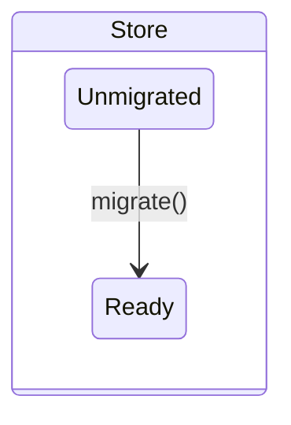
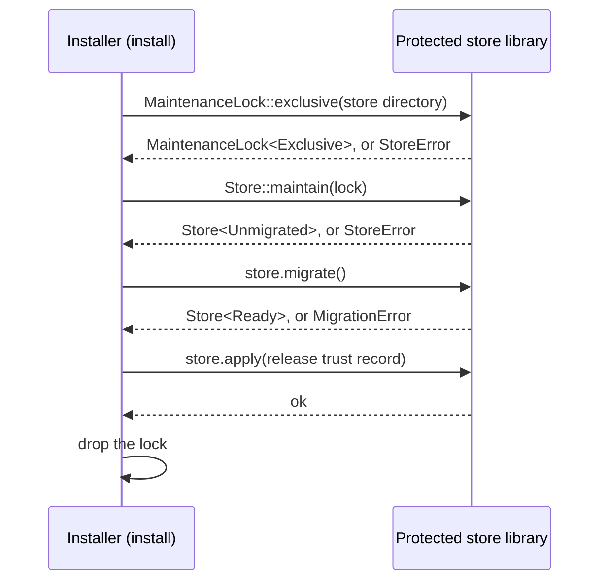
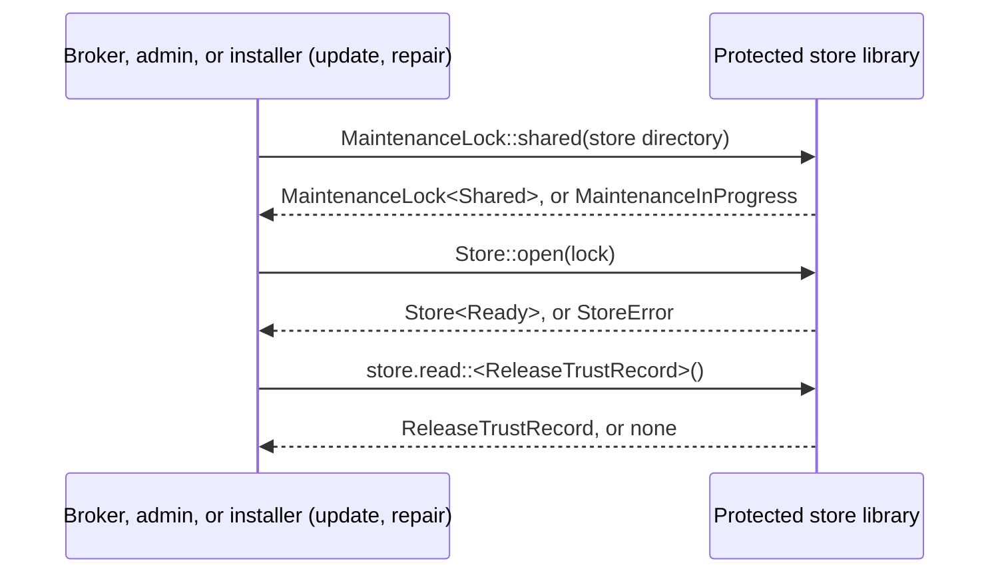
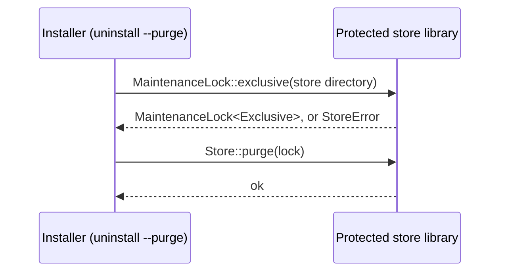

# C4 level 4: protected store library

- Status: agreed
- Date: 2026-11-13

Code-level view of the protected store library (`lib_store`), the only code that touches the protected store (`store` in [02-containers.md](02-containers.md)). This version covers the store's lifecycle and what the installer keeps in it; the tables and functions of the broker and the admin binary are added when their level 3 documents are written. Which components use the library is in each container's level 3 document, starting with the [installer](03-components-installer.md#libraries).

## Files

```
store/                    root, 700
├── gofin.db              the one SQLite database (with its -wal and -shm files)
└── maintenance.lock      empty file; carries the maintenance lock
```

The database is opened in WAL mode with foreign keys on and full synchronous writes. Its SQLite `application_id` is set to GoFin's own value, so the library can tell its database from any other file.

## Types

| Type | Purpose | Fields |
| --- | --- | --- |
| `MaintenanceLock<Mode>` | An operating-system file lock on `maintenance.lock` that separates normal use from maintenance. `MaintenanceLock<Shared>` holders use the store; the one `MaintenanceLock<Exclusive>` holder changes it. The mode is part of the type, so the compiler refuses maintenance under a shared lock. The operating system releases the lock when the holder exits, even after a crash. | Lock file |
| `Migration` | One numbered, named change to the schema or data, built into the library. Numbers are sequential; a released migration is never changed, later releases only append. | Number, name, step (SQL or code that runs inside the migration's transaction) |
| `MigrationRecord` | One row of the migration journal: proof that a migration was fully applied. The schema version is the highest number in the journal. | Number, name, applied at, applied by (GoFin version) |
| `Store<State>` | The open database. `Unmigrated` when opened with `maintain`, whatever its schema version; `Ready` once its schema version is exactly the one this build expects. Only a ready store gives access to data. | Connection, schema version |
| `StoreRecord` (trait) | Implemented for each domain type kept in the store: the type itself knows how it is loaded and how it is persisted. The store calls both inside a transaction it opens and commits. | `load(transaction, key)`, `persist(&self, transaction)` |
| `ReleaseTrustRecord` | What the installation remembers about release keys ([release verifier library](04-release-verifier.md#types)). Stored as one row; implements `StoreRecord`. | Highest accepted key serial; newest revocation list, as its exact signed bytes |
| `StoreError` | Why a store cannot be used, so the caller can tell the human what to do. | `MaintenanceInProgress`, `NotInitialized`, `NeedsMigration` (found, expected), `NewerSchema` (found, expected), `Unrecognized` |

Tables in this version:

| Table | Holds |
| --- | --- |
| `schema_migrations` | The migration journal: one `MigrationRecord` per applied migration |
| `release_trust_record` | The single `ReleaseTrustRecord` row |

## Typestates



`Store::open` returns a ready store directly, or a `StoreError`; it never migrates. `Store::maintain` returns an unmigrated store, which only `migrate()` turns into a ready one.

## Functions

| Function | Purpose | Inputs | Output | Used in |
| --- | --- | --- | --- | --- |
| `MaintenanceLock::shared()` | Takes the lock for normal use. Fails at once while maintenance holds it. | Store directory | `Result<MaintenanceLock<Shared>, StoreError>` (`MaintenanceInProgress`) | [Normal use](#normal-use) |
| `MaintenanceLock::exclusive()` | Takes the lock for maintenance, waiting up to a timeout for shared holders to finish. | Store directory | `Result<MaintenanceLock<Exclusive>, StoreError>` | [Install and update](#install-and-update), [Purge](#purge) |
| `Store::open()` | Opens the store for normal use. Succeeds only when the schema version is exactly the expected one. | A lock in either mode | `Result<Store<Ready>, StoreError>` | [Normal use](#normal-use) |
| `Store::maintain()` | Opens the store for maintenance by the installer, creating the directory and an empty database when there is none. Refuses a database that is not GoFin's or has a newer schema. | `MaintenanceLock<Exclusive>` | `Result<Store<Unmigrated>, StoreError>` | [Install and update](#install-and-update) |
| `Store<Unmigrated>::migrate(self)` | Applies every pending migration in order. Each runs in its own transaction, which also writes its journal row, so a migration is applied fully or not at all. Stops at the first failure and keeps what was applied. | — | `Result<Store<Ready>, MigrationError>`; the error names the failed migration and those applied in this run | [Install and update](#install-and-update) |
| `Store<Ready>::read::<T>(&self, ...)` | Loads one domain value by calling its `StoreRecord::load` inside a read transaction. | Key (none for single-row types) | `Result<Option<T>, StoreError>` | [Normal use](#normal-use) |
| `Store<Ready>::apply(&self, ...)` | Writes one or more domain values by calling each one's `StoreRecord::persist` inside one transaction, so they are stored together or not at all. | One or more `StoreRecord` values | `Result<(), StoreError>` | [Install and update](#install-and-update), [Normal use](#normal-use) |
| `Store::purge()` | Removes the database and its files. | `MaintenanceLock<Exclusive>` | `Result<(), StoreError>` | [Purge](#purge) |

## Flows

### Install and update

A fresh install, an update and the resumption of an interrupted one are the same calls: a new database has no journal, so every migration is pending; after an interruption, only the unapplied ones are.



1. A `MigrationError` with no migration applied in this run means the store is unchanged, so the installer may switch back to the previous version. Once one is applied, the store has moved forward and only a newer or equal version can open it.
2. Running the flow again resumes from the first pending migration.

### Normal use



1. `NeedsMigration` and `NotInitialized` tell the human to run `gofin repair`; `NewerSchema` tells them to run `gofin update`; `MaintenanceInProgress` tells them an install is running.
2. Shared holders coordinate with each other through database transactions, not through the lock.
3. `update` and `repair` use this flow to read the release trust record and, with `store.apply(...)`, to store a newer revocation list before the new release's install takes over.

### Purge



## Decisions

| Decision |
| --- |
| The migration journal is the only record of the schema version. A migration and its journal row commit in one transaction, so the journal never disagrees with the schema. |
| Migrations are numbered sequentially, built into the library and forward-only. A released migration is never edited; a release only appends migrations. |
| Only the installer migrates, under the exclusive maintenance lock. Every other open requires the exact expected schema version and otherwise fails with an error that names the command to run. |
| The maintenance lock is shared by every process using the store and exclusive for the installer while it changes files and schema. It is an operating-system file lock, so a crashed process never leaves it held. Its mode is part of its type, so only code holding the exclusive lock can call `maintain` or `purge`. |
| The database identifies itself with a SQLite `application_id`; a file without it is never opened or migrated as GoFin's. |
| The store has no getter or setter per kind of data. Domain types implement `StoreRecord` (`load` and `persist`), and the store offers only `read` and `apply`, which run them inside a transaction the store controls. |
| The implementations of `StoreRecord` live in this library, next to the migrations that define the tables they use, and receive a transaction rather than the connection. Containers therefore never write SQL or hold a database connection, and every `apply` is atomic. |
| This document grows with the containers: each container's tables and functions are added when its level 3 document is written. |
