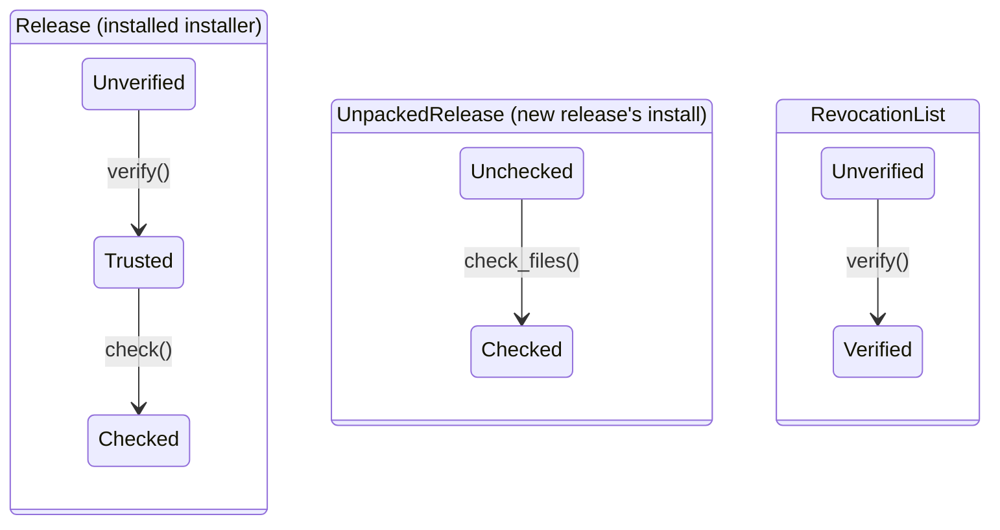
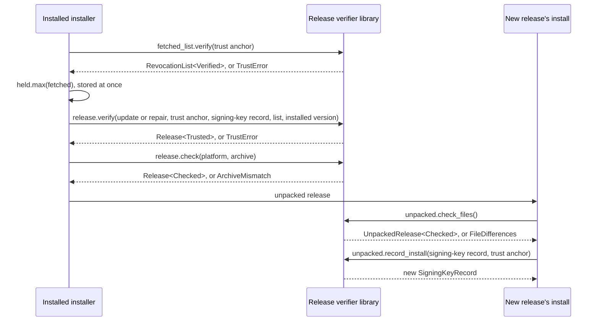
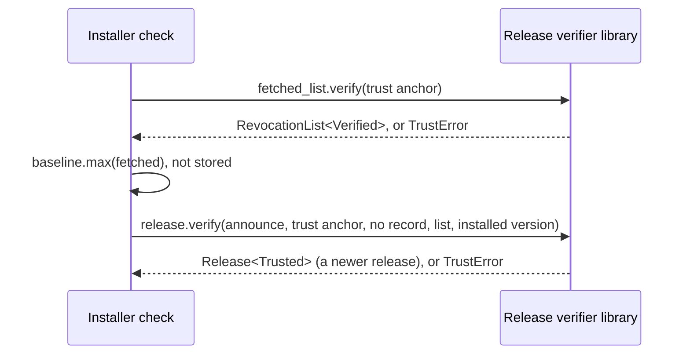
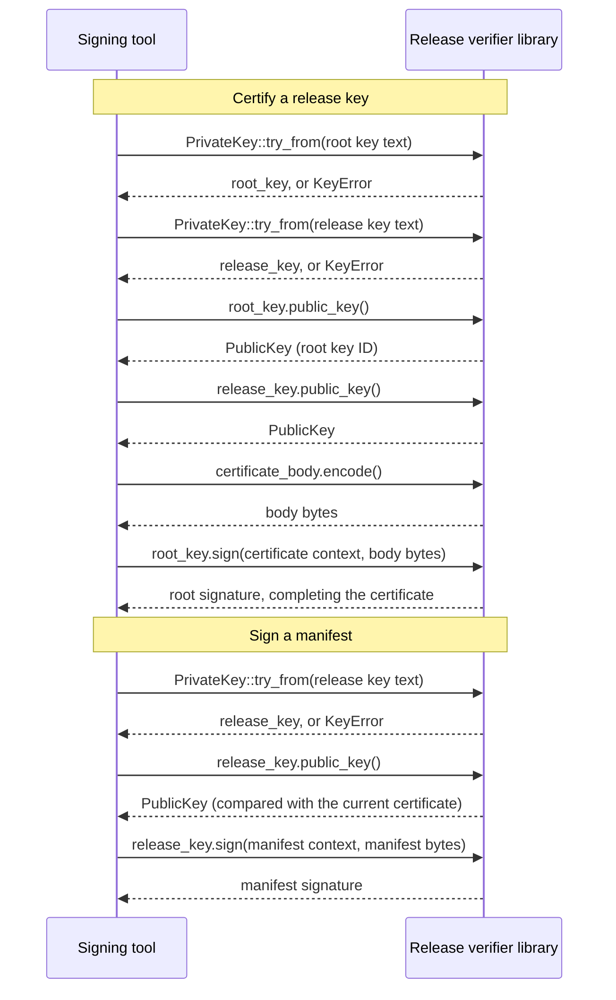

# C4 level 4: release verifier library

- Status: agreed
- Date: 2026-11-12

Code-level view of the release verifier library (`lib_verifier`), the shared library behind release trust. It has three parts: formats, verification and key handling. Which containers build in which part, and how they obtain the library's inputs, is in their level 3 documents: [installer](03-components-installer.md#libraries) (verification), [release builder](03-components-release-builder.md#libraries) (formats) and [signing tool](03-components-signing-tool.md#libraries) (key handling).

## Keys

| Key | Algorithm | Signs | Identified by |
| --- | --- | --- | --- |
| Root key | SLH-DSA-SHA2-192s | Release-key certificates, revocation lists | Root key ID: the fingerprint of the root public key |
| Release key | SLH-DSA-SHA2-192s | Manifests | The key serial in its certificate: a monotonically increasing number, never reused |

## Types

| Type | Purpose | Fields |
| --- | --- | --- |
| `TrustAnchor` | What a verifier trusts from the start: the root public keys and a baseline revocation list, supplied by the caller. | Root public keys, baseline revocation list |
| `ReleaseKeyCertificate` | Vouches that a release key may sign releases: signed by a root key, it binds the release public key to a key serial. | Format version, purpose (`release`), key serial, algorithm, release public key, root key ID, root signature |
| `RevocationList<State>` | Names release keys that must never be trusted again: signed by a root key, versioned so that a newer list always wins. `Unverified` as decoded; `Verified` once its root signature checks. Only verified lists can be compared, by list version. | Format version, list version, revoked key serials, root key ID, root signature |
| `Manifest` | Describes one release: its version and the archive for each platform. Signed by a release key with a detached `ManifestSignature`. | Format version, release version, archives (platform, name, size, hash) |
| `ManifestSignature` | The release key's signature over the manifest's exact bytes. | Signature |
| `Release<State>` | One release as the installed installer handles it. `Unverified` as fetched; `Trusted` once verified under a policy; `Checked` once the downloaded archive matches the manifest. Only a checked release is unpacked and handed to the new release's install. | Manifest, manifest signature, certificate; the archive once checked |
| `ReleaseFileList` | Describes what one archive contains, so unpacked files can be checked. Not signed: it is covered by its archive's hash in the manifest. | Release version, platform, source commit, files (name, size, hash) |
| `UnpackedRelease<State>` | One release as the new release's install handles it. `Unchecked` as unpacked; `Checked` once the files are exactly those its release file list describes. Only a checked release updates the signing-key record. | Release file list, unpacked files, certificate |
| `LatestVersion` | The latest-release pointer: names the latest release for one major version. Not signed: only a hint for which manifest to fetch. | Latest release version |
| `SigningKeyRecord` | What an installation remembers about release keys between verifications, so it never goes back to an older or revoked key. | Highest accepted key serial, newest revocation list |

A root public key file is UTF-8 text, one `name: value` line per field, in this order:

```
format: gofin-public-key-v1
algorithm: SLH-DSA-SHA2-192s
fingerprint: <lowercase hex SHA-256 of the raw public key bytes>
public-key: <base64 of the raw public key bytes>
```

The fingerprint is the key's ID. A reader recomputes it from `public-key` and refuses the file if it differs from the `fingerprint` line.

A release-key certificate is UTF-8 text in the same style, in this order:

```
format: gofin-release-key-certificate-v1
purpose: release
serial: <key serial, a positive decimal integer>
algorithm: SLH-DSA-SHA2-192s
public-key: <base64 of the raw release public key bytes>
root-key-id: <fingerprint of the root public key that signed it>
root-signature: <base64 of the root signature>
```

The root signature covers the exact bytes of every line before `root-signature`, including their line endings, signed with the certificate context. A reader refuses a certificate with missing, extra or reordered lines, or with any `purpose` other than `release`.

A revocation list uses the same style, signed with the revocation-list context:

```
format: gofin-revocation-list-v1
list-version: <a positive decimal integer>
revoked: <key serials, comma-separated in ascending order; empty when none>
root-key-id: <fingerprint of the root public key that signed it>
root-signature: <base64 of the root signature>
```

The encodings of the manifest, release file list and latest version are left to the implementation: the verifier depends only on their fields (above) and on the manifest being signed over its exact bytes.

## Typestates

Verification is a classical typestate: each check is a method that consumes a value in one state and returns it in the next state, or a typed error. Code that needs trust takes only the later state, so an unverified value cannot reach it. There are two release typestates because two different processes verify: the installed installer up to the archive check, then the new release's install for the unpacked files.



## Functions

Every function takes its inputs as values and returns a result or a typed error; none reads files, the network or the environment.

### Verification

| Function | Purpose | Inputs | Output | Used in |
| --- | --- | --- | --- | --- |
| `RevocationList<Unverified>::verify(self, ...)` | Checks the list's root signature, so it can be trusted and compared. | Trust anchor | `Result<RevocationList<Verified>, TrustError>` | [Update and repair](#update-and-repair), [Check](#check) |
| `Ord` on `RevocationList<Verified>` | Picks the list to hold with `held.max(candidate)`: the higher list version wins, an equal version keeps the held list. | Two verified lists | The list to hold | [Update and repair](#update-and-repair), [Check](#check) |
| `Release<Unverified>::verify(self, ...)` | Decides whether the release may be trusted under a policy: its certificate comes from a trusted root key, its key is not revoked or older than accepted, its manifest signature is valid, and its version fits the policy. | Policy, trust anchor, signing-key record (none for `announce`), verified revocation list, installed version | `Result<Release<Trusted>, TrustError>` | [Update and repair](#update-and-repair), [Check](#check) |
| `Release<Trusted>::check(self, ...)` | Confirms the downloaded archive is the one the manifest lists for this platform. | Platform, archive bytes | `Result<Release<Checked>, ArchiveMismatch>` | [Update and repair](#update-and-repair) |
| `UnpackedRelease<Unchecked>::check_files(self)` | Confirms the unpacked files are exactly those the release file list describes. | — | `Result<UnpackedRelease<Checked>, FileDifferences>`; the error lists the files that differ, are missing or are unexpected | [Update and repair](#update-and-repair) |
| `UnpackedRelease<Checked>::record_install(&self, ...)` | Updates what the installation remembers once this release is installed: the serial of its certificate, if higher, and the newer of the record's and the trust anchor's revocation lists. | Signing-key record, trust anchor | The new `SigningKeyRecord` | [Update and repair](#update-and-repair) |

Policies: `announce` (no signing-key record: reports a newer verified release), `update` (a newer release) and `repair` (the installed version again).

### Formats

| Function | Purpose | Inputs | Output | Used in |
| --- | --- | --- | --- | --- |
| `decode` (on each type) | Reads a type from its exact bytes. Typestate types start in their first state: `Release<Unverified>`, `RevocationList<Unverified>`, `UnpackedRelease<Unchecked>`. | Bytes | `Result<the type, FormatError>` | All flows |
| `encode(&self)` (on each type) | Writes a type as exact bytes, so every container reads and writes the same format. | — | Bytes | All flows, e.g. the certificate body in [Certify and sign](#certify-and-sign) |
| `PublicKey::decode_file` | Reads a root public key file, refusing it if the fingerprint does not match the key. | Public key file text | `Result<PublicKey, FormatError>` | [Certify and sign](#certify-and-sign) (the caller's root key check) |
| `PublicKey::encode_file(&self)` | Writes a public key in the public key file format. | — | Public key file text | Generating a key in the signing tool (`derive`) |

### Key handling

Built only into the signing tool.

| Function | Purpose | Inputs | Output | Used in |
| --- | --- | --- | --- | --- |
| `PrivateKey::generate()` | Creates a new root or release key. | — | An SLH-DSA-SHA2-192s `PrivateKey` | Generating a key in the signing tool (`keygen`) |
| `PrivateKey::to_base64(&self)` | Writes the key as base64 text, for its one-time export. | — | Base64 text | Generating a key in the signing tool (`keygen`) |
| `PrivateKey::try_from(&str)` | Loads a key from base64 text, ignoring surrounding whitespace and rejecting text that is not a valid key. | Base64 text | `Result<PrivateKey, KeyError>` | [Certify and sign](#certify-and-sign) |
| `PrivateKey::public_key(&self)` | Recovers the key's public key and ID, so the caller can compare it with committed ones. | — | `PublicKey` with its fingerprint | [Certify and sign](#certify-and-sign) |
| `PrivateKey::sign(&self, ...)` | Signs exact bytes for one kind of object, so the signature cannot be reused for another kind. | Context (certificate, revocation list or manifest), bytes | Signature | [Certify and sign](#certify-and-sign) |

Every signed object is serialized once by the signer and verified over its exact bytes; nothing is re-serialized before verification. Each signature uses a context string naming the object type, so a signature for one type can never be accepted for another.

## Flows

The main uses of the library, as the functions a caller triggers, in order; each function's purpose is in the table above. How each caller obtains and stores that data is in its level 3 document.

### Update and repair



1. The revocation list is verified and stored first, so a revocation takes effect even if the rest of the update fails.
2. `verify` rejects a revoked serial, a serial lower than the record's, a bad signature, or a version that is not newer (`update`) or not equal (`repair`).
3. The handover between the two processes is the unpacked archive; the new release's install starts its own typestate from `UnpackedRelease<Unchecked>`.
4. `record_install` runs only once the install has succeeded, so the record only ever reflects an installed release.

### Check



1. With no signing-key record there is no serial floor; the root modes apply it when the human updates.

### Certify and sign



1. The caller makes the comparisons (root key ID against the committed root public keys, release public key against the current certificate) before signing.
2. Revocation lists are encoded and signed with the root key the same way, with the revocation-list context.

## Decisions

| Decision |
| --- |
| Release trust is root-certified: a root key signs certificates for release keys, and a release is a manifest, its signature by a release key and that key's certificate. Verifiers trust only the root public keys in their trust anchor, so rotating a release key changes no trust anchor; only rotating the root key does. |
| Root and release keys both use SLH-DSA-SHA2-192s. |
| Release-key certificates never expire and carry no dates. Each carries a monotonically increasing key serial; a signing-key record keeps the highest serial accepted, and lower serials are rejected. |
| A release-key certificate contains: format version, purpose (`release`), key serial, algorithm, the release public key, the root key ID (fingerprint of the root public key that signed it) and the root signature over all of these. A trust anchor may hold more than one root public key during a root-key rotation; the root key ID selects which one verifies the certificate. |
| A revocation list, signed with the root key, names key serials that are never valid. It carries a monotonically increasing list version and is accepted only if its version is not lower than the one held. |
| A release file list (version, platform, source commit, and the name, size and hash of every file in one archive) is not signed: it is trusted through its archive's hash. The manifest says which archives make up a release; the release file list says what is inside each archive. |
| Verification is a classical typestate (`Release`, `UnpackedRelease`, `RevocationList`): each check consumes a value and returns it in its next state or a typed error, so unverified data cannot reach code that needs trust. The two release typestates match the two processes that verify, the installed installer and the new release's install. |
| The library performs no input or output: callers fetch, read and store every input and output, so the same functions serve every container. |
| The root-signed objects (root public key file, release-key certificate, revocation list) have a defined text format, because the maintainer handles them and their signatures carry the trust; other encodings are left to the implementation. |
| Signed objects are verified over the exact bytes the signer produced, and every signature carries a context string naming the object type. |
