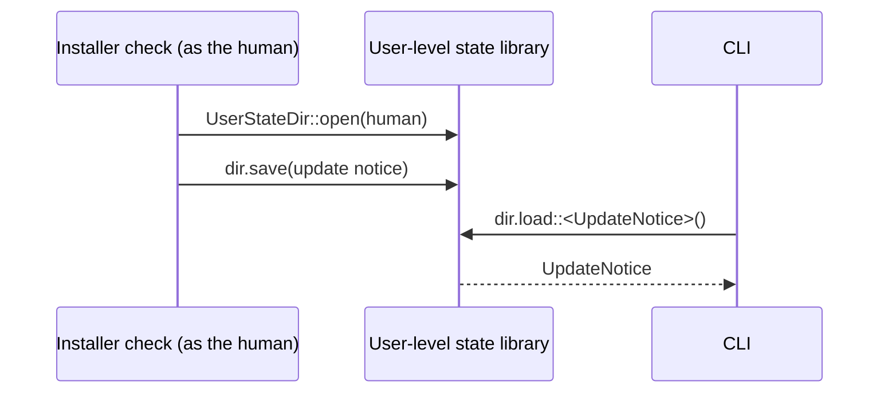
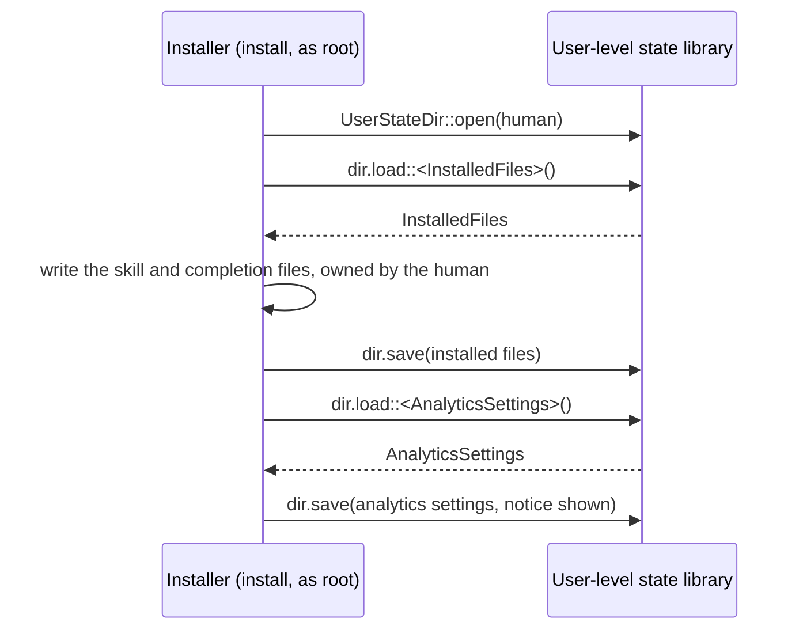
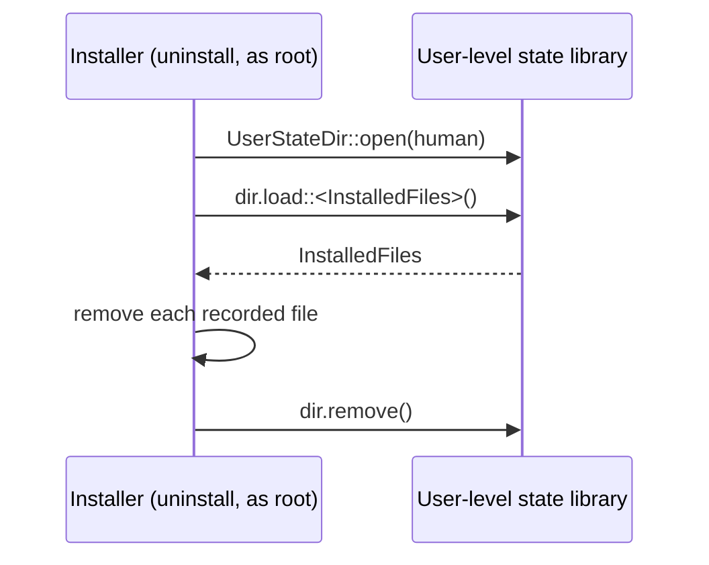

# C4 level 4: user-level state library

- Status: agreed
- Date: 2026-11-13

Code-level view of the user-level state library (`lib_user_state`), the only code that reads and writes GoFin's files in the human's home directory (`user_state` in [02-containers.md](02-containers.md)). This version covers the files the installer needs; files of the other binaries are added when their level 3 documents are written.

Nothing here is secret and nothing here is trusted: any process running as the human, including the agent, can change these files, so nothing that protects funds depends on them.

## Files

```
~/.gofin/                     the human, 700
├── analytics.json            analytics settings and anonymous installation ID
├── update-notice.json        latest update notice
└── installed-files.json      record of the files GoFin placed outside this directory
```

The companion skill and shell completions are the only files outside `~/.gofin/`: they must live where each agent and shell looks for them (for example `~/.claude/skills/gofin/`), so `installed-files.json` records every one of them.

`~` stands for the human's home directory. In the human's own session that is the directory `HOME` names. The installer runs as root through sudo, where `HOME` may name root's home, so it asks the operating system for the home directory of the user who ran sudo; both ways give the same directory. Every file is owned by the human and readable only by them, also when the installer writes it as root.

## Types

Each file is one plain type with public fields. Loading it populates the fields; callers read and change the fields directly and save the value back. There are no getters or setters per field.

| Type | Purpose | Fields |
| --- | --- | --- |
| `UserStateDir` | The human's `~/.gofin/`, resolved for one user and created on first use. Loads and saves the types below. | User, path |
| `UserStateFile` (trait) | Implemented by each type kept in a file: the type itself knows its file name and format, how it is loaded and how it is saved. | `load(directory)`, `save(&self, directory)` |
| `AnalyticsSettings` | Whether reporting is allowed, whether the human has seen the analytics notice, and the anonymous installation ID, which is random, created once and never tied to accounts or funds. With no file: on, notice not yet shown, a new ID. | Enabled, notice shown, installation ID |
| `UpdateNotice` | The result of the latest update check, which the CLI shows to its caller. With no file: never checked. | Installed version, latest verified newer release (or none), checked at |
| `InstalledFiles` | Every skill and completion file GoFin placed outside `~/.gofin/`, so an update refreshes exactly those and an uninstall removes exactly those. With no file: empty. | Entries: path, kind (skill or completion), GoFin version |

## Functions

| Function | Purpose | Inputs | Output | Used in |
| --- | --- | --- | --- | --- |
| `UserStateDir::open()` | Opens the directory for one user: resolves it and creates it if needed. | User | `Result<UserStateDir, UserStateError>` | Every flow |
| `UserStateDir::load::<T>(&self)` | Builds one `UserStateFile` type from its file by calling its `load`. A missing or unreadable file gives the type's defaults, so loading never stops a command. | — | `T` with its fields populated | [Update check](#update-check), [Install](#install), [Uninstall](#uninstall), analytics reporting |
| `UserStateDir::save(&self, ...)` | Writes one value by calling its `save`, which replaces the whole file atomically (a temporary file, then a rename), so readers never see a partial file and no lock is needed. | A `UserStateFile` value | `Result<(), UserStateError>` | [Update check](#update-check), [Install](#install) |
| `UserStateDir::remove(self)` | Removes `~/.gofin/` and everything in it. | — | `Result<(), UserStateError>` | [Uninstall](#uninstall) |

## Flows

### Update check



### Install



1. The installer shows the analytics notice only when the settings say it has not been shown.

### Uninstall



## Decisions

| Decision |
| --- |
| All of GoFin's own user-level files live in one directory, `~/.gofin/`. Only files that another program must find (agent skills, shell completions) live elsewhere, and each is recorded in `installed-files.json`. |
| The directory is the `.gofin` directory in the human's home directory. The installer, running as root, finds that home from the user who ran sudo rather than from its own `HOME`, so it writes where the CLI reads. |
| Each file is one plain type with public fields that loads and saves itself through the `UserStateFile` trait; `UserStateDir` offers only `load` and `save`. This mirrors the protected store, where `StoreRecord` types load and persist themselves behind `read` and `apply`. |
| Files are replaced atomically and need no locks. A missing or unreadable file gives the type's defaults. |
| User-level state is never trusted: it holds no secrets, and nothing that protects funds reads it. |
| This document grows with the containers: each container's files and functions are added when its level 3 document is written. |
