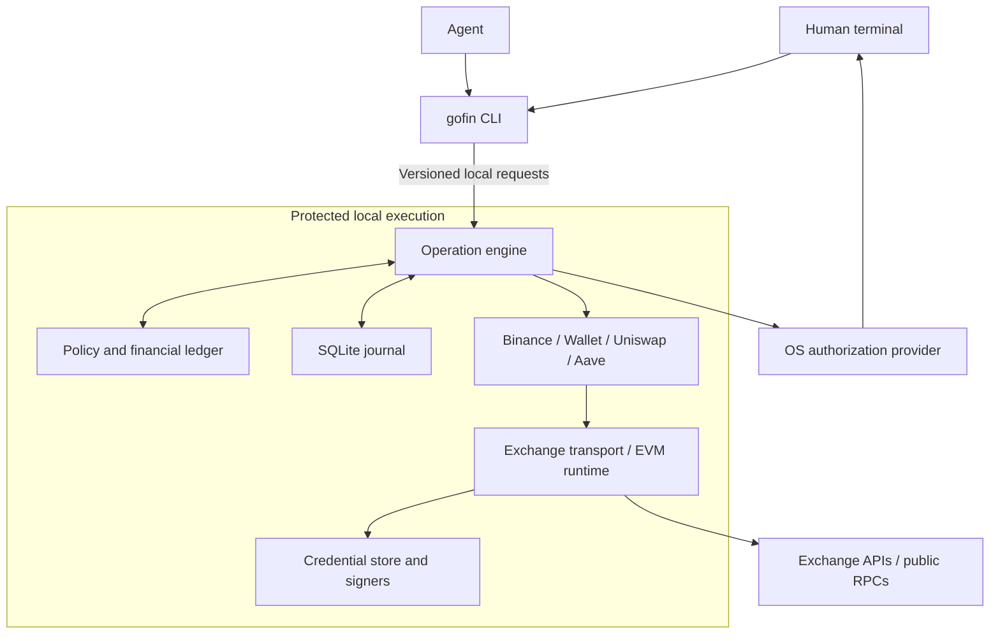

# Rust implementation architecture

The compiled Rust workspace contains the CLI, protected broker, terminal enrollment, typed financial engine, Binance funding adapter, reusable EVM wallets, reviewed EVM Uniswap and Ethereum/Base Aave adapters, a typed Hyperliquid adapter, plus Relay and canonical bridge adapters. Commands in the [usage guide](usage.md) describe the current interface. Implementation alone is not acceptance evidence. Human installation, credential isolation and real Touch ID require separate observed results under the [testing guide](testing/README.md).

## One CLI and a protected execution role

The human and agent use one public CLI, `gofin`. A local broker owns execution credentials, policy, authorization, signing, submission, and durable records. The broker is an internal service, not a second application-specific CLI. Both roles may share one Rust executable with separate client/service entry points or use two binaries; this packaging choice must preserve the same protected process boundary.

The CLI should remain lightweight and avoid linking execution-only venue SDKs or owning keys. A later MCP interface calls the same protected API and registry. The API accepts reviewed named operations, never arbitrary code, venue methods, raw signing requests, approval receipts from clients, or credential-export requests.

Protect executable code, configuration, approval identities, credential storage, and state from the actual agent user's tools. A separate same-user process, masked terminal input, or a keychain entry alone is not an isolation proof. The macOS implementation uses a root-owned broker and protected code/state. A dedicated service identity may be evaluated later; startup grants no broad agent-accessible administrator privileges. Record and test the chosen boundary, including native helper integrity and dynamic-library loading.

## Workspace responsibilities

The compiled workspace separates shared accounting from application-owned interpretation. There is no crate per operation.

| Component               | Responsibility                                                                                                                                         |
| ----------------------- | ------------------------------------------------------------------------------------------------------------------------------------------------------ |
| `gofin-domain`            | Account/resource/asset identities, exact amounts, operation and evidence versions, financial effect types, stable errors. No CCXT or Alloy dependency. |
| `gofin-engine`            | Registry, lifecycle, policy and reservations, effect ledger, reconciliation coordination, run/baseline/return checks.                                  |
| `gofin-store`             | SQLite journal, schema migrations, unique request identities, atomic financial settlement and terminal status.                                         |
| `gofin-evm`               | Alloy EVM encoding, fee/nonce preparation, frozen signing envelopes and canonical receipt mechanics.                                                   |
| `gofin-solana`            | Solana mainnet identity, protected keypair use, SPL/Token-2022 account decoding, legacy/v0 transaction preparation, frozen signatures and finalized receipt verification. |
| `gofin-jupiter`           | Shared keyless transport and exact-mint Price V3, swap/Trigger/JLP/perpetual transaction validation and application-owned financial effects. Integration acceptance remains in progress. |
| `gofin-meteora`           | DLMM and DAMM v2 instruction construction, unsigned quote simulation, transaction-scoped position and fee evidence, and finalized liquidity settlement. |
| `gofin-exchange`          | Shared exchange Adapter lifecycle, default public-read profile, and internal official CCXT Rust wrapper with exact response capture.                  |
| `gofin-binance`           | Binance account mapping, funding routes, permissions, stable client identifiers, exact venue quantities and settlement evidence.                       |
| `gofin-pricing`           | Provider-independent async USD quotes, exact CoinGecko parsing, identity mappings, source freshness and shared bounded cache.                           |
| `gofin-ethereum`          | EVM wallets across reviewed networks, optional reviewed-network Uniswap and Ethereum/Base Aave, conditional return planning, protocol-specific receipt interpretation and position anchors.                         |
| `gofin-bridge`            | Relay quote normalization, fixed order/calldata validation, exact source-deposit decoding, and destination/refund event decoding. It supplies candidates; broker RPC verification and engine settlement establish proof. |
| `gofin-authorization`     | Shared challenge/decision contract, trusted operation presentation, native authentication providers, response verification, single-use approval.       |
| `gofin-credentials`       | Protected enrollment, credential references and storage backends, signer access, replacement/removal. No secret-export API.                            |
| `gofin-human-terminal`    | Direct human terminal provenance checks, bounded private secret capture, cancellation and terminal restoration.                                        |
| `gofin-discovery`         | Shared offline command metadata, safe schemas and enrollment outcomes.                                                                                 |
| `gofin-presentation`     | Shared human/machine rendering, safe terminal text, stderr progress and diagnostic policy; no credentials or financial authority. |
| `gofin-protocol`          | Versioned bounded local requests and typed run planning contracts.                                                                                     |
| `gofin-cli`, `gofin-broker` | Public command handling and local client; protected composition, configuration, enrollment and service lifecycle.                                      |

The beta ships one public `gofin` binary and two internal protected executables, `gofin-broker` and the compiled `gofin-touch-id` helper. It uses official `ccxt-base =4.5.85` (the raw engine underlying `ccxt`) with Binance, Kraken, Hyperliquid, OKX, Coinbase and Bybit features. SQLite uses `rusqlite`; Ethereum uses Alloy. macOS packages use hardened ad hoc signatures and checksums. Published-release CI builds downloadable bundles; the curl bootstrap verifies their manifests and starts bundled setup. See [release delivery](releases.md). Publisher authentication and Linux/Windows write authorization are not established by these packages.

The shared domain and engine must not import application implementations. Application modules depend on shared contracts and runtimes. Wire reviewed implementations into an explicit registry at the broker composition boundary. Use static compiled integrations and Cargo features initially; do not dynamically load agent-writable plugins into the credential-owning process.

The signed helper artifact remains `gofin-touch-id` in the seven-component source
bundle. Installation derives its protected executable at
`/Library/GoFin/runtime/authorization/GoFin`, avoiding a filename collision with the
public CLI on case-insensitive filesystems. Both its signed metadata and native
application identity use **GoFin**. The parent directory and executable retain the
same root ownership, hardened signature and ACL validation as other runtime code.

## Analytics boundary

`gofin-analytics` owns finite event types, privacy vocabularies, per-account settings
and best-effort delivery preparation. The CLI observes one public command outcome
around parsing/review/dispatch; internal recovery calls do not inflate command
counts. Recognized request/result shapes supply reviewed network, protocol and
bridge categories without extra broker calls. Adapters contain no analytics calls.

Command outcome and operation result status are separate: pending submission is
never treated as settlement. An execution's returned error record can produce an
exception only if its creation time falls inside the current invocation. Status
reads and older replayed attempts retain their status without fresh exceptions.
This is conservative best-effort attribution: clock changes can suppress reports,
and concurrent invocations of one newly created attempt can report it twice. No
deduplication identifier is persisted and no timestamp is sent for this check.

Normal broker errors return through the CLI. The real broker entrypoint separately
observes privileged-command failures and panics, activating only after a trusted
human UID is available. It delegates sanitized metadata to a fixed unprivileged
CLI helper; that helper checks the same preference immediately before sending.
Panic reporting preserves the existing panic behavior and never uploads raw panic
payloads, financial state or arbitrary backtraces. Broker IPC is unchanged.

Installer/updater commit hooks own runtime lifecycle outcomes; unprivileged exec
wrappers own command outcomes. The sender launches detached system curl with a
bounded stdin payload and deadline, without redirects, retries, configuration-file
loading or a persistent queue. The connection timeout is five seconds and the
total request timeout is ten seconds; neither blocks the foreground command.
It never runs HTTP as root. Published-build and
real-entrypoint gates exclude local and isolated development, tests and maintenance.
The analytics commands themselves remain local and do not activate reporting.

Unit tests inject event sinks and process launchers to inspect payloads, failures
and launch configuration without network servers, OS approval or live ingestion.
They establish reporting logic, not observed proxy delivery or native isolation.

## Solana integration boundary

The broker's wallet-family router registers shared `wallet.*` operations once
and selects the enrolled runtime using explicit network input. EVM network
routing remains beneath that router. Recovery selects the original saved
preview and binding, never a current default network. Solana accounting uses
`solana:mainnet-beta` and case-sensitive mint identities; it does not use EVM
allowance or nonce semantics.

Solana and Jupiter share GoFin's journal, reservations, financial plans and
protected authorization. A transaction's immutable message identity, signer
set, known signatures, provider request identity and expiry are persisted before
dispatch. Confirmed inclusion is progress; finalized identity and exact
application effects are required for terminal settlement. An uncertain result
retains its original identity across restart and never causes automatic
blockhash refresh or order recreation.

The broker and Solana enrollment use the same ordered, reviewed mainnet-beta
RPC pool. Each endpoint must pass URL validation and the mainnet genesis check
before use. Read eligibility, rate-limit cooldowns, slot freshness and missing
history are provider-specific; missing or lagging evidence does not suppress
usable evidence from another endpoint. Each transport read has a twenty-second
budget, including identity checks and failover. Commitment and blockhash lifetime
checks remain Solana-specific. Before accepting a block height, the same provider
must return a fresh blockhash whose last-valid block height is at least that
height. This rejects slot-as-height responses before they can poison height
observations; the check never changes a frozen transaction's blockhash.
Strict response-regression watermarks use a bounded cache of provider and hashed
read scope, so unrelated methods and accounts may observe different fresh banks.
Caller minimum-slot checks apply independently of that cache.
Financial dispatch uses only the first configured
provider and never replays a signed transaction after a timeout or lost response;
reconciliation searches for the saved signature through read providers and still
requires the saved finalized transaction identity and exact effects.

The reviewed endpoint defaults are code-owned, so existing version-2 protected
configuration, credentials, pending submissions and reservations need no schema
migration or reenrollment. Wallet, Jupiter, Meteora and CCTP destination
operations share the broker-owned transport. `doctor` exposes only observed, sanitized pool health
and performs no new RPC probes.

The four ordered public defaults are:

1. `https://api.mainnet-beta.solana.com` ([Solana](https://solana.com/docs/references/clusters)).
2. `https://solana-rpc.publicnode.com` ([PublicNode](https://solana.publicnode.com/)).
3. `https://solana.api.onfinality.io/public` ([OnFinality](https://www.onfinality.io/en/networks/solana)).
4. `https://rpc.solanatracker.io/public` ([published public endpoint](https://freesolanarpc.com/)).

At most two read attempts run concurrently; failed or insufficient attempts let
later providers participate within the same read budget. All four defaults are
keyless; public availability, rate limits and method eligibility may vary.
Genesis verification is required independently for each provider; configured
providers do not guarantee complete historical coverage. New submission payloads
use version 2 and retain the signed or partially signed wire bytes privately
before dispatch. Recovery verifies those bytes against the saved identities;
version-1 submissions remain readable without rewriting their records. Public
broker responses withhold the wire bytes. A complete reconciliation pass,
including sponsored history search and lookup-table reads, has one twenty-second
budget; incomplete evidence retains the original reservation.

A single broker-owned Jupiter client coordinates keyless rate limits across
modules, with a separate Swap v2 execute bucket. Optional service keys remain
independent of wallet signers. Production transports use reviewed hosts;
synthetic tests inject typed transports at the broker composition boundary.
The [Solana/Jupiter verification guide](testing/solana-jupiter.md) separates
implemented behavior, required rehearsals, live settlement and pending human
installation/Touch ID checks.

## Meteora position accounting

`gofin-meteora` keeps DLMM and DAMM v2 instruction construction and protocol
event decoding in their family modules. Its shared adapter pins the pool and
both mint identities, simulates unsigned quote probes, freezes one bounded
transaction, and settles only from a finalized receipt plus authenticated
transaction-scoped protocol evidence. Writable transfer-hook accounts are
resolved from canonical mint metadata and remain subject to the ordinary signer,
wallet-debit, recipient, and fee checks. DAMM v2 reports active transfer-hook
mints as incompatible when its deployed instruction cannot forward the required
account metas.

Liquidity positions use a stable protocol liquidity-unit anchor. Typed
`LiquidityPositionEvidence` stores observed current A/B composition separately
from contribution, withdrawal, fee, and reward history; imported positions retain
unknown historical principal basis. Composition is an observation, not a
reconstruction of historical deposits, and the synthetic unit/NFT identity is
not counted as a second fungible holding. When both observed token amounts and
exact USD prices are available, the adapter attaches a typed A/B backing value
to the position and the engine carries it into its projected-position view.
Unknown composition or unavailable prices remain unpriced; projected position
changes clear the observation until a fresh snapshot. The synthetic unit/NFT
asset is never sent to the fungible token price source. Refundable account
funding uses the shared `account-funding:<address>` identity; shared DLMM bin
arrays are reported as nonrefundable account costs.

Each liquidity history event keeps its chain signature as adapter-verified
evidence and a separate generic submission identity bound to the operation's
durable submission. New operations capture exact prior verified anchors in
their immutable baseline. For older pending records missing that baseline, the
engine may pass a transient adapter copy reconstructed from an earlier
matching anchor and the immutable prepared liquidity prestate; it never
rewrites the canonical journal record or creates a new submission.

Each swap or position action is one atomic transaction. A named plan can sequence
swaps and actions for an already-open position. Open remains separately
approved because its generated position identity cannot yet be bound before plan
approval; later steps must pin that exact position address. The broker carries
each generated identity across unsubmitted refreshes and restarts. Oversized
instruction graphs fail preparation; the adapter does not split or replay one
journal submission.

## Independent extension dimensions

| Dimension                        | Example extension                         | Required work                                                                                                               |
| -------------------------------- | ----------------------------------------- | --------------------------------------------------------------------------------------------------------------------------- |
| Application                      | Kraken, another lending protocol          | Typed operations, capabilities, preparation, receipt verification, financial effects, recovery semantics, tests.         |
| Network runtime                  | Solana                                    | Its own transaction/signing/lifetime/finality model and typed identities; do not impose EVM nonce or address shapes.        |
| Network/deployment configuration | Another reviewed EVM chain or Aave market | Chain identity, trusted public RPCs, fee/finality rules, valuation, exact assets, reviewed protocol deployment and version. |
| Connection                       | Another main account, child, or wallet    | Human enrollment, credential reference, physical identity, authority/permissions, resource locking.                         |
| Policy/platform                  | Different limits or native authentication | Explicit versioned policy and a tested authorization/storage provider through the existing engine.                          |

Wallet, AMM, and Aave operations share the EVM runtime; their financial semantics remain application-owned. A new RPC URL does not add a chain. Token symbols and identical contract addresses on different chains do not establish asset identity or compatibility.

`gofin-networks` is the reviewed EVM wallet-network registry: identity, public
RPC defaults, confirmation floor and settlement classification. Broker
validation, enrollment, discovery, development RPC overrides and canonical
receipt policy consume it. Protocol deployments remain application-owned.
Adding a network requires reviewing its fee model as well as sequencing and
registering its deployments; an Optimism-style additional L1 data fee needs
bounded estimation and verified receipt accounting before enabling writes.

At protected configuration load, the broker derives missing reviewed networks
and AMM deployments for any reusable `ConnectionConfig::Evm`, including
read-only wallets. The validated effective config is in memory only: this
overlay does not rewrite protected config, inspect credentials, or create
financial authority. Exact previously shipped Base/Arbitrum/Robinhood single-RPC default
lists gain their reviewed public fallback on startup/reload, including already
configured legacy networks. Custom RPC lists and provider order, deployment
overrides and asset scope win;
legacy chain-scoped Ethereum connections remain limited to their configured
network. The same pure derivation runs on startup and protected reload so a
broker update can expose newly shipped reviewed coverage without reenrollment.

The EVM transport owns endpoint eligibility, freshness checks, read
capability cooldowns and credential-free health observations. It races the first
two eligible endpoints, with at most two active attempts, and replaces failed or
missing attempts with the next configured provider. The first usable response
that passes transport validation wins and cancels its competitors. Invalid shape
or wrong-chain evidence rejects that endpoint; a semantic contract revert seen
before a winner fails the read closed. RPC reads have no overall or per-endpoint
deadline and no HTTP total-response timeout. Further providers start when a
failed or missing attempt releases a slot; a stalled pair waits for a response
or caller cancellation. RPC snapshot aggregation has no separate elapsed-time
cutoff; non-RPC composite observers retain their existing deadline.
The shared EVM/Solana wallet router forwards the selected EVM read scope.
Solana transport reads retain their twenty-second budget, including during mixed
snapshots and deposit recovery, independently of EVM response time.
Negotiated RPC read commands, including snapshots whose selected scope
uses RPC, have no broker, engine or client response deadline. Other integrations
and local service requests retain their existing waits. Typed state reads resolve
one canonical hash and retain it across racing header lookups, provider changes
and shared-cache eviction. The bounded cache is not the authority for an
in-flight request.
Adapters continue to interpret original-envelope, receipt, financial effects and
finality evidence. Minimum-height constraints exclude lagging responses without
weakening those adapter-owned requirements. `doctor` reads allowlisted snapshots
from the actual wallet/bridge clients without probing networks. Attempt IDs follow
configured order, including cancelled competitors. `last_failover` records an
actual non-primary winner independently of the latest read; a later primary win
does not erase it. Broadcasts remain primary-only and unresolved writes use the
existing journal and reconciliation path. Their 10-second pre-dispatch identity
check and original 30-second HTTP transport timeout remain separate from reads.
When the effective config changes, the existing reload path recomposes adapters
against the same journal; pending submission identities remain in place and
are never replayed as a consequence of coverage derivation.

Closed v3 deployment profiles separate factory pool lookup, quoter ABI,
router encoding and fee semantics. Uniswap identifies pools by a fixed fee
tier. Ramses identifies pools by signed tick spacing and reads their mutable
fee at the quote block. It uses its own reviewed router, factory, quoter and
pool deployer. The same `gofin-amm` contract, finite permit path, financial
limits, journal and receipt settlement handle both implementations. A
compatible fork can reuse the v3 kernel after ABI/deployment review; changed
encodings or fee models require an explicit profile implementation and tests.

Uniswap v3/v4 swaps use exact-input, single-pool requests with a wallet-bound
recipient, fresh quote, minimum-output floor, bounded slippage/impact, native
fee cap and short deadline. EIP-2612 and Permit2 use typed permit structures
bound to verified domains, chain, owner, token, finite amount, nonce and the
configured router. A preview may persist an unsigned permit transaction
template; only the post-approval journal path can sign, materialize the reviewed
signature slots, simulate that exact transaction and submit it. Swap deadlines
are also checked against financial-authority expiry. See the
[Uniswap handoff and verification guide](testing/uniswap-amm.md); its human
Touch ID/mainnet cases remain separate from synthetic verification.

### Reusable wallet and network profiles

`ConnectionConfig::Evm` stores an address and protected signer once, independently
of a chain. Reviewed profiles provide chain identity, public RPCs, confirmations,
finality requirements and configured token scope. Operation requests use
`network: evm` plus `chain_id`; accepted legacy `ethereum` inputs remain
compatible. New setup includes Ethereum mainnet (1), Base (8453), Arbitrum One (42161) and
Robinhood Chain (4663). A wallet-only adapter works without protocol deployments;
Uniswap v3/v4 has reviewed deployments on all four networks; Ramses v3 is
reviewed on Robinhood and Aave on Ethereum and Base. Base fee envelopes include
execution, L1 data and operator costs, while receipt completion uses canonical
L2 inclusion. Relay transfers are a separate application
capability, not a general wallet write or arbitrary calldata interface.

Reusable EVM wallets also derive runtime-only Hyperliquid owner mappings with
the same protected signer and read-only/signing status. Hyperliquid operations
use the existing wallet alias; public connection inventory hides derived owner
views while protected authorization identities retain their exact venue resources.
The overlay performs no
venue calls, persists no alias or new credential, and grants no financial
authority. Explicit owner mappings remain unchanged and suppress duplicate
account observers. Generated aliases follow parent wallet rotation/removal;
unresolved Hyperliquid resources remain part of connection-change checks.

### Relay bridge composition and settlement

`gofin-bridge` owns typed quote/step contracts, anonymous Relay quote transport,
protocol order validation, Solana source transaction validation and payout
decoders. `gofin-broker` injects reviewed deployments, resolves the
physical signer/address, persists quotes and step topology, and composes source,
destination and refund observers. It reuses the existing per-chain `gofin-evm`
runtime for simulation, finite approvals, signing, nonce serialization and
canonical receipts. `gofin-engine` and `gofin-store` own grant binding, step claims,
cumulative debit/fee usage, source-proof transit handoff, and terminal settlement;
shared accounting has no provider-specific branch.

Wallet authority includes the reviewed EVM networks and Solana mainnet-beta.
Base (`8453`) can provide solver identity evidence; Relay Chain (`537713`) is an
observer-only settlement network and cannot sign a transfer. One grant binds
one persisted transfer and its finite approval,
allowance-reset and deposit steps. Each step remains a separate immutable
operation. A quote refresh can replace only an unsubmitted quote inside the
approved identities, amount interval, receipt floor and caps; it does not renew
grant expiry. A source deposit that is submitted or uncertain is reconciled under
its original transaction identity, never repriced and resent.

The source receipt proves only source inclusion/debit and creates a non-spendable
transit resource while releasing the source nonce/transaction lock. It does not
prove user receipt. Relay status provides candidate hashes and diagnostics. The
broker independently checks canonical receipts at the network receipt policy, the pinned solver,
exact router event metadata and the user-selected destination/refund expectation
before calling the engine's idempotent external settlement API. Missing or
ambiguous correlation remains pending. See the [bridge guide](usage.md#relay-routes)
and [bridge verification procedure](testing/bridge.md).

A legacy `ConnectionConfig::Ethereum` stays scoped to its original chain.
Protected human-approved `connections update --provider evm` broadens it
explicitly. Custody and asset identities continue using `ethereum:<chain_id>`;
renaming the public provider never rewrites persisted resource or submission
identities. The same address on different chains has distinct balances and
chain-specific nonce/fee state. Within a chain, aliases cannot duplicate custody.

`wallet.balances` obtains bounded cached Blockscout candidates, combines them
with explicit/configured token addresses, and verifies contract metadata and
balances through RPC. It always reports partial discovery, including indexer
failure/cache warnings. A financial baseline tracks native plus configured token
scope; successful observation of that scope does not establish all wallet/dapp
positions. A complete claim must name its scope.

Shared `gofin-pricing` valuation serves Binance and EVM networks through
`UsdPriceSource`. `ExchangeSpotPrices` composes a `SpotMarketSource` and a
`StablecoinUsdSource`, delegating on-chain quotes unchanged to CoinGecko.
Binance exact market/base/quote metadata selects an active direct USDC pair,
then USDT; best ask times the corresponding USD rate supplies policy valuation.
Pair identity stays exchange-local; no global coin ID or symbol search is used.
The same derived source serves previews, fees, allocation and execution checks.
Legacy `binance` financial identities are unchanged; additional integrations can
use `exchange:<venue>` with explicitly registered market readers.
CoinGecko remains responsible for verified EVM platform/contract and native ETH
identity. Aave health/collateral oracles remain protocol-specific checks.
Fee preparation freezes the RPC-estimated envelope. All writes and external
credits on reviewed rollups settle on canonical sequencer inclusion, including
wallet transfers, Binance deposits, AMM swaps and permission changes. Arbitrum
One and Robinhood Chain share this explicit network classification and do not
wait for the RPC `finalized` marker. Reconciliation verifies the original
envelope and canonical receipt, exact protocol effects, permissions and actual
costs before terminal settlement. Evidence is labeled `sequencer-inclusion`
and does not claim parent-chain finality. Other networks retain configured
confirmation/finality policy. For mapped Binance withdrawals, one canonical
sequencer-included block suffices when the original hash, chain, recipient,
asset identity and expected amount match. Missing or noncanonical receipts stay
unresolved under the same identity after response loss or restart. A receipt
observer does not establish a Binance route; Robinhood's mapping remains
unavailable/unverified.

RPC customization belongs to protected network configuration and will need a
human-authorized setting; no public RPC-changing command is implemented.
See [wallet verification](testing/evm-wallets.md).

Configuration separates networks, deployments, connections, credential references, and policy. Validate it strictly and version it. Reject aliases that count the same physical account or signer twice; query venue identity when supported and record any remaining human-verified mapping. Trusted policy, destinations, credential replacements, and approval identities require independent human authorization to change.

## Typed operations and complete command discovery

Each operation owns typed request, prepared execution, and evidence structures. Use JSON at client/storage boundaries rather than passing untyped maps through the financial engine. Reject unknown write fields and ambiguous quantities. Runtime dispatch may erase types internally, but must re-enter the registered typed implementation before preparation or execution.

An operation implements preparation, revalidation, submission, and reconciliation. Its definition also includes description, examples, input/output/error schemas, field semantics, authority requirements, read/write/configuration classification, and completion criteria.

The engine owns final validation and checks binding, valuation, policy and
reservation before handing the complete immutable candidate to `submit_revalidated`.
An adapter can opt into `preparation_reuse_window`: reviewed EVM and Solana
wallet operations and swaps reuse initial preparation for at most 30 seconds measured from before
preparation starts, provided all candidate/price deadlines remain valid. Both
monotonic and wall-clock ages must fit. Delayed approval or preparation falls back
to adapter revalidation; other adapters keep their original revalidation contract.
Reuse never restores evidence from the journal or changes approved financial
bounds. Aave risk paths retain final revalidation. This in-process handoff is not serialized or restored from
the journal. Exchange, wallet and bridge submission reuse that evidence without
another preparation or simulation; direct submissions and adapters without this
contract retain their validating path. Candidate and price expiry remain local
checks at signing/dispatch, along with current authority and revocation. EVM
submission rereads the pending nonce and verifies the exact frozen envelope;
permit templates additionally materialize and simulate signed calldata once.
Solana keeps its exact frozen message, signer roles, blockhash lifetime and final
fee/authority checks; it never refreshes an uncertain transaction to reuse approval.
Every path persists its immutable submission identity before dispatch.
Wallet-funded Kraken deposits select the exact nested transfer transaction from
that immutable binding and retain the validated outer candidate for journal
authority and price-freshness checks through signing and dispatch.

The shared EVM wallet/swap/Aave preparation path gives transaction previews five
minutes. Revalidation still refreshes pricing within its independent freshness
limits and preserves the original onchain deadlines.

Human clients opt into bounded progress frames on the existing authenticated
broker connection. The engine emits fixed stage enums at actual preparation,
approval, final validation, submission and reconciliation boundaries. These are
UI observations only, never authority or completion evidence. Delivery runs
independently of execution: a disconnected or backpressured observer cannot
cancel, delay indefinitely or repeat dispatch. Legacy and machine clients retain
one final response, with unchanged operation records and error contracts.

RPC read clients separately opt into cancellation on disconnect and keep their
socket's write side open until completion. The broker resolves the selected
adapter, snapshot scope or original journal identity before confirming an RPC
wait; a client-provided flag cannot remove a financial execution deadline.
The client consumes this confirmation as an internal transport frame, preserving
human progress and the final JSON result. A disconnected negotiated read drops
its work and releases service/configuration guards. Legacy clients keep their
bounded observation deadline because a write-half close cannot distinguish
completion of their request frame from cancellation. Legacy half-closed clients
and financial dispatch retain the existing independent observer behavior.

AMM preparation obtains one pinned protocol quote and uses it for shared bound
validation and transaction construction. Final revalidation obtains its own fresh
quote and retains exact simulation; there is no duplicate outer quote pass.
Independent token metadata, pool-state and deployment reads run concurrently at
the same selected block. USD valuation reuses the phase's verified asset identity
and requests at most three distinct asset prices concurrently, preserving source
identity and observation time. There is no cross-phase metadata or quote cache.

The command registry also covers installation, daemon lifecycle, onboarding, and connection management. Help, `explain`, schemas, and implementation must use the same definitions. Generate structural schemas from Rust types with Serde/Schemars, retain explicit semantic validation, and pin schema-generation behavior with contract fixtures. Keep existing financial verbs and JSON behavior compatible where practical; document deliberate changes and migrations.

Discovery must work before installation of the protected component, without credentials or a running broker. It must say who runs an interactive command, what safe arguments it accepts, how secret input is collected, what human approval is needed, what it changes, what checks actually run, and how success or failure is checked. See the required [onboarding/discovery contract](onboarding.md).

The companion skill teaches agents to inspect the installed CLI. It must not be the only source of onboarding instructions or duplicate provider-specific command catalogs. Refresh it against implemented Rust commands when they exist.

### Reusable CLI command patterns

Keep dispatch separate from presentation. `read`, `preview`, `execute`, `status`
and run commands return broker values; `gofin-presentation` renders those same
values for humans or preserves the machine JSON shape. A new application adds
typed operations and discovery, not another output/error/progress stack.
Financial quantities, units, resource identities and uncertain statuses stay exact.

Select `--json` before side effects: human-only configuration commands return a
structured handoff before sudo or stdin; financial commands retain native
per-write approval. `--verbose` is human diagnostics only. The shared UI owns
TTY/color/progress/stream rules, including `NO_COLOR` across privileged launch.
Safe argument types drive flag parsing, schema generation and completion; guided
public metadata becomes the same `AddConnectionArgs` and uses the same validator.
No wizard owns credentials. Default human discovery omits deep schemas and
internal metadata, with explicit verbose/machine paths for those details.

Trusted configuration review is a separate responsibility from public CLI
rendering. The protected human terminal produces a consumed challenge-bound
review proof only after confirmation and successful terminal restoration.
The macOS authorizer accepts that proof for configuration only; the helper also
checks a root-owned, mode-0600, unlinked regular-file input inherited read-only
and an anonymous response pipe. Darwin pipe metadata reports the inspecting
process's UID, so it cannot prove the creating broker's identity. Invalid or
missing configuration review proofs fail; no custom dialog supplies a fallback.

Human financial execution prints a read-only preview in the terminal before
calling the existing execution/recovery path. `--verbose` exposes its exact
technical details. Agent execution with `--json` adds no presentation or extra
preview request: the agent obtains a dry-run and presents it before execution.
The helper opens only the system Touch ID prompt, with the protected broker's
operation summary as its authentication reason. For every named plan, it derives
the same concise reason from the bound plan name, step count and consent duration,
with explicit revision wording when applicable. Complete step scopes and
financial limits remain in the conversation/terminal review and canonical binding.
It still checks the canonical binding hash, nonce and deadline and grants no
reusable authority. The engine
revalidates the complete approved binding before submission. Client previews
are informative and may be refreshed; they cannot authorize a write.

### Pricing evidence and approved USD ceilings

These ceilings bind individual attempts, separately from reusable quantity
consent. EVM attempts retain their USD reservation under standalone, boundary
and named-plan execution; boundary consent itself does not freeze a unit price.

Binance and EVM preparation attach versioned `_fin_usd_ceiling_v1` metadata using the
shared domain helper. Movement, fee and extra-allocation maxima round upward to
cents before initial policy checks/reservation and appear in the review summary.
New EVM AMM swap candidates first add a fixed 1% pricing buffer, then round up
to cents. The complete ceiling is reserved and checked against protected movement
and rolling-allocation limits before approval or dispatch. This is independent
of swap slippage: exact input, receipt and native gas limits do not increase.
The summary discloses the buffer; old attempt records keep their original caps.
Composite deposits carry the wallet transfer's ceilings into their outer approval
while preserving the original nested transaction and historical deposit records.
The immutable approval binds these ceilings and exact priced asset/unit/provider
identities along with execution and financial intent. Actual unit prices and
observation timestamps remain factual valuation evidence, outside that ceiling's
hash; named valid observation timestamps in source descriptions are metadata.

Revalidation refreshes the venue and pricing, checks every USD total against the
original ceiling, and verifies source/asset/unit identity and freshness. It keeps
the original monetary reservation maxima while retaining the actual fresh quote
evidence. Changed execution terms, increased ceilings, incompatible identities,
stale quotes and unavailable providers still fail. Final submission revalidation
uses the same contract. Historical bindings without this metadata retain the
legacy exact-quote hash and pending records are never replayed or rebound.

AMM revalidation keeps the original quote's slippage floor and the exact encoded
minimum output in both calldata and typed conversion effects. A better quote
does not impose a new minimum. A worse quote must still meet the frozen floor;
fresh impact, route, identity, simulation and fee checks continue to apply.

## Write lifecycle and authorization

### Operation-boundary authorization

The engine separates a logical intent, its versioned human authorization and
immutable concrete attempts. Domain boundary contracts and adapter hooks define
fixed identities and operation-specific permitted variations. The first adapter
scope is Binance spot LIMIT IOC/FOK placement. Financial authority stays in the
protected broker; public authorization IDs only reference durable state.

Consent defaults to 600 seconds from successful approval; requesters may choose
a representable positive duration. Native challenge expiry remains at most 90
seconds and does not limit grant lifetime. Fresh quote requirements remain
independent. Approval binds scope, cumulative debit/cost bounds and duration;
each attempt binds its exact parameters, expected effects and submission ID.
The journal independently checks current grant ownership, expiry/revocation,
remaining authority and protected policy before dispatch.

Verified partial effects and fees consume cumulative authority atomically with
ledger settlement; unresolved attempts retain reservations. Candidate
supersession atomically invalidates an unsubmitted predecessor, while submitted
or uncertain attempts require original-identity reconciliation. Authorization
revocation needs no Touch ID; boundary/expiry replacement needs fresh approval
and retains intent consumption. Existing records are never broadened. Durable
grants may survive restart with original expiry, but restart cannot auto-submit.
Administration retains its separate protected human path. See the
[CLI workflow](usage.md#operation-boundary-authorization).

### CCTP burn and mint composition

The CCTP V2 provider fixes native-USDC deployments and Circle domains for
Ethereum, Arbitrum and Base, with Solana mainnet-beta as an additional destination.
Protocol encoding, message decoding, attestation
validation and receipt interpretation stay in `gofin-bridge`; the broker owns
explicit source/destination transaction preparation and durable lifecycle
coordination. The engine consumes typed source transit, net destination receipt
and attributed fees. A new `mint` bridge step reuses plan/step authority and
chain-qualified gas accounting rather than automatically dispatching from a
status read. Persisted source message identity is distinct from the attested
message: Circle fills nonce, executed finality, executed fee and expiration,
while all immutable route/amount/recipient fields remain bound.

The source burn settles only source progress. The final receipt requires the
exact destination message and native-USDC mint evidence. Re-attestation or a
proved-failed destination attempt retains the original burn and cumulative
usage; uncertainty retains original submission identity. Existing serialized
records without CCTP metadata continue to deserialize unchanged. Hyperliquid
composition consumes only the verified Arbitrum credit and reuses the existing
Bridge2 plus owner-ledger proof; no second deposit accounting path is introduced.

Solana destination scope has an explicit network, enrolled signer, owner and USDC
associated token account; it has no synthetic EVM chain ID. Legacy numeric EVM
fields and call envelopes retain their serialized shape. The Solana runtime owns
frozen instructions, transaction lifetime, simulation, protected signing, durable
submission and finalized proof. The CCTP provider checks program state, source
pairing, attesters, nonce, receive/mint CPI events and exact token-account delta.
Transaction fee and permanent used-nonce rent consume separate finite SOL caps.
The source preflight rejects missing recipient accounts and a signature threshold
whose direct mint packet cannot fit before allowing a burn. Journal schema 18
adds a compatibility marker for cross-VM locators without rewriting existing rows.

### Named sequential plan authorization

A separate versioned financial-plan contract binds a name, ordered step identities,
exact registry input scopes or adapter variation scopes, completion conditions, funding dependencies,
aggregate asset/fee caps and duration. The omitted lifetime uses the shared sequential planning budget from
successful approval; the native challenge has its separate short lifetime.
The prompt identifies the plan by its bound name while terminal review presents
all permissions. Names are labels, never authority or unique identifiers.

Exact scopes use ordinary registered operation schemas and protected connection
identity snapshots. They fix every input field and per-step debit/cost cap;
current and future registry operations require no special plan implementation.
Authorization identity metadata must retain stable, non-secret protected configuration,
including destination alias address/network/asset mappings. The complete metadata
is bound; live balances and other volatile observations are excluded.
Public `gofin connections` output remains the enrolled accounts and one grouped
EVM-wallet summary. Broker-only `authorization_identities()` retains exact
per-chain signer/confirmation metadata and Binance destination asset maps for
plan binding. This metadata split is intentional; saved generic EVM plans made
with the earlier public identity set may fail closed and require a newly
approved revision after the identity contract changes.
Reads retain ordinary results and cannot create verified financial funding.
Administration and credential enrollment keep their separate human-only path.
`operation_succeeded` completion reuses normal verified operation success,
including authority-only operations; optional amount conditions are conjunctive.
Plan metadata is engine-owned, stripped before adapter calls and retained in the
durable operation record and journal, preserving strict adapter binding parsers.

Generic exact permission review validates structure and invokes the adapter's
balance-independent `validate_plan_feasibility` hook before approval. Protected
read-only permission, route and fee queries are allowed; mutations, reservations
and balance-dependent admission are not. Unsupported checks return explicit
review warnings and remain mandatory at execution. Independent hook calls use
bounded concurrency. Review does not require future balances or freeze execution
quotes. Each explicit attempt uses the normal prepare/validate/submit path
with distinct plan authority; no independently usable child grants exist. The
journal checks the active revision, step eligibility, funding, cumulative caps,
expiry, revocation and protected policy at dispatch. Typed verified effects and
costs determine cumulative completion; terminal IOC attempts alone do not.

SQLite commits proof, operation settlement, released reservations, plan/step
consumption, net proceeds and progress atomically. Future inputs require verified
predecessor credit and current balances. Reservations are counted once, and
intermediate credits never replenish gross authority. Exact-input operations
preserve ordinary conservative USD policy charges for
non-cash exposure as well as cash movements. Revisions retain usage and
financially started-step scope. Terminal never-submitted zero-effect attempts
can be repaired by a freshly approved revision. Completed steps retain their
historical specification and permission instead of regenerating execution
permission against changed adapter metadata. Named steps refresh at most two
proved-unsubmitted transient failures within one invocation and active authority.
Numeric USD attempt-ceiling changes also qualify, after validating priced
asset/unit/provider identities; malformed bounds and identity changes do not.
Every fresh candidate repeats plan and protected policy checks without widening
existing authority or rebinding the failed attempt's ceiling. The
durable logical-request linkage preserves idempotency of the latest candidate.
Restart never replays work and releases unsubmitted bridge claims atomically with
operation cancellation and reservations. Expired or revoked plans can still reconcile submitted attempts.
Historical restoration runs remain separate recovery data.

An operation definition may explicitly name string JSON pointers that GoFin
assigns per attempt, such as a venue request ID. The plan binds the caller's
unchanged input template and the declaration; GoFin substitutes a stable
plan/revision/step/attempt-derived value only when preparing that concrete
attempt. Terminal review labels generated fields as GoFin-assigned.

Agent-nominated `bridge.execute` and `swap.execute` scopes use the same plan
permission, candidate validation, reservation and settlement path. They require
named-plan authority. Review binds exact financial identities, finite allowed
provider/deployment identities and cumulative limits without selecting a live
quote. The agent supplies a supported concrete nomination at execution; the
broker never ranks quotes or treats the nomination as authority. The EVM wrapper
retains `swap.execute` as its operation identity and binds the concrete DEX in
the adapter execution evidence, reusing the existing protocol preparation and
proof routines.

A bridge intent is one logical plan step with explicitly submitted provider
children. Each child retains its own journaled identity, while all children
share the logical step's cumulative debit/cost scope. A submitted child pins
the saved transfer through restart and renewal; an unsubmitted cancelled claim
can be released through normal recovery. Completion requires verified
destination receipt. Source success, refunds and projected quote output cannot
unlock a downstream destination-proceeds dependency.

Optional `maximum_fraction_bps` on a funding dependency bounds cumulative
consumption per consumer step by a share of verified producer proceeds, rounded
down using exact integer arithmetic. Durable attempt effects establish each
consumer's usage; all consumers also share the producer's remaining proceeds.
It does not create a balance sweep or replenish the
consumer's separately approved input/cost caps. Omission preserves historical
serialization and funding behavior.

### Standalone exact-operation authorization

1. Persist the logical request ID and canonical fingerprint; resolve aliases to exact resource identities.
2. Prepare the actual execution payload, preview checks, effect expectations, observation times, expiry, and bounds.
3. Validate policy and reserve the required source holdings, authority, costs, and resource conflicts.
4. Obtain bound authorization for that exact operation: native approval by default, or explicit protected Yolo authority when enabled.
5. Revalidate current conditions without widening the approved payload or bounds.
6. Sign in protected memory, derive and durably record the submission identity, then dispatch externally.
7. Reconcile the original submission, source outcome, destination receipt, usable credit, and financial effects.
8. Commit validated ledger settlement and terminal operation state in one SQLite transaction.

Collect external evidence before opening the final database transaction. A completed transaction or venue success response is not sufficient evidence of end-to-end completion. Confirmed failures still need correlated evidence and cost settlement; unknown or mismatched outcomes retain reservations and the original identity.

The authorization provider receives a broker-generated challenge containing purpose, exact versioned execution binding, trusted display details, nonce, and expiry. It returns a decision whose authenticity and binding the broker verifies. Submission consumes an opaque local approval once. Audit records survive restarts; reusable approval authority does not. Recheck expiry immediately before signing/dispatch. A changed nonce, destination, amount, contract, authority, or material bound requires new approval.

### Platform authorization

`gofin-authorization` isolates OS integration. The macOS provider bundles the small compiled Swift helper behind this crate. Release builds package it with GoFin; end users do not install Swift or a helper separately. Keep application/credential onboarding terminal-based. Native OS authentication prompts and the minimum trusted operation display needed for exact approval may remain.

An agent's explanation or agent-controlled terminal output cannot substitute for the broker's trusted presentation. If operation details are displayed in a terminal, verify that the presentation path is human-controlled and bound to the same challenge used by native authentication. Never remove the exact-operation review merely to avoid UI.

The default production-write provider is macOS Touch ID, biometric-only and fresh for each write. Preserve independent authority for token allowances, spending permits, collateral changes, and cleanup. Explicit protected Yolo authority is the only automatic production financial source; it is never inferred from a CLI flag, environment or development mode. Define Windows/Linux provider boundaries now; implementation or verified equivalence is not implied. Unsupported authentication must report unavailable and block writes, with no silent password, PIN, or mock fallback.

Credential enrollment/replacement/removal and trusted configuration changes use a separately classified human-authorized setup path. They do not authorize future financial writes. Starting the service grants no financial permission.

### Protected Yolo source and submission admission

The broker owns Yolo state and selects the typed financial authorizer. The
engine receives the same authorizer for challenge approval and submission
admission; clients cannot submit receipts or select an authorizer. Ordinary
configuration authorization remains separate. Exact, boundary and named-plan
paths all pass through this contract, including explicit cleanup/recovery writes.

Yolo state has a version, revision and non-reusable activation identity. Its
cross-process configuration gate is independent of the maintenance lock held
through ordinary requests: disable must not queue behind remote preparation,
approval or reconciliation. A short shared lease reloads authoritative Yolo
state at `OperationSubmissionJournal` admission and remains held while immutable
submission identity and fresh per-attempt provenance persist atomically. Enable
and disable serialize with exclusive leases. Existing policy, binding, expiry
and candidate freshness checks still run.

Durable admission is the cutoff. Once admitted, the same immutable submission
may finish dispatch after disable; further checks do not mint new Yolo authority.
Unadmitted work is rejected after disable. Previously created Yolo grants/plans
cannot resume after re-enable; new authority is required. Read-only evidence and
settlement remain available for submitted/uncertain work. Additive audit fields
retain old records without rewriting financial history or weakening duplicate
prevention. See [the protected-state failure contract](security.md#protected-yolo-authority).

Journal schema 21 is a transactional compatibility marker for these new typed
audit payloads. The existing schema 19-to-20 migration first completes both bridge
persistence lineages; the schema 20-to-21 marker preserves existing JSON, pending
identities and reservations. Older executors reject schema 21 before loading
records; accepting the same SQL tables alone would be unsafe because their
strict audit decoders do not understand Yolo provenance.

## Recovery and persistence

Use SQLite through `rusqlite`, durable journaling, unique request IDs, and atomic transactions. Persist normalized inputs, canonicalization version, operation/application/evidence version, preparation binding, approval audit metadata, submission identity, and reconciled results. Never persist raw signed transactions or unrestricted spending signatures.

Request identity distinguishes a retry from a deliberately new action. Changed parameters under the same request ID conflict. After timeout or restart, reconcile the original venue identifier or transaction hash before considering any new write. Do not promise universal exactly-once execution.

The service runs interrupted-operation recovery once after acquiring its listening
socket, before accepting requests. Protected startup holds the exclusive
configuration lock during recovery; ordinary runtime composition and configuration
reload never recover operation records, since another runtime can still be active. Unsubmitted
approvals are cancelled and their reservations released; submitted operations
become uncertain and keep their original identities and reservations. Existing
named-plan authority retains its original scope and expiry. Recovery never
requests approval or submits a write.

Endpoints without a client correlation ID can append immutable dispatch evidence
through `SubmissionJournal::persist_dispatch_evidence`. The broker checks the
exact already-persisted submission; SQLite atomically saves the receipt without
changing that identity, status, reservations or consumed authority. Saving a
response does not require consent to remain fresh after dispatch. Receipt
identity and application-specific history still need verification before typed
financial effects settle. A crash before receipt persistence leaves unknown
authority; a matching amount/time alone cannot recover a lost transaction ID.

Financial execution retains the engine's serialized queue for reservations,
nonces and duplicate control. Read-only previews, stored status and revocation
bypass the broker's broad mutation gate. A busy execution queue causes operation
and plan status to return durable progress promptly; reconciliation runs when
available and observes the original submission, never repeating dispatch.
Revocation and submission admission are ordered by the store's atomic authority/CAS checks;
revocation cannot recall an already admitted submission. The composite snapshot
observer and EVM network router each admit at most four readers concurrently.
The EVM router omits its former 8-second cutoff; composite aggregation omits its
10-second observer cutoff only for selected RPC readers. Non-RPC observers keep
their existing deadline, including time queued for a slot. EVM RPC readers wait
until completion or caller cancellation; Solana transport reads retain their
bounded budget. Both layers preserve stable result ordering
and abort their child tasks when dropped. Errors, incomplete evidence, unmatched
scope or a non-RPC observer timeout can still produce partial coverage.
The broker and engine omit their 120-second read deadlines only when the resolved
adapter and selected scope use RPC. The authenticated RPC-wait confirmation also
removes the client's response deadline; without confirmation the existing
response budget remains. Explicit RPC status/recovery observations can likewise
wait until caller cancellation. Non-RPC reads and reconciliation retain their
existing limits. Preparation/revalidation, pricing and reconciliation performed
inside financial execution retain 120-second evidence deadlines. Binance's
independent account-identity check keeps its 10-second bound. Public indexer,
pricing and bridge-provider HTTP limits, local connection/frame/configuration
limits and all approval/quote expiry checks remain independent safeguards.
Independent EVM reads overlap within each phase, with original request tags and
final pending-nonce checks retained. The financial submission
future is never cancelled by an evidence timeout. Further per-resource execution
concurrency must preserve nonce control, cumulative policy and deduplication.

Version fingerprint encoding explicitly; do not hash incidental JSON ordering or observation timestamps. Migration must preserve existing request and submission identities, cost reservations, provenance, and unresolved work. Old records require a compatible reconciler or an explicit unresolved status, never automatic resubmission as a new request. Adapter upgrades must understand persisted evidence versions or refuse safely. Preserve supported legacy records through explicit, versioned migrations and verify interrupted-upgrade recovery.

Journal schema 16 merges two historical version-10 layouts: upstream ordered settlement progress and signer nonces, and Kraken immutable native proof events. It recognizes each complete layout and Kraken versions 11–15, validates the exact known table columns, and adds missing tables without rewriting approvals, submissions, proof JSON/digests, ledger effects, consumed-cost watermarks or reservations. Each committed intermediate migration remains reopenable. Incomplete or foreign layouts fail closed; upgrading a journal never dispatches an operation.

## Verified financial effects and exact arithmetic

Application adapters verify their own venue/protocol receipts and emit typed effects: custody movements, asset conversions, positions, debt, spending/collateral authority, usable deposit credit, and attributable costs. The shared ledger checks those effects against approved expectations, identities, reservations, and conservation/provenance rules. It must not branch on `binance.*`, `aave.*`, or other operation-name prefixes to interpret finances.

Ordinary execution prepares and reserves one exact operation, independently of
historical restoration runs. Resource reservations cover approved principal and
maximum additional fees before approval and submission. Competing work cannot
spend resources reserved for an unresolved submission. Denied or expired
unsubmitted work releases only its own reservation; uncertain submitted work
retains its original identity, evidence and reservation until reconciliation.
Approved amount, destination, price/slippage and fee bounds cannot be widened by
a later policy change. Reconciliation uses the frozen evidence and approved
bounds, without replaying a write or requiring return to starting holdings.

Historical run records retain their original baseline, origin lots, cost
reserves and proofs for inspection and compatible settlement. They are not
required for new operations, and unresolved restoration alone is not a gate on
normal execution. Existing uncertain operations still retain their actual
operation reservations. `gofin operations` lists recorded operations and
`gofin status` reconciles original operations. The public `run` command, its broker
inspection endpoint and `execute --run` argument are removed. Internal historical
records remain available to accounting and recovery; no journal data is deleted.

An effect bundle is a claim from trusted reviewed adapter code, not a substitute for proof. Preserve versioned protocol-specific evidence alongside the shared effect vocabulary. New financial behaviors may require a reviewed vocabulary extension; do not disguise unsupported behavior as a generic balance adjustment.

Shared USD valuation is injectable through `gofin-pricing::UsdPriceSource`.
Binance uses exact string bookTicker data, with live-request start time because
REST does not expose an event timestamp. Best ask is a conservative value measure,
not a liquidity guarantee. Metadata caches for 30 seconds, books for 10 seconds;
spot age must remain below 30 seconds. A coalesced CoinGecko request fetches
`usd-coin,tether` together; both rates cache for 30 seconds and retain provider
and retrieval times, each below five minutes. Multiplication uses exact integer
coefficients; unsupported result precision errors rather than rounds a price.
Effective source time is the oldest leg. Attribution binds pair, currency and
provider identities; cached observations never receive a new timestamp.

Batch reads deduplicate exact markets, at most 16 books per request. Concurrent
requests share caches. A missing preferred book does not switch to another pair;
invalid identity, stale legs and rate limits remain explicit errors. Existing
CoinGecko scheduling, protected key routing and bounded public-read retry apply
to conversion/on-chain calls. No Binance price request receives the pricing key.
The previous catalog resolver and persisted identity cache remain compatible
historical utilities but are not consulted for normal exchange pricing.

`SharedUsdValuator` translates only confirmed absence of a Binance direct pair
into an explicitly marked unpriced estimate. Zero requires exact source/asset
identity and whole-unit scale; on-chain, corrupt, stale and outage quotes cannot
use it. Previews disclose unknown value. Protected policy
`allow_unpriced_exchange_assets` defaults false and binds the exact setting to
configuration approval. If enabled, ordinary USD ceilings count only priced
amounts; the warning appears in preview/approval and policy output. Quantities,
cost caps, reservations, per-write approval and original-request recovery remain
mandatory. Priced-to-unpriced or source/pair changes require a new approval.
Previously excluded amounts remain honestly excluded in retained records;
disabling the exception does not disable reconciliation. Historical scoped runs
reject estimates so test accounting remains fully valued.

Anonymous public access is best effort. Optional Demo/Pro keys are enrolled
through protected `connections add --provider coingecko`; the broker retrieves
them privately from `gofin-credentials`, never from environment variables or public
request metadata. API plan is safe configuration, the key is not. Authenticated
read-only ping plus a fresh ETH/USD quote precede configuration Touch ID; it
authorizes saving one
`market-data:coingecko` connection, not future financial writes. Calls may consume
plan quota/billing but grant no exchange/wallet access. Without enrollment, the
provider remains anonymous and unavailable quotes fail closed. There is no
credential-sharing workaround or alternate exchange-price path. Protocol-specific Aave price/health checks remain necessary
for its collateral and lending behavior; they do not replace shared wallet USD
valuation.

Use exact decimal strings at boundaries, integer quantities with explicit asset/scale internally, checked `U256` conversion at EVM boundaries, and exact signed deltas and valuation arithmetic. Never pass financial quantities or policy valuations through `f64`. Use explicit conservative rounding for reserves; requested amounts must not be silently rounded. A fixed-width decimal type is not a universal container for 256-bit chain values.

Preserve these financial accounting requirements:

- Preserve finer Binance observed precision separately from spendable chain units. Observed residuals must not disappear through numeric conversion.
- Aave supplied underlying, scaled receipt units, accrual indices, and debt are different quantities. Reviewed protocol math and historical evidence establish backing; do not hide rounding with a tolerance.
- Receipt tokens and their underlying position are not separate wealth. Borrowed proceeds and debt remain distinct; test allocation counts proceeds without netting debt.
- Chain inclusion, canonical finality, intended effects, and spendable exchange credit have separate completion criteria.
- Live E2E tests verify the required financial effects and reconcile costs under [$gofin-e2e](../skills/gofin-e2e/SKILL.md). Baseline restoration is optional unless it is part of the requested scenario.

Human-owned policy has two exact USD ceilings. The movement ceiling includes
gross movement plus maximum execution costs. The legacy-named
`max-run-allocation-usd` ceiling covers installation-wide rolling 24-hour gross
allocation across all commands and accounts: movement, maximum costs and
additional borrowed allocation. It is cumulative turnover, not net holdings.
Unresolved submitted operations continue consuming their reserved budget beyond
the window. Durable accounting and resource reservations survive restart;
retries do not create new charges or submissions. Zero removes that personal
ceiling only. `gofin policy show` reports limits, scope and usage.

Setup collects both limits in the protected human Terminal. Later changes use
`gofin policy set`, fresh configuration approval, atomic protected storage and the
existing broker reload mechanism. Nonterminal operations block policy mutation;
historical unrestored runs do not. Existing installations retain stored $100
limits until an explicit human change. Legacy run-required configuration no
longer gates ordinary execution. No migration removes pending identities,
financial evidence or reservations, or broadens approved operation authority.

Use [$gofin-e2e](../skills/gofin-e2e/SKILL.md) for live development verification, scenario budgets and optional restoration. Align the isolated environment’s finite policy and authorizations with the scenario through GoFin. There is no normal/verification execution classification; production policy remains human-owned.

## Exchange connectivity and extension

`gofin-exchange::ExchangeAdapter
` implements the domain Adapter contract. Its
`ExchangeProfile` composes venue operation definitions, account/route planning,
valuation comparison and completion evidence with shared operation gates, preview
freshness, immutable binding checks, journal-before-dispatch and recovery.
`BinanceAdapter` remains a compatibility constructor around `BinanceProfile` and
that shared adapter. Existing `binance.*` names, exact inputs, fingerprints,
serialized `binding.params`, submission kind `binance`, stable client IDs and
history selectors are unchanged. No journal migration or replay occurs.

`DefaultExchangeProfile` implements the named public reads `exchange.markets`
and `exchange.ticker` for Kraken, Hyperliquid, OKX, Coinbase and Bybit without
additional Adapters. It has
no credentials, account enrollment or writes, and contributes an explicitly empty
financial snapshot. OKX and Bybit are spot-only; Coinbase uses Advanced public
products and one capped market page; Hyperliquid reads the primary perpetual
market's metadata and contexts through a fixed read-only POST to `/info`.
Hyperliquid ticker selection verifies metadata/context array alignment and exact
market name. Other venue envelopes remain intact, including pagination metadata.
Native pair formats are schema-validated and arbitrary parameters are rejected.
New venue support first adds reviewed routing/capability data
to the internal wrapper and default profile. Add specialized profile behavior only
for actual differences in authority, routing or evidence; installing a CCXT feature
does not automatically expose its methods through GoFin.

The wrapper pins **official CCXT Rust `ccxt-base =4.5.85`**, rather than a similarly
named third-party crate. CCXT types stay inside `gofin-exchange::ccxt`. The protected
broker owns clients and credential access; the public CLI links no exchange SDK.
Per-exchange `binance`, `kraken`, `hyperliquid`, `okx`, `coinbase` and `bybit`
features avoid compiling the full venue catalog.
A bounded runtime worker keeps CCXT client and rate-limit state. Library and HTTP
retries are zero, redirects are disabled, and an uncertain write is reconciled by
its original persisted identity. A protected journal guard checks authorization
after queueing/throttling immediately before CCXT signs each write.

Authoritative quantities use exact strings and GoFin's integer accounting. Typed
CCXT convenience amounts (`f64`) are never used. A small forwarding observer of
CCXT's `DerivedExchange::handle_errors` captures original response text and status;
Serde arbitrary-precision JSON preserves number tokens independently of CCXT's
dynamic floating-point conversion. Existing Binance parsers still reject numeric financial
amounts where the venue contract requires strings. No raw CCXT exception, signed
URL, secret or upstream error body reaches public diagnostics.

Alloy preparation completes nonce, gas and chain fields before approval and
freezes the approved envelope. Signing/dispatch checks the exact serialized
sender and payload/fee fields; changing a provider must not mutate the approved
transaction. A new adapter can reuse runtime tooling only through this path.
Preparation uses 20% gas-unit and up to 50% fee-quote headroom, including priority
fees, within the caller's finite total fee cap. Revalidation checks fresh
conditions against those frozen bounds without rebuilding the envelope.

Compatibility shims are deliberately limited to demonstrated 4.5.85 gaps:

- Normalize RSA PKCS#8 to PKCS#1 and Ed25519 PKCS#8 to minimal RFC8410 form so
  CCXT selects and parses the correct key. CCXT performs the actual signing.
- Escape data values for Binance methods whose CCXT implementation uses
  `rawencode`, before CCXT computes the signature.
- Route the missing Travel Rule questionnaire lookup through CCXT's fixed
  `request_typed` path; callers cannot select a URL, method or arbitrary params.
- Suppress only CCXT-thread panic logging because upstream uses panic-based
  exceptions containing request data; return safe categories and numeric codes.

Alloy supplies the Ethereum runtime, and `rusqlite` owns durable state. Exchange
connectivity does not by itself grant financial authority or establish support
for every operation exposed by a venue SDK.

## Installation and daemon lifecycle

Ship compiled releases requiring no Node/npm or Rust toolchain on the user's machine. A small downloadable shell bootstrap selects the platform/architecture, verifies the release as supported, and invokes bundled `gofin setup`. Setup lives with GoFin; a separate GUI installer/package is not a beta requirement. Do not publish a speculative install URL or present future commands as runnable before release artifacts exist.

Implemented lifecycle: `gofin setup`, `gofin daemon start`, `gofin daemon status`, and graceful `gofin daemon stop`. The human performs initial protected installation and provisioning in their own terminal. The agent can inspect setup/help and safe diagnostics; it cannot grant itself installation or financial authority. Installer elevation is OS administrator authorization, which may require a password; it is distinct from GoFin's per-write biometric authorization. Do not silently change system authentication policy or leave the agent with cached/passwordless elevation.

Status observes the fixed launchd job directly without opening its activation
socket; readiness/configuration remain in Doctor. Stop records root-owned public
intent in `/Library/GoFin/run/daemon-stopped` before draining/exiting. Ordinary
clients check this intent before socket connection, and the protected broker
independently rejects non-lifecycle requests while stopped. Explicit start alone
clears the marker after protected runtime validation. Launchd keeps its trusted
socket registration; no new privilege rule or financial authorization exists.
Start/stop report observed process state rather than submission acknowledgement.

Prefer service-manager/on-demand activation where practical. Start invokes the fixed installed service, never client-selected privileged code or configuration. Stop preserves the journal and unresolved reservations and must not erase or declare pending financial work complete. Source/development execution cannot become a production write bypass. Signing/notarization can improve public distribution later, but is not an additional beta implementation gate.

## Trading profiles and typed settlement

Binance trading builds on the same `ExchangeAdapter` rather than a separate order
engine. Its profile owns closed CCXT route mapping, permissions, market filters,
mode checks, deterministic client IDs, fills and before/after account evidence.
`prepare_with_context` receives broker-owned position anchors;
`refresh_prepared` preserves that trusted context while rechecking the exact
approval binding. Clients cannot supply a substitute position provenance record.

Shared domain effects distinguish derivative long/short exposure from cash and
custody positions. Signed realized-PnL/funding settlements carry separate caps,
proof and cost attribution. The ledger consumes typed effects without branching
on exchange names. Output commission deducts from the gross conversion credit
once; losses consume reserved selected collateral. Positive settlements remain
attributed to the original collateral lot and never increase the run's original
allocation. Zero-position return proofs require evidence that actual exposure is
zero; a partial close must invalidate the remaining planned restoration.

A submission-cancellation effect binds the original durable operation/submission,
run and locks. This permits an individually approved cancellation while the
original is unresolved, without transferring its accounting or releasing its
reservation. Original fill reconciliation remains mandatory even if cancellation
reports success or races a final fill. Venue profiles implement the observation;
the shared engine checks the target and owns the durable lifecycle.

The offline CLI financial catalog is generated from the composed broker registry
with `make catalog`; recursive key ordering keeps changes reproducible. Discovery
reports scoped operation restrictions separately from CCXT library availability.
The current profile's conservative single-position and FOK-spot limits can later
be extended through richer route proofs without changing the approval boundary.

Long-lived submissions may report progressive settlement through cumulative
`VerifiedEffects` snapshots. Each proof remains bound to the immutable original
submission and places `settlement_progress` in its evidence with version `1`, a
strictly increasing per-submission `sequence`, a stable `snapshot_id`, and an
`event_digests` map from adapter event identity to canonical receipt digest.
The map only grows; existing identities and digests cannot change. Typed
effects describe the complete cumulative state at that sequence, including all
previously proved fills and costs. The proof digest covers these fields and the
effects. Pending snapshots may defer terminal minimum expectations, but still
must satisfy approved identities, anchors, and cumulative maxima.

The engine persists each accepted snapshot in an append-only table in the same
SQLite transaction that updates the operation and its remaining resource/cost
reservations. An exact retry is idempotent; a stale sequence or changed proof
content for a reused sequence is rejected. Boundary consumption advances by
the delta from the last accepted cumulative snapshot. Terminal proof settles the
full final cumulative effects, including fills already observed during progress,
and releases the remaining liability once. A terminal failed order preserves
its proved partial fills and attributable costs. Adapters must not report
incremental deltas as though they were cumulative snapshots.

## Independent plan clocks

Parent plan lifetimes begin at successful native approval. Omitted durations are
resolved by the broker from trusted adapter timing metadata and persisted routes;
explicit durations retain their exact value. Shared domain arithmetic adds 25%
headroom (minimum five minutes) and rounds upward to five minutes. Review hashes
bind the resolved duration. Revisions budget incomplete steps and retain usage.

Relative `action_deadline_seconds` is a plan-template field, initially supported
by reviewed AMM definitions. Template schema projection removes only the trusted
absolute deadline requirement. Concrete preparation reinstates the original
schema. The broker binds one resolved instant and deadline to each attempt;
revalidation and reconciliation reuse it. AMM maximum action horizon remains
600 seconds without limiting parent lifetime. Adapter-specific consent ceilings
continue to limit the parent. Historical records omit new optional fields and
retain their original hashes and deadline behavior.

An internal Clock dependency supplies deterministic expiry/freshness fixtures.
Production constructors select system UTC; no public clock-selection or approval
bypass exists. Planning budgets, action windows, native challenge expiry, quote
freshness and client transport deadlines remain distinct.
